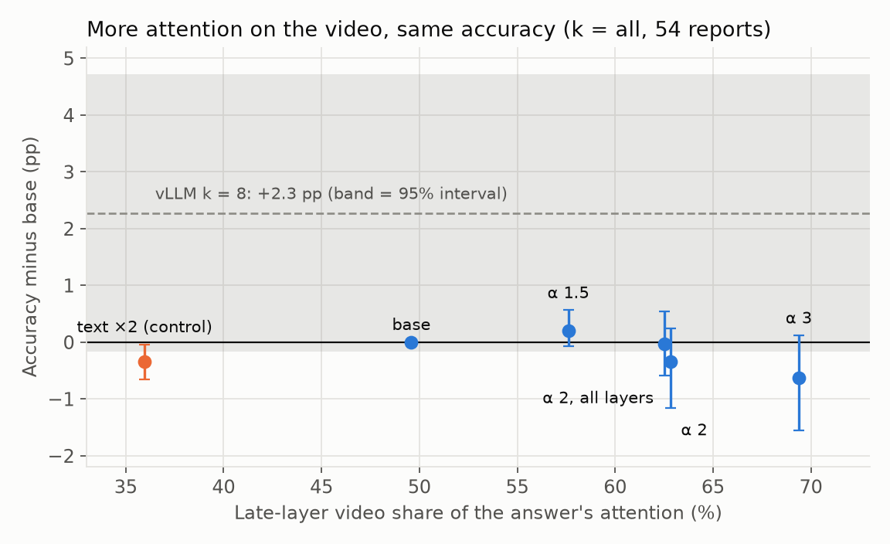

# Qwen3-VL-32B 注意力干預:放大影片注意力能補救 k = all 嗎?

狀態(2026-11-21):完成,涵蓋 54 份報告(A 類 23、B 類 31),k = all、正序。

模型:Qwen3-VL-32B-Instruct。資料:`cc4d_k32_v1`。

## 為什麼做這個實驗

[注意力量測](attention_probe.zh.md)發現,整份報告的題目放在同一個 prompt(k = all)時,答案 token 在晚層對影片的注意力比 k = 8 少約 13 pp(同題、同位置、答案相同:47% 對 60%),而 k = all 的準確率也低 2–4 pp(不顯著)。如果是影片注意力變少導致準確率下降,把它補回來應該就能恢復。這個實驗直接檢驗這一點:在 k = all 放大影片注意力,看準確率會不會動。

## 結論

**不會。** 把晚層影片注意力從 50% 提到 69%(高於 k = 8 的 60%),準確率不變:−0.6 到 +0.2 pp,所有區間都包含 0,而改成擾動文字注意力的對照組也有同樣大小的變化。所以注意力差距不是 k = all 準確率較低的原因。可能的原因是 k = all 時答案退化成接近固定的預設值(見 [attention_probe.zh.md](attention_probe.zh.md) 第 6 節)。

## 方法與結果

對 54 份報告的 k = all 答案重新生成(`scripts/qwen_intervene.py`,評分 `results/cc4d_intervene_score.py`)。預填一次,之後每個條件從同一份 KV cache 解碼。只對正在生成的 token,在 softmax 前對目標 key 的注意力分數加 log α;第一個生成 token 來自預填,不受影響。

條件:`base`(α = 1,同一條手動注意力路徑);`a1.5`、`a2`、`a3`(最後 1/4 的層,影片 key);`all2`(全部層,影片 key);`text2`(對照:最後 1/4 的層,prompt 文字 key)。基準用 `base` 而不是 vLLM 存下的答案,因為手動注意力與融合 kernel 差 bf16 捨入。HF 的輸出和 vLLM 高度一致:四個測試呼叫的欄位答案相同比例為 27/31、37/39、55/55、61/61(最長的兩個逐字相同),`base` 準確率也與 vLLM 一致(33.4% 對 33.5%)。

2,557 題一般題、54 份報告,95% 區間為對報告 bootstrap:

| 條件 | 準確率 | 對 base 差(pp)[95% 區間] | 晚層影片注意力 | 答案與 base 不同的比例 |
| --- | --- | --- | --- | --- |
| base | 33.4% | – | 49.6% | – |
| a1.5 | 33.6% | +0.2 [−0.1, +0.6] | 57.6% | 3.2% |
| a2 | 33.0% | −0.4 [−1.2, +0.2] | 62.8% | 4.7% |
| a3 | 32.7% | −0.6 [−1.6, +0.1] | 69.4% | 6.0% |
| all2 | 33.3% | −0.0 [−0.6, +0.5] | 62.5% | 7.4% |
| text2(對照) | 33.0% | −0.4 [−0.7, −0.0] | 36.0% | 4.4% |
| vLLM k = 8(參考) | 35.6% | +2.3 [−0.2, +4.7] | – | – |

- 干預有效(影片注意力隨 α 上升,文字對照則下降),α = 3 的影片注意力甚至高於 k = 8 的水準(60%),但準確率沒有往 k = 8 移動。
- 各題型沒有一致方向(bool、multi_choice、seconds 都在 ±1 pp 內;整數與單選分別只有 54、39 題)。
- 文字對照也讓準確率略降,所以 α = 2–3 的小幅下降同樣可以解釋成「擾動注意力本身有點傷害」。
- 輸出全部可解析,長度不變。
- 解讀:[attention_probe.zh.md](attention_probe.zh.md) 3.2 節的 13 pp 注意力差距不是 k = all 準確率較低的原因,至少用單一全域倍率補回來沒有幫助。限制:只在晚層用同一個倍率,沒有逐 head 干預;k = 8 與 k = all 只差 2–4 pp,偵測空間小;α 最高只到 3。

## 重現

- `scripts/qwen_intervene.py RUN_DIR OUT.jsonl --model ... --conditions base,a1.5,a2,a3,all2,text2 --mlp-chunk 32768 --max-gpu-mem 22`(A 類加 `--max-seconds 660`;B 類加 `--min-seconds 660 --max-seconds 1020`)。可續跑。在 vm2 上用 `~/envs/capstone-qwen8b`、4 張 A100 80GB、`PYTORCH_CUDA_ALLOC_CONF=expandable_segments:True`;佇列腳本 `~/intervene_queue.sh`,進度 `~/intervene_queue.log`。
- `results/cc4d_intervene_score.py RUN_DIR GT.jsonl ROWS.json.gz OUT.json INTERVENE.jsonl ...`:用專案的 parser 與 scorer 評分。
- 原始輸出(只在 vm2,不在 repo):`~/cc4d_run/gen/intervene_A.jsonl`(138 筆)、`intervene_B.jsonl`(186 筆),評分摘要 `gen/intervene_scores.json`。每個 (呼叫, 條件) 一筆:生成文字、注意力佔比、token 數、時間。
