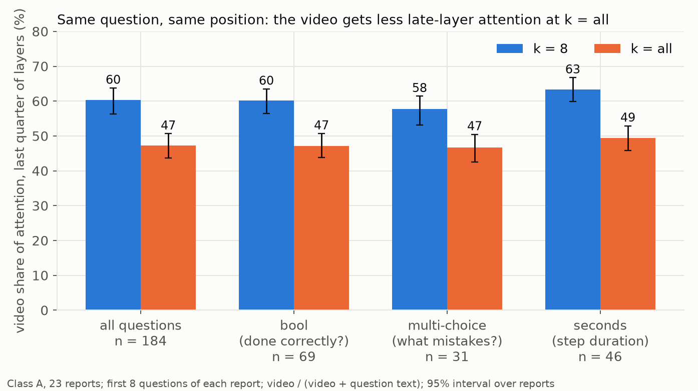
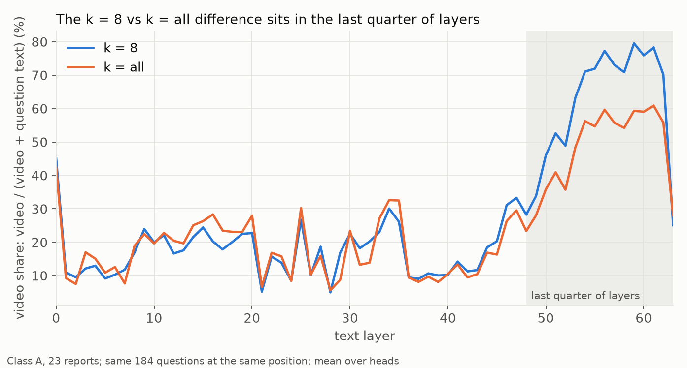

# Qwen3-VL-32B attention probe: do answers look at the video, and how does it change with position and batch size?

Status (2026-11-19): probe and analysis finished (k = all on class A and B, k = 8 on class A). The intervention has not started. Chinese version with more detail: [attention_probe.zh.md](attention_probe.zh.md).

Model: Qwen3-VL-32B-Instruct. Data: `cc4d_k32_v1` (see [q7.md](../cc4d/new_experiment/q7.md)).

## Summary

| Question | Result | Section |
| --- | --- | --- |
| Do later questions look less at the video? | **No.** Within k = all, the video's share of attention barely moves with position (−0.03 pp per doubling); once the sink and earlier answers are excluded it rises. What changes is that later answers look more at the answers already written | 3.1 |
| Does asking everything at once (k = all) look less at the video than k = 8? | **Yes, in the late layers.** Same question, same position, same answer: the video's share in the last quarter of layers is about 12–13 pp lower (60% vs 47%) | 3.2 |
| Does it cost accuracy? | Same direction but small: +1.8 to +4.0 pp, intervals include 0 | 3.3 |
| Worth intervening? | Worth trying: scale up the video attention in the late layers at k = all. The expected accuracy change is only 2–4 pp, so detecting it needs all 54 reports | 5 |

## 1. Why

The mentor proposed using the open weights to measure how much attention the answer tokens put on the video as a function of distance from the end of the prompt, and, if Qwen shows the Gemini-like position effect, to scale up visual attention for far-away questions at inference time.

First check of the premise (HD-EPIC four-model per-question data; accuracy change per doubling of distance from the end, controlling for batch size):

| | HD-EPIC | CC4D (Q7) |
| --- | --- | --- |
| Flash-Lite | −3.4 pt | – |
| Argon | −1.4 pt | −0.4 pt (includes 0) |
| Qwen-32B | **+1.2 pt** | **+0.8 pt** |

Gemini does better closer to the end; Qwen-32B goes the other way, and does worse with larger batches (HD-EPIC −1.7, CC4D −1.4 pt per doubling). So the premise does not hold. But Qwen's video gain vanishes at large batch size ([novideo.md](../cc4d/new_experiment/novideo.md): +5.9 → −1.0 pt), which suggests it may look at the video less, so we measure attention directly.

All providers put the video first and the questions after it, so "far from the end" and "close to the video" are the same thing in the current data and cannot be separated.

## 2. Method

- **Teacher forcing, no new generation.** Take a finished run's frozen prompt, the clip vLLM saw and the saved response, and run one forward pass of the same model in HF Transformers. vLLM does not return attention weights.
- **Only the answer tokens' rows are computed.** For each answer token, the share of its attention on four kinds of tokens: the video; everything before the video (system prompt and chat header, where the attention sink sits); the rest of the prompt (timestamps, questions); earlier answers. Averaged over heads. Memory scales with sequence length × answer tokens, so long clips fit.
- **Input check.** The rebuilt prompt token count equals vLLM's recorded `input_tokens` for every call (e.g. 55,638, 155,653, 211,113).
- **Three measures.** `raw`: video share of all attention. `prompt`: video / (video + rest of prompt), which drops the sink and earlier answers (both change mechanically with position). `late`: `prompt` over the last quarter of layers, where most video attention sits (about 50% vs 20–25% in the earlier layers).
- **Within-question effects.** The same question appears forward and reversed at different positions; slopes use question fixed effects and bootstrap over reports.

Coverage: class A (≤ 11 min, 23 reports) and class B (11–17 min, 31 reports), both 352p. Class C (> 17 min) is excluded because its resolution is reduced. k = 8 was run on class A, forward only; reversed would only move questions within positions 0–7.

## 3. Results

### 3.1 k = all: no decay with position

54 reports, 5,678 answers, positions 0–78.

| Measure | Mean | Slope per doubling of position (pp) [95% CI] |
| --- | --- | --- |
| Video, all attention (`raw`) | 11.3% | −0.033 [−0.045, −0.022] |
| Video share of prompt (`prompt`) | 29.6% | **+0.83** [+0.79, +0.87] |
| Same, last quarter of layers (`late`) | 51.8% | +0.30 [+0.22, +0.38] |
| Before the video (sink) | 38.5% | −0.54 [−0.57, −0.52] |
| Earlier answers | 28.5% | **+1.91** [+1.84, +1.97] |

- The `raw` decline is tiny (about 0.2 pp from position 1 to 64). The direction is the same for bool, multi-choice and seconds (single-choice and integer have too few answers), for each layer quarter, and for classes A and B separately.
- Later answers shift attention onto the answers already written, taken from the sink and the question text.
- Accuracy slope per doubling: −0.67 pt [−1.41, +0.17], includes 0. The association between attention and correctness is not reliable (A alone −1.1, B alone −0.13).

### 3.2 k = 8 vs k = all: less video attention at k = all, in the late layers

Class A, 23 reports, 1,101 questions. Compared on questions at the same position in both prompts (the first 8 of each report, 184 questions), so the only difference is how many other questions are in the prompt.

| Measure | k = 8 | k = all | Difference (pp) [95% CI] |
| --- | --- | --- | --- |
| `raw` | 10.8% | 9.6% | +1.21 [+0.97, +1.43] |
| `prompt` | 28.2% | 25.1% | +3.07 [+2.44, +3.70] |
| `late` | **60.4%** | **47.2%** | **+13.13** [+10.34, +15.55] |

Robustness (`results/cc4d_attention_k8.py`):

- **By answer type:** the `late` gap is +13.0 (bool), +11.0 (multi-choice), +13.9 (seconds).
- **Identical answers only** (646 of 1,101 questions got the same answer at both k; 112 at the same position): +12.4 [+9.2, +15.3]. The gap is not caused by different answers.
- **All 1,101 questions (different positions):** `late` +8.5 [+6.0, +10.7]. `prompt` is −0.7 because it rises with position and k = all questions sit later.
- The same-position `late` gap was +16.5, +14.8 and +13.1 with 7, 17 and 23 reports: slightly smaller, still excluding 0.

### 3.3 Accuracy

Same questions, abstention questions excluded:

| Scope | Questions | k = 8 | k = all | Difference [95% CI] |
| --- | --- | --- | --- | --- |
| Same position (first 8) | 163 | 50.3% | 48.5% | +1.8 pp [−7.2, +9.8] |
| All | 981 | 37.9% | 33.9% | +4.0 pp [−0.4, +7.4] |

Both intervals include 0. The +11 pp seen with only 7 reports was noise plus the longest videos. **The attention evidence holds; the accuracy evidence is weak.**

## 4. Interpretation and limits

- Position alone has little effect. Batch size itself is what matters: at the same position and answer, the late-layer video attention is about 12–13 pp lower at k = all, consistent with Q7's batch-size effect and the vanishing video gain, but the accuracy effect is small and unresolved.
- **Correlation, not causation.** The identical-answer check removes differing answers as a confound, nothing more.
- **"Looks less at the video" and "more question text competes for attention" cannot be separated:** k = all has about 7× the question text.
- **Averaged over heads and layers.** If the video information sits in a few heads, the average dilutes it; no per-head analysis yet.
- **More attention on earlier answers is not copying:** the JSON format naturally looks back. Needs a separate check of whether answers repeat the previous one.
- **Sample:** 23 class A and 31 class B reports, intervals bootstrap over reports; k = 8 covers class A only.

## 5. Next steps

1. **Done:** k = 8 vs k = all (3.2). The late-layer gap of about 13 pp makes batch size worth intervening on.
2. **Answer-bias check (existing data):** does the share of answers equal to the previous answer of the same type rise with position and k? Compare with the "no mistake" and "10 s" biases.
3. **Intervention (new generation, HF):** in the last quarter of layers, add log α to the answer tokens' attention scores on video keys before the softmax (α = 1.5, 2, 4) and regenerate at k = all. Controls: all layers; scaling a text span instead of the video; α = 1 as HF's own baseline (not vLLM's). Metrics: accuracy, video gain (existing no-video control), hallucination, "no mistake" share, position curve; k = 8 is the upper reference. Because the k = 8 / k = all accuracy gap is only 2–4 pp, the evaluation must cover all 54 reports.
4. **Format control (new generation):** put the questions before the video to separate distance from the end from distance to the video.
5. Optional: per-head analysis to find the heads that carry the video information.
