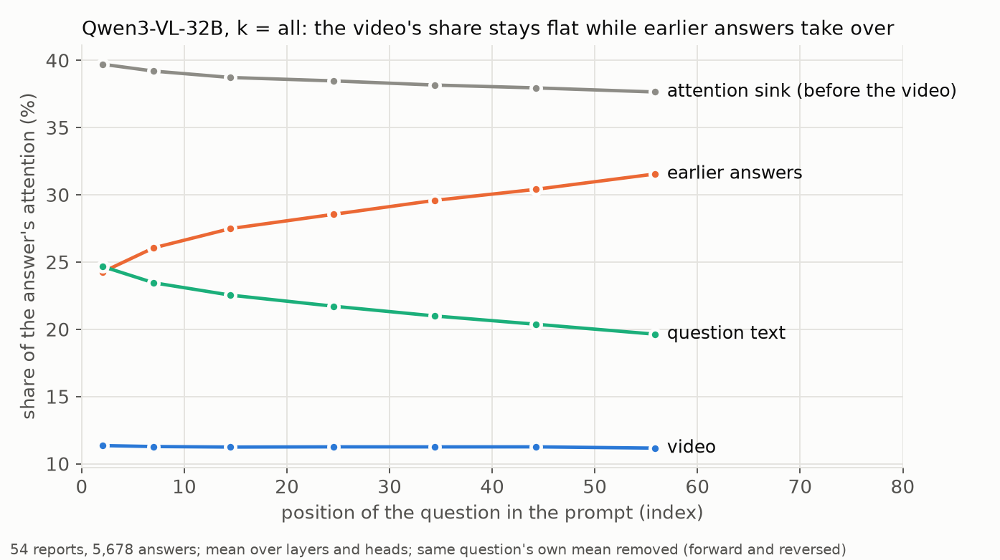

# Qwen3-VL-32B attention probe: do answers look at the video, and how does it change with position and batch size?

Status (2026-11-20): probe, analysis and the first intervention finished (k = all on class A and B, k = 8 on class A).

Model: Qwen3-VL-32B-Instruct. Data: `cc4d_k32_v1` (see [q7.md](../cc4d/new_experiment/q7.md)).

## Summary

| Question | Result | Section |
| --- | --- | --- |
| Do later questions look less at the video? | **No.** Within k = all, the video's share of attention barely moves with position (−0.03 pp per doubling); once the sink and earlier answers are excluded it rises. What changes is that later answers look more at the answers already written | 3.1 |
| Does asking everything at once (k = all) look less at the video than k = 8? | **Yes, in the late layers.** Same question, same position, same answer: the video's share in the last quarter of layers is about 12–13 pp lower (60% vs 47%) | 3.2 |
| Does it cost accuracy? | Same direction but small: +1.8 to +4.0 pp, intervals include 0 | 3.3 |
| Does scaling up video attention fix k = all? | **No.** Raising the late-layer video share from 50% to 69% leaves accuracy unchanged (−0.6 to +0.2 pp, all intervals include 0) | 5 |
| Is the input the limit? | **No, for mistake detection.** With exactly the right ± 5 s clip the model still cannot tell a correct step from a wrong one (balanced accuracy 53%, chance 50%) | 7 |
| Why, then, does k = all do worse? | **Answers collapse to defaults and copy the previous answer.** At k = all, positions 32+ are 91% default answers (truth: 39%) and 85–94% repeat the previous step's answer; at k = 8 the default rate is 54–60% | 6 |

## 1. Why

We proposed using the open weights to measure how much attention the answer tokens put on the video as a function of distance from the end of the prompt, and, if Qwen shows the Gemini-like position effect, to scale up visual attention for far-away questions at inference time.

First check of the premise (HD-EPIC four-model per-question data; accuracy change per doubling of distance from the end, controlling for batch size):

| | HD-EPIC | CC4D (Q7) |
| --- | --- | --- |
| Flash-Lite | −3.4 pt | – |
| Argon | −1.4 pt | −0.4 pt (includes 0) |
| Qwen-32B | **+1.2 pt** | **+0.8 pt** |

Gemini does better closer to the end; Qwen-32B goes the other way, and does worse with larger batches (HD-EPIC −1.7, CC4D −1.4 pt per doubling). So the premise does not hold. But Qwen's video gain vanishes at large batch size ([novideo.md](../cc4d/new_experiment/novideo.md): +5.9 → −1.0 pt), which suggests it may look at the video less, so we measure attention directly.

All providers put the video first and the questions after it, so "far from the end" and "close to the video" are the same thing in the current data and cannot be separated.

## 2. Method

- **Teacher forcing, no new generation.** Take a finished run's frozen prompt, the clip vLLM saw and the saved response, and run one forward pass of the same model in HF Transformers. vLLM does not return attention weights.
- **Only the answer tokens' rows are computed.** For each answer token, the share of its attention on four kinds of tokens: the video; everything before the video (system prompt and chat header, where the attention sink sits); the rest of the prompt (timestamps, questions); earlier answers. Averaged over heads. Memory scales with sequence length × answer tokens, so long clips fit.
- **Input check.** The rebuilt prompt token count equals vLLM's recorded `input_tokens` for every call (e.g. 55,638, 155,653, 211,113).
- **Three measures.** `raw`: video share of all attention. `prompt`: video / (video + rest of prompt), which drops the sink and earlier answers (both change mechanically with position). `late`: `prompt` over the last quarter of layers, where most video attention sits (about 50% vs 20–25% in the earlier layers).
- **Within-question effects.** The same question appears forward and reversed at different positions; slopes use question fixed effects and bootstrap over reports.

Coverage: class A (≤ 11 min, 23 reports) and class B (11–17 min, 31 reports), both 352p. Class C (> 17 min) is excluded because its resolution is reduced. k = 8 was run on class A, forward only; reversed would only move questions within positions 0–7.

## 3. Results

### 3.1 k = all: no decay with position

54 reports, 5,678 answers, positions 0–78.

| Measure | Mean | Slope per doubling of position (pp) [95% CI] |
| --- | --- | --- |
| Video, all attention (`raw`) | 11.3% | −0.033 [−0.045, −0.022] |
| Video share of prompt (`prompt`) | 29.6% | **+0.83** [+0.79, +0.87] |
| Same, last quarter of layers (`late`) | 51.8% | +0.30 [+0.22, +0.38] |
| Before the video (sink) | 38.5% | −0.54 [−0.57, −0.52] |
| Earlier answers | 28.5% | **+1.91** [+1.84, +1.97] |

- The `raw` decline is tiny (about 0.2 pp from position 1 to 64). The direction is the same for bool, multi-choice and seconds (single-choice and integer have too few answers), for each layer quarter, and for classes A and B separately.
- Later answers shift attention onto the answers already written, taken from the sink and the question text.
- Accuracy slope per doubling: −0.67 pt [−1.41, +0.17], includes 0. The association between attention and correctness is not reliable (A alone −1.1, B alone −0.13).

### 3.2 k = 8 vs k = all: less video attention at k = all, in the late layers

Class A, 23 reports, 1,101 questions. Compared on questions at the same position in both prompts (the first 8 of each report, 184 questions), so the only difference is how many other questions are in the prompt.

| Measure | k = 8 | k = all | Difference (pp) [95% CI] |
| --- | --- | --- | --- |
| `raw` | 10.8% | 9.6% | +1.21 [+0.97, +1.43] |
| `prompt` | 28.2% | 25.1% | +3.07 [+2.44, +3.70] |
| `late` | **60.4%** | **47.2%** | **+13.13** [+10.34, +15.55] |

Robustness (`results/cc4d_attention_k8.py`):

- **By answer type:** the `late` gap is +13.0 (bool), +11.0 (multi-choice), +13.9 (seconds).
- **Identical answers only** (646 of 1,101 questions got the same answer at both k; 112 at the same position): +12.4 [+9.2, +15.3]. The gap is not caused by different answers.
- **All 1,101 questions (different positions):** `late` +8.5 [+6.0, +10.7]. `prompt` is −0.7 because it rises with position and k = all questions sit later.
- The same-position `late` gap was +16.5, +14.8 and +13.1 with 7, 17 and 23 reports: slightly smaller, still excluding 0.

### 3.3 Accuracy

Same questions, abstention questions excluded:

| Scope | Questions | k = 8 | k = all | Difference [95% CI] |
| --- | --- | --- | --- | --- |
| Same position (first 8) | 163 | 50.3% | 48.5% | +1.8 pp [−7.2, +9.8] |
| All | 981 | 37.9% | 33.9% | +4.0 pp [−0.4, +7.4] |

Both intervals include 0. The +11 pp seen with only 7 reports was noise plus the longest videos. **The attention evidence holds; the accuracy evidence is weak.**

## 4. Interpretation and limits

- Position alone has little effect. Batch size itself is what matters: at the same position and answer, the late-layer video attention is about 12–13 pp lower at k = all, consistent with Q7's batch-size effect and the vanishing video gain, but the accuracy effect is small and unresolved.
- **Correlation, not causation.** The identical-answer check removes differing answers as a confound, nothing more.
- **"Looks less at the video" and "more question text competes for attention" cannot be separated:** k = all has about 7× the question text.
- **Averaged over heads and layers.** If the video information sits in a few heads, the average dilutes it; no per-head analysis yet.
- **More attention on earlier answers is not copying:** the JSON format naturally looks back. Needs a separate check of whether answers repeat the previous one.
- **Sample:** 23 class A and 31 class B reports, intervals bootstrap over reports; k = 8 covers class A only.

## 5. Intervention: scaling up video attention at k = all

Regenerate the k = all answers of all 54 reports (`scripts/qwen_intervene.py`, scored by `results/cc4d_intervene_score.py`). Prefill once, then decode once per condition from the same KV cache. For the generated tokens only, add log α to the attention scores on the target keys before the softmax. The first generated token comes from the prefill and is not modified.

Conditions: `base` (α = 1, same manual code path); `a1.5`, `a2`, `a3` (last quarter of layers, video keys); `all2` (all layers, video keys); `text2` (control: last quarter of layers, prompt-text keys). `base` is the baseline instead of vLLM's saved answers, because the manual attention differs from the fused kernel by bf16 rounding; the two agree on accuracy (33.4% vs 33.5%).

2,557 ordinary questions, 54 reports, 95% bootstrap intervals over reports:

| Condition | Accuracy | Minus base (pp) [95% CI] | Late-layer video share | Answers changed vs base |
| --- | --- | --- | --- | --- |
| base | 33.4% | – | 49.6% | – |
| a1.5 | 33.6% | +0.2 [−0.1, +0.6] | 57.6% | 3.2% |
| a2 | 33.0% | −0.4 [−1.2, +0.2] | 62.8% | 4.7% |
| a3 | 32.7% | −0.6 [−1.6, +0.1] | 69.4% | 6.0% |
| all2 | 33.3% | −0.0 [−0.6, +0.5] | 62.5% | 7.4% |
| text2 (control) | 33.0% | −0.4 [−0.7, −0.0] | 36.0% | 4.4% |
| vLLM k = 8 (reference) | 35.6% | +2.3 [−0.2, +4.7] | – | – |

- The intervention does what it should (video share rises with α, falls for the text control) and the video share at α = 3 is above the k = 8 level (60%), yet accuracy does not move toward k = 8.
- No answer type shows a consistent direction (bool, multi-choice and seconds all within ±1 pp; integer and single-choice have 54 and 39 questions).
- The text control also lowers accuracy slightly, so the small drop at α = 2–3 is as consistent with "perturbing attention hurts a little" as with anything about the video.
- All outputs parsed; output length unchanged.

Reading: the 13 pp attention gap in 3.2 is not what costs k = all its accuracy, or at least restoring it with one global factor does not help. Limits: one factor for all heads in the late layers (no per-head intervention); a k = 8 gap of 2–4 pp leaves little room to detect a recovery; only α up to 3.

## 6. Answer bias: defaults and copying

Existing vLLM answers (`results/cc4d_answer_bias.py`), step questions only (`correct`, `error_types`, `duration`). Default answer: `correct` = true, `error_types` = [], `duration` = 1 or 10 s. Cell: default rate / rate of repeating the previous step's answer, %, by position in the call.

| Run, field | 0–7 | 8–15 | 16–31 | 32+ |
| --- | --- | --- | --- | --- |
| Ground truth: default rate | `correct` 39, `error_types` 39, `duration` 0 | | | |
| k = 8 (positions 0–7 only) | 60 / 56 / 54 (default rate, the three fields) | – | – | – |
| k = all forward, `correct` | 70 / 38 | 80 / 86 | 88 / 91 | 91 / 94 |
| k = all forward, `error_types` | 64 / 12 | 81 / 82 | 88 / 88 | 91 / 94 |
| k = all forward, `duration` | 61 / 0 | 72 / 50 | 82 / 71 | 91 / 85 |
| k = all reversed, `correct` | 97 / 96 | 98 / 95 | 98 / 96 | 99 / 84 |

- At k = all the output turns into a default and the previous answer; the effect grows with position and is already there from the first questions in the reversed order.
- This matches the attention picture (more attention on earlier answers, 3.1) and explains why the intervention in section 5 does nothing: most answers are copied, not read from the video.
- Position therefore does matter for the answers, through copying, although not through lower video attention.
- Not checked: whether the defaults are often right, and how much of the repetition is real similarity between neighbouring steps.

## 7. Oracle clips: is the input the limit?

One report per done step (951 steps, 64 recordings), the clip is the annotated step span ± 5 s (mean 54 s), both step questions (`correct`, `error_types`) in one call (`scripts/build_cc4d_oracle.py`, `results/cc4d_oracle_compare.py`). Compared with k = 8 and k = all on the same questions.

| | `correct` accuracy | Default rate (answers true) | Accuracy, step done correctly | Accuracy, step done wrong | Balanced accuracy |
| --- | --- | --- | --- | --- | --- |
| Oracle clip | 57.7% | 14.6% | 18.5% | 87.6% | 53.0% |
| k = 8 | 51.6% | 63.6% | 67.6% | 39.4% | 53.5% |
| k = all | 46.3% | 88.2% | 90.0% | 13.0% | 51.5% |

- Oracle minus k = all on `correct`: +11.5 pp [+5.7, +17.7]; the default rate falls from 88% to 15%, so the copying is gone.
- The gain is a shift in bias, not discrimination: balanced accuracy is 51.5–53.5% for all three, close to chance. k = all says "done correctly" almost always, the oracle says "done wrong" almost always, and wrong steps are the majority of this set.
- `error_types` (exact match): oracle 21.1%, k = 8 35.4%, k = all 40.5%. About 39% of steps have no error, so answering "[]" every time scores 39%; the oracle is below that.
- Reading: giving the model exactly the right footage does not let it tell whether a step was done correctly. For this task the limit is perception of small errors, not how much input it gets, so input allocation (zoom, retrieve, agentic) has little to gain here.
- Limits: one padding (5 s), two questions per call, no k = 8 oracle; the prompt is the full-report prompt and may push single steps toward "wrong"; says nothing about localisation questions (start time), where finding the right span is the task.

## 8. Next steps

1. **Done:** k = 8 vs k = all (3.2); intervention at k = all (5).
2. **Done:** answer-bias check (6).
3. **Done:** oracle clips (7). The input is not the limit for mistake detection.
4. Localisation questions (start time of a step), where finding the span is the task: the case where agentic input could still help.
5. Check whether the oracle's bias toward "wrong" comes from the full-report prompt (single-step prompt).
6. Optional: format control (questions before the video); per-head intervention.
