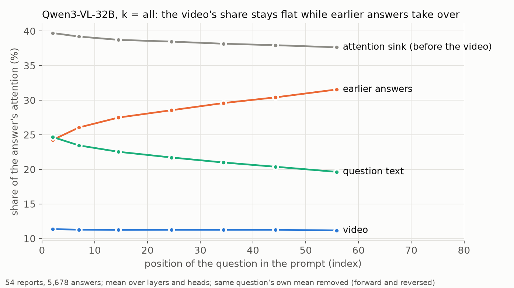
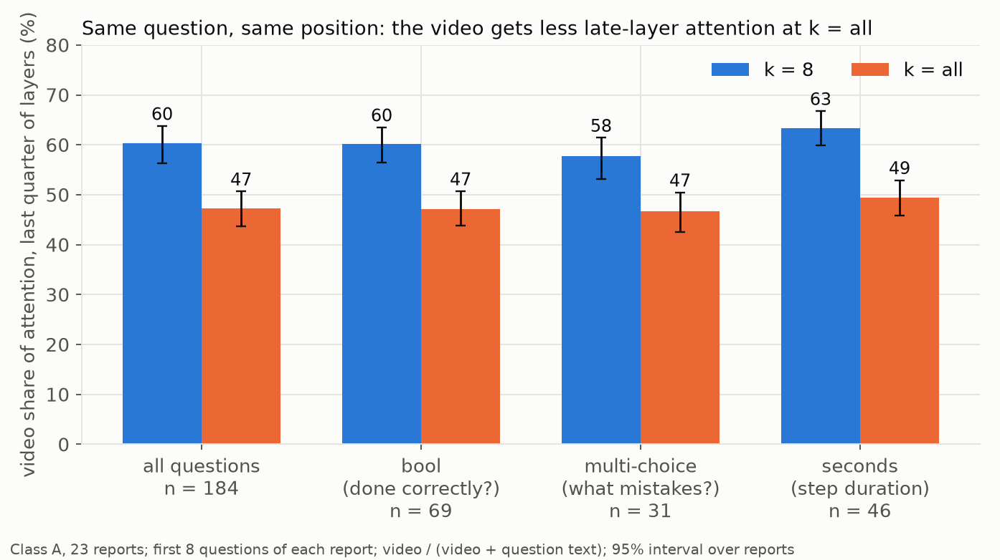
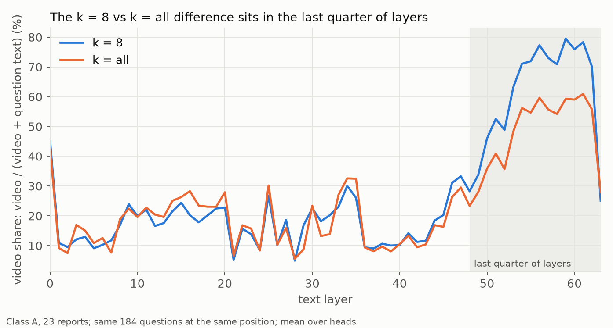

# Qwen3-VL-32B 注意力量測:答案有沒有看影片,隨位置與批次大小怎麼變

狀態(2026-11-19):注意力量測與分析完成(k = all 的 A、B 類,k = 8 的 A 類);HF 生成計時測試完成;干預實驗尚未開始。

模型:Qwen3-VL-32B-Instruct。資料:`cc4d_k32_v1`(見 [q7.zh.md](../cc4d/new_experiment/q7.zh.md))。

## 結論摘要

| 問題 | 結果 | 位置 |
| --- | --- | --- |
| 題目越後面,答案越不看影片嗎? | **沒有。** k = all 內部,影片佔的注意力幾乎不隨位置變(每倍位置 −0.03 pp);排除 sink 與前面答案後,影片比例反而上升。變的是後面的答案越來越看前面已寫出的答案 | 3.1 |
| 一次問很多題(k = all)比 k = 8 更不看影片嗎? | **是,在後段的層。** 同一題、同位置、答案相同時,最後 1/4 的層的影片注意力少約 12–13 pp(60% 對 47%) | 3.2 |
| 這會讓準確率變差嗎? | 方向一致但很小:+1.8 到 +4.0 pp,區間包含 0 | 3.3 |
| 能拿來做干預嗎? | 有理由試(在後段的層放大影片注意力),但預期的準確率變化只有 2–4 pp,需要涵蓋全部 54 份報告才偵測得到。k = all 一次完整生成約 4.7 小時 | 5、6 |

## 1. 為什麼做

mentor 的提議:Qwen 是開放權重,可以量答案 token 對影片 token 的注意力如何隨「離結尾的距離」變化;如果 Qwen 也有 Gemini 那種位置效應,就在推論時放大遠處題目的視覺注意力,把曲線拉平。

先檢查前提(用 HD-EPIC 四模型的逐題資料,離結尾每遠一倍的準確率變化,控制批次大小):

| | HD-EPIC | CC4D(Q7) |
| --- | --- | --- |
| Flash-Lite | −3.4 pt | – |
| Argon | −1.4 pt | −0.4 pt(包含 0) |
| Qwen-32B | **+1.2 pt** | **+0.8 pt** |

Gemini 是越靠近結尾越準,Qwen-32B 方向相反,批次越大越差(HD-EPIC −1.7、CC4D −1.4 pt/倍)。所以前提不成立,但 Qwen 的另一個現象(批次大時影片增益歸零,見 [novideo.zh.md](../cc4d/new_experiment/novideo.zh.md):+5.9 → −1.0 pt)提示可能是「影片看得少」,因此改為直接量注意力。

注意:所有 provider 的 prompt 都是影片在前、題目在後(`gemini.py`、`vertex_gemini.py`、`vllm.py`),所以「離結尾遠」和「離影片近」在現有資料裡是同一件事,分不開。

## 2. 怎麼量

- **teacher forcing,不重新生成:** 取已完成 run 的凍結 prompt、vLLM 當時看到的片段、模型當時存下的回應,用 HF Transformers 載入同一個模型做一次前向計算。注意力權重不在 vLLM 輸出裡(FlashAttention 不產生),所以必須重算。
- **只算答案 token 那幾列:** 自訂 attention 函式,對每題答案 token 算 softmax 後落在四類位置的比例:影片 token、影片前的 prompt(系統提示與對話開頭,attention sink 所在)、影片後的 prompt 文字(時間戳、題目)、前面已寫出的答案。每層對各 head 平均。記憶體與「序列長度 × 答案 token 數」成正比,所以長影片放得下。
- **輸入重現驗證:** 每次呼叫重建的 prompt token 數都和 vLLM 記錄的 `input_tokens` 完全一致(例如 55,638、155,653、211,113)。
- **三個量測:**
  - `raw`:影片佔全部注意力。
  - `prompt`:影片 /(影片 + 影片後的 prompt 文字)。排除 sink 與前面答案,因為後者隨位置增加,會讓 `raw` 機械性下降。
  - `late`:`prompt`,只取最後 1/4 的層(影片注意力大多集中在這裡,約 50%,前 3/4 的層只有 20–25%)。
- **效應都在同一題內比較:** 同一題在正向與倒序出現在不同位置,用題目固定效果,以報告為單位 bootstrap(300 次)。

### 涵蓋範圍

| 類別 | 影片 | 報告數 | 解析度 | 狀態 |
| --- | --- | --- | --- | --- |
| A:≤ 11 分鐘 | 23 | 23 | 352p | k = all 正反向、k = 8 正向完成 |
| B:11–17 分鐘 | 31 | 31 | 352p | k = all 正反向完成 |
| C:> 17 分鐘 | – | – | 降過解析度 | 不跑(解析度是額外干擾) |

k = 8 倒序不跑:每次呼叫只有 8 題,位置只落在 0–7,正反向差別太小。

## 3. 結果

### 3.1 k = all:影片注意力沒有隨位置衰減

A + B,54 份報告、5,678 個答案,位置 0–78。

位置每增一倍的變化(pp):

| 量測 | 平均 | 斜率 [95% 區間] |
| --- | --- | --- |
| 影片佔全部注意力(`raw`) | 11.3% | −0.033 [−0.045, −0.022] |
| 影片佔 prompt(`prompt`) | 29.6% | **+0.83** [+0.79, +0.87] |
| 同上,最後 1/4 的層(`late`) | 51.8% | +0.30 [+0.22, +0.38] |
| 開頭 sink 區 | 38.5% | −0.54 [−0.57, −0.52] |
| 前面已寫出的答案 | 28.5% | **+1.91** [+1.84, +1.97] |

- `raw` 的下降幅度很小(位置從 1 到 64 約掉 0.2 pp),排除 sink 與前面答案後,影片比例反而隨位置上升。bool、seconds、multi_choice 與四個層區間方向一致。
- 變的是「後面的答案越來越看前面已寫出的答案」(每倍約 +1.9 pp),這部分是從 sink 與題目文字搬來的。
- A、B 單獨看結論相同(A:`raw` −0.01、`prompt` +0.86;B:−0.05、+0.81)。
- 注意力與對錯的關聯不可靠:A 類單獨是 −1.1 pp(每 +1 pp 注意力),B 類沒有重現(−0.13,包含 0);合併後控制位置為 −0.37 [−0.90, +0.20]。

### 3.2 k = 8 對 k = all:大批次的影片注意力較低,尤其在後段的層

A 類 23 份報告,1,101 題,k = 8 正向對 k = all 正向。取兩種 prompt 裡位置相同的題目(每份報告前 8 題,184 題),所以差別只在 prompt 裡其他題目的數量。

差(k = 8 減 k = all,pp)[95% 區間,對報告 bootstrap]:

| 量測 | k = 8 | k = all | 差 |
| --- | --- | --- | --- |
| `raw` | 10.8% | 9.6% | +1.21 [+0.97, +1.43] |
| `prompt` | 28.2% | 25.1% | +3.07 [+2.44, +3.70] |
| `late` | **60.4%** | **47.2%** | **+13.13** [+10.34, +15.55] |

穩健性(`results/cc4d_attention_k8.py`):

- **按答案型別:** `late` 差 bool +13.0、multi_choice +11.0、seconds +13.9,方向一致。
- **只比兩種批次大小答案相同的題目**(1,101 題中 646 題相同;位置相同的 112 題):`late` 差 +12.4 [+9.2, +15.3],結論不變,所以差距不是答案不同造成的。
- **全部 1,101 題(位置不同):** `late` 差 +8.5 [+6.0, +10.7]。`prompt` 差為 −0.7,因為 k = all 後段的題目位置較後面,而 `prompt` 隨位置上升(3.1),兩者互相抵消。
- 隨報告數累積,位置相同的 `late` 差依序是 +16.5(7 份)、+14.8(17 份)、+13.1(23 份),略為縮小,區間仍排除 0。

### 3.3 準確率

同一批題目,不含棄答題:

| 範圍 | 題數 | k = 8 | k = all | 差 [95% 區間] |
| --- | --- | --- | --- | --- |
| 位置相同(前 8 題) | 163 | 50.3% | 48.5% | +1.8 pp [−7.2, +9.8] |
| 全部 | 981 | 37.9% | 33.9% | +4.0 pp [−0.4, +7.4] |

區間都包含 0。早先只有 7 份報告時看到的 +11 pp 是雜訊與偏長影片造成的。k = all 內部的位置斜率為 −0.67 pt/倍 [−1.41, +0.17](A、B 各自 −0.66、−0.68),同一題正向 33.5%、倒序 32.9%。**注意力的證據成立,準確率的證據偏弱。**

## 4. 解讀與限制

- k = all 內部沒有「離影片越遠越不看」。位置影響很小;大批次本身(k = all 對 k = 8)才是有訊號的因素:相同位置、相同答案下,最後 1/4 的層的影片注意力約少 12–13 pp。與 Q7 的批次大小效應、影片增益歸零一致,但對準確率的影響很小,尚未定論。
- **相關性,不是因果。** 注意力是模型輸出既定答案時量的,答案不同注意力也不同(3.2 節的相同答案檢查已排除這一項,但仍不是因果)。
- **「少看影片」與「被更多題目文字分散」分不開:** k = all 有 7 倍題目文字,影片比例低可能只是競爭者變多。
- **層與 head 平均:** 影片資訊若集中在少數 head,平均會稀釋。尚未逐 head 分析。
- **前面答案的注意力上升不等於抄答案:** JSON 結構本來就會回看前面內容,需另外檢驗答案是否與前一題相同。
- 樣本:A 類 23 份、B 類 31 份報告,區間是對報告 bootstrap,樣本不大。k = 8 只有 A 類。

## 5. 下一步與決策規則

1. **k = 8 對 k = all 已完成**(3.2 節):`late` 差約 +13 pp,批次大小是值得干預的因素,進入第 3 步。
2. **答案偏誤檢驗(用現有資料,不需新跑):** 答案與前一題同型答案相同的比例是否隨位置、隨 k 上升;對照「沒有錯誤」與「10 秒」的偏誤。
3. **干預實驗(需新生成,用 HF 逐 token 生成,成本見第 6 節):** 在最後 1/4 的層,對答案 token 對影片 token 的注意力分數在 softmax 前加 log α(α = 1.5、2、4),k = all 重新生成。
   - 對照:對全部層放大、放大一段文字而非影片(排除「擾動注意力就有用」);α = 1 為 HF 自己的基準(不是 vLLM 的,見第 6 節)。
   - 指標:準確率、影片增益(用既有無影片對照)、幻覺率、「沒有錯誤」比例、位置曲線。上限對照是 k = 8。
   - 規模:k = 8 與 k = all 的準確率差只有 2–4 pp,依 3.3 節的區間,數百題偵測不到,至少要涵蓋全部 54 份報告。
   - 可能的省法(尚未驗證):只對「生成的答案 token」放大注意力時,prompt 的預填結果與 α 無關,可以共用同一份 KV cache、只重做解碼。預填佔每次呼叫 60–80% 的時間(prompt 越長比例越高),但複製 cache 要額外的 GPU 記憶體,最長的呼叫放不放得下要實測。
4. **格式對照(新生成):** 題目放在影片前面再跑一次,把「離結尾的距離」與「離影片的距離」分開。
5. 選做:逐 head 分析,找出真正承載影片資訊的 head。

## 6. HF 生成計時測試

干預實驗要用 HF 逐 token 生成,所以先量成本,並檢查 HF 的輸出是否和 vLLM 當時存下的一致。設定:4 張 A100 80GB,bf16,greedy,MLP 分段計算(`--mlp-chunk 32768`),每張卡放 22 GiB 權重。輸入與第 2 節相同。

| prompt token | 輸出 token | 預填 | 解碼 | 總時間 | GPU 0 峰值 | 與 vLLM 輸出 |
| --- | --- | --- | --- | --- | --- | --- |
| 57,669(A) | 293 | 41 s | 11.3 tok/s | 67 s | 30.9 GiB | 27/31 欄位相同 |
| 86,574(A) | 389 | 78 s | 9.7 tok/s | 118 s | 37.3 GiB | 37/39 欄位相同 |
| 155,653(A,最長) | 535 | 213 s | 7.3 tok/s | 286 s | 55.0 GiB | **55/55,逐字相同** |
| 211,113(B) | 573 | 371 s | 6.1 tok/s | 464 s | 69.3 GiB | **61/61,逐字相同** |

- **輸出和 vLLM 高度一致,但不保證逐字相同:** 兩個較短的呼叫各有 4 與 2 個欄位的答案不同(推測是兩邊 kernel 與 MLP 分段計算的 bf16 捨入差異,讓貪婪解碼在某處分岔,未驗證)。所以干預實驗的基準要用 HF 自己的 α = 1,不能直接拿 vLLM 的結果當對照。
- **成本:** 總時間對 prompt 長度呈超線性(預填的注意力隨長度平方成長)。用前三點擬合 `t ≈ 0.764 N + 0.00689 N²`(N 單位 k token,t 單位秒),預測 211k 為 468 s,實測 464 s。照此估算 k = all 一次完整生成(單一方向、單一條件):A 類 23 份約 1.3 小時,B 類 31 份約 3.4 小時,合計約 **4.7 小時**。每個 α、每個對照、每個方向都要各乘一次。
- **記憶體:** GPU 0 峰值隨 prompt 長度線性成長(約 0.26 GiB 每千 token)。B 類最長的 prompt 約 23.9 萬 token,外插約 76 GiB,逼近單卡上限(約 79 GiB 可用),**最長的幾次可能放不下**,要實測。

## 7. 重現

程式在分支 `experiment/qwen-attention-probe`:

- `scripts/qwen_attention.py`:抽取注意力。在 vm2 上用 `~/envs/capstone-qwen8b`(vllm 環境缺 `accelerate`),4 張 A100 80GB。B 類需要 `--mlp-chunk 32768 --max-gpu-mem 22`,A 類最長的 k = all 呼叫(15.6 萬 token)需要 4 張卡與 `PYTORCH_CUDA_ALLOC_CONF=expandable_segments:True`。
- `results/cc4d_attention.py`:k = all 的位置分析。`python results/cc4d_attention.py ATTN_DIR rows_qwen32.json.gz "" _B`(A + B)。
- `results/cc4d_attention_k8.py`:k = 8 對 k = all。`PYTHONPATH=src python results/cc4d_attention_k8.py ATTN_DIR rows_qwen32.json.gz RUNS_DIR`,需要 vLLM run 目錄(讀取兩邊存下的答案),所以在 vm2 上執行。
- `results/cc4d_attention_figs.py`:本文件的三張圖。`python results/cc4d_attention_figs.py ATTN_DIR docs/attention/figs rows_qwen32.json.gz`(需要 numpy、matplotlib)。
- 原始輸出(vm2):`~/cc4d_run/attn/k32_{fwd,rev}_kall{,_B}.jsonl`、`k32_fwd_k8.jsonl`;佇列腳本 `~/attn_queue2.sh`,進度 `~/attn_queue.log`。每個答案一行,含四類注意力、每層的值、位置、prompt token 數。
- 計時測試(第 6 節)的腳本與結果(`~/cc4d_run/gen_timing.py`、`gen/timing.jsonl`)只在 vm2 上,還沒放進 repo。
