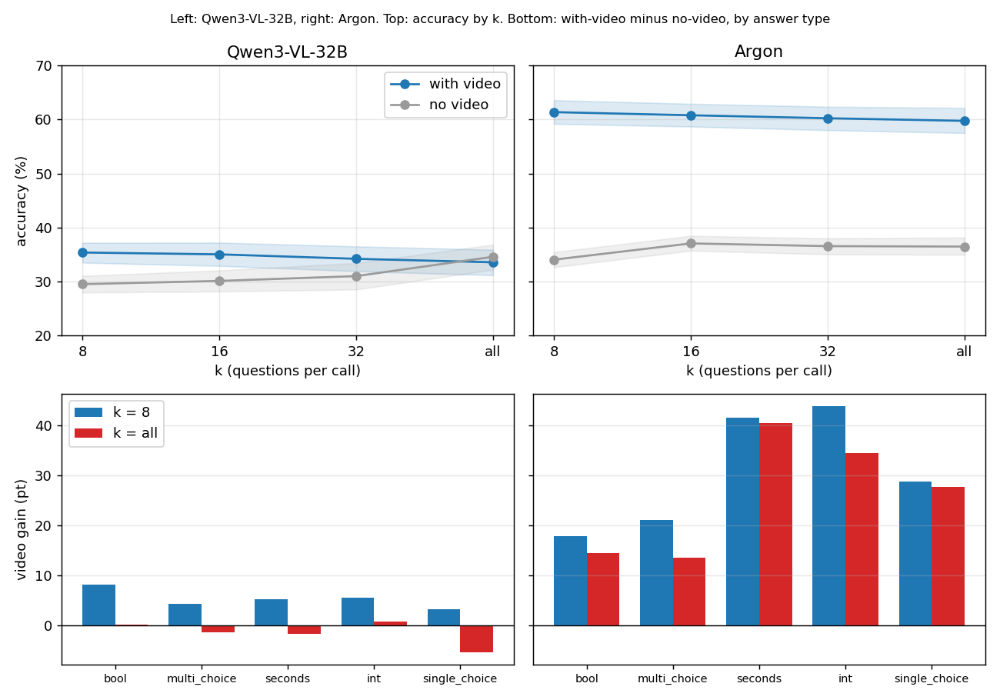

# No-video control: does the model use the video less when batches get larger?

Models: Gemini 4 Argon, Qwen3-VL-32B. Data and setup as in [q7.md](q7.md) (`cc4d_k32_v1`, 64 recordings, k = 8, 16, 32, all × forward / reversed, 1,770 calls per model), **the only difference is that no video is sent**; the prompts are unchanged. 
Scripts: `results/cc4d_k32_novideo.py` (output `cc4d_k32_novideo_out.txt`). Raw data: `results/cc4d_k32_v1_*_novideo_20261111/rows.json.gz`. Configs: `experiments/cc4d_k32_novideo/` (Argon), `cc4d_k32_qwen_novideo/` (Qwen); the code change is `video.enabled: false` (default true).

## Conclusions

**Why:** On HD-EPIC, Argon loses accuracy from k = 8 to 32, while on CC4D it loses less. Hypothesis: with larger batches the model uses the video less, so tasks that need the video more drop more. No video is the floor of "not using the video at all", and it is used to measure the "video gain" = with video − without video.

| | Argon | Qwen3-VL-32B |
| --- | --- | --- |
| Video gain (k = 8 → all) | **+27.3 → +23.2** pt, change −4.0 [−6.6, −1.5] | **+5.9 → −1.0** pt, change −6.9 [−8.5, −5.2] |
| How large is the gain | **Large** (+27 at k = 8) | **Small** (+6 at k = 8), gone at k = all |
| What causes the drop | With video −1.6, without video +2.4, each part of it | With video −1.8, without video +5.1, **the rise without video is the main cause** |
| Question types where the gain drops most | Multi-choice "What mistakes?" (−7.6), integer (−9.4); **seconds barely drops** (−1.1) | Bool (−8.1), seconds (−6.8), multi-choice (−5.7) |

- **The hypothesis holds in direction:** for both models the gain shrinks as k grows, and the intervals exclude 0.
- **But the magnitudes differ a lot.** At k = all Argon still has a gain of +23 pt (+40 on seconds questions); it has not given up on the video, it just uses it a little less. At k = all Qwen has no gain at all (no video 34.6% ≥ with video 33.6%): when the whole report is asked at once its answers are the same as without the video, since both almost always answer "done correctly / no mistake" (see "Checks").

## Figure and numbers

Top: accuracy (ordinary questions only, abstention questions excluded, as in q7). Bottom: video gain by question type, k = 8 vs k = all.

| k | Argon with video | Argon no video | Argon gain | Qwen with video | Qwen no video | Qwen gain |
| --- | --- | --- | --- | --- | --- | --- |
| 8 | 61.3 | 34.1 | 27.3 [25.0, 29.4] | 35.4 | 29.5 | 5.9 [4.4, 7.3] |
| 16 | 60.8 | 37.1 | 23.7 [20.9, 26.5] | 35.0 | 30.1 | 4.9 [3.5, 6.4] |
| 32 | 60.2 | 36.6 | 23.7 [21.4, 25.8] | 34.2 | 31.0 | 3.2 [1.4, 5.0] |
| all | 59.7 | 36.5 | 23.2 [20.4, 26.0] | 33.6 | 34.6 | −1.0 [−1.8, −0.1] |

(Both directions pooled; intervals are a bootstrap over recordings, 1,000 draws.)

## Hallucination (abstention questions)

**Conclusion:** Without video both models almost always make up an answer for steps that were not done (86–100%); with video, Argon answers "not visible" more as batches grow, Qwen does not.

| k | Argon with video | Argon no video | Qwen with video | Qwen no video |
| --- | --- | --- | --- | --- |
| 8 | 84.4 | 93.1 | 90.7 | 85.8 |
| 16 | 81.6 | 97.5 | 94.0 | 84.3 |
| 32 | 75.0 | 99.2 | 97.5 | 87.7 |
| all | 38.9 | 94.6 | 97.5 | 100.0 |

(Share of made-up answers, %; both directions pooled.) Argon's abstention only appears with the video, so it really uses the video to judge "this step was not done". Qwen's hallucination rate with video is about the same as without, so the video does not help it recognise steps that were not done.

## Video gain by question type (pt)

**Conclusion:** For Qwen the gain shrinks monotonically with k for every question type and is ≈ 0 or negative at k = all; for Argon seconds and single-choice barely drop, and what drops is mainly multi-choice (−7.5) and integer.

| Question type | Argon k=8 | 16 | 32 | all | Qwen k=8 | 16 | 32 | all |
| --- | --- | --- | --- | --- | --- | --- | --- | --- |
| Bool | 17.8 | 14.3 | 18.8 | 14.4 | 8.2 | 6.1 | 4.2 | 0.1 |
| Multi-choice (What mistakes?) | 21.0 | 14.6 | 12.9 | 13.5 | 4.3 | 3.3 | 1.7 | −1.4 |
| Seconds | 41.5 | 40.6 | 37.3 | 40.4 | 5.2 | 4.9 | 3.8 | −1.7 |
| Integer | 43.8 | 41.4 | 43.0 | 34.4 | 5.5 | 9.4 | −0.8 | 0.8 |
| Single-choice | 28.7 | 23.4 | 25.5 | 27.7 | 3.2 | 6.4 | 4.3 | −5.3 |

Integer (about 8 questions) and single-choice (about 6 questions) have very few samples per cell and wide intervals (e.g. Argon single-choice k = 8 [16.7, 41.1]); treat them as hints only.

## Checks

- **Qwen without video has 0% abstention at k = all:** it is not a special case but the extreme of the same bias. At k = all, Qwen without video answers 94% of the abstention questions with "done correctly" / "no mistake", and 97.1% of the ordinary questions with "done correctly" (the true share is only 43.3%), so it does not even choose `not_visible`.
- **Why the accuracy without video rises with k:** mainly from the multi-choice "What mistakes?" questions (correct only if identical to the ground truth). The share of Qwen-without-video answering "no mistake" goes 65.2% → 97.1% (k = 8 → all) and the share answering "done correctly" 64.5% → 97.1% (true share 43.3%); the same happens with video ("done correctly" 67.1% → 93.4%). A random set of mistakes is almost never exactly right, while "no mistake" is right 43.3% of the time, so multi-choice accuracy rises from 32.4% to 43.3% (+10.9), and most of the overall rise 29.5% → 34.6% comes from here; bool rises only 2.8 (41.9 → 44.7). At k = all, Qwen with video vs without: bool 44.8% vs 44.7%, multi-choice 41.9% vs 43.3%, **both equal to that constant answer**, so the video gain is 0. Argon without video also leans towards "done correctly" (40.9% → 52.0%), accuracy 34.1 → 36.5, multi-choice +5.8, a smaller effect that was not broken down further; Argon with video answers "done correctly" 43.6–45.1% at every k, close to the true share.
- **Qwen's seconds:** with video the share of answers equal to 10 s is 46% → 53% → 57% → 64% (k = 8 → all), without video only 12–16%; with video the seconds accuracy goes 19.6 → 14.1, which is one source of Qwen's drop with video. Argon answers 10 s only 2–4% of the time.
