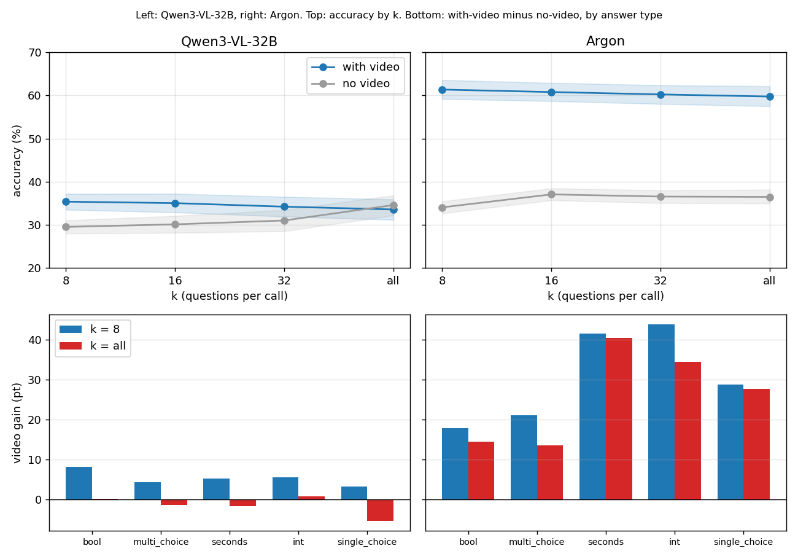

# 無影片對照:批次變大時,模型是不是少用了影片?

模型:Gemini 4 Argon、Qwen3-VL-32B。資料與設定同 [q7.zh.md](q7.zh.md)(`cc4d_k32_v1`,64 支錄影,k = 8、16、32、all × 順向 / 倒序,每個模型 1,770 次呼叫),**唯一差別是不送影片**,提示詞一字未改。
腳本:`results/cc4d_k32_novideo.py`(輸出 `cc4d_k32_novideo_out.txt`)。原始資料:`results/cc4d_k32_v1_*_novideo_20261111/rows.json.gz`。設定:`experiments/cc4d_k32_novideo/`(Argon)、`cc4d_k32_qwen_novideo/`(Qwen);程式改動是 `video.enabled: false`(預設 true)。

## 結論

**起因:** HD-EPIC 上 Argon 從 k = 8 到 32 會掉分,CC4D 掉得少。假設:批次變大時模型少用影片,所以越需要影片的任務掉越多。無影片就是「完全不用影片」的下限,用它量「影片增益」= 有影片 − 無影片。

| | Argon | Qwen3-VL-32B |
| --- | --- | --- |
| 影片增益(k = 8 → all) | **+27.3 → +23.2** pt,變化 −4.0 [−6.6, −1.5] | **+5.9 → −1.0** pt,變化 −6.9 [−8.5, −5.2] |
| 增益有多大 | **很大**(k = 8 時 +27) | **很小**(k = 8 時 +6),k = all 時已經沒有 |
| 掉分是誰造成的 | 有影片 −1.6、無影片 +2.4,各佔一部分 | 有影片 −1.8、無影片 +5.1,**無影片上升是主因** |
| 增益掉最多的題型 | 多選「什麼錯誤」(−7.6)、整數(−9.4);**秒數幾乎不掉**(−1.1) | 是非(−8.1)、秒數(−6.8)、多選(−5.7) |

- **假設方向上成立:** 兩個模型的增益都隨 k 變大而縮小,而且區間不含 0。
- **但幅度差很多。** Argon 在 k = all 仍有 +23 pt 的增益(秒數題更是 +40),它沒有放棄影片,只是用得稍少。Qwen 在 k = all 完全沒有增益(無影片 34.6% ≥ 有影片 33.6%),等於整份一次問時它的答案和沒看影片一樣:兩者都幾乎一律答「做對了 / 沒有錯」(見「檢查」)。

## 圖與數字

上排:準確率(只算一般題,不含 abstention 題,同 q7)。下排:各題型的影片增益,k = 8 對 k = all。

| k | Argon 有影片 | Argon 無影片 | Argon 增益 | Qwen 有影片 | Qwen 無影片 | Qwen 增益 |
| --- | --- | --- | --- | --- | --- | --- |
| 8 | 61.3 | 34.1 | 27.3 [25.0, 29.4] | 35.4 | 29.5 | 5.9 [4.4, 7.3] |
| 16 | 60.8 | 37.1 | 23.7 [20.9, 26.5] | 35.0 | 30.1 | 4.9 [3.5, 6.4] |
| 32 | 60.2 | 36.6 | 23.7 [21.4, 25.8] | 34.2 | 31.0 | 3.2 [1.4, 5.0] |
| all | 59.7 | 36.5 | 23.2 [20.4, 26.0] | 33.6 | 34.6 | −1.0 [−1.8, −0.1] |

(兩個方向合併,區間依錄影 bootstrap 1,000 次。)

## 幻覺(abstention 題)

**結論:** 無影片時兩個模型對沒做的步驟都幾乎一律編答案(86–100%);Argon 有影片時,批次越大越會答「看不到」,Qwen 不會。

| k | Argon 有影片 | Argon 無影片 | Qwen 有影片 | Qwen 無影片 |
| --- | --- | --- | --- | --- |
| 8 | 84.4 | 93.1 | 90.7 | 85.8 |
| 16 | 81.6 | 97.5 | 94.0 | 84.3 |
| 32 | 75.0 | 99.2 | 97.5 | 87.7 |
| all | 38.9 | 94.6 | 97.5 | 100.0 |

(編造答案的比例,%;兩個方向合併。)Argon 的 abstention 能力只在有影片時出現,所以它是真的靠影片判斷「這步沒做」。Qwen 有影片時的幻覺率和無影片差不多,表示影片沒有幫它辨認沒做的步驟。

## 各題型的影片增益(pt)

**結論:** Qwen 每種題型的增益都隨 k 單調變小,k = all 時全部 ≈ 0 或為負;Argon 的秒數、單選幾乎不掉,掉的主要是多選(−7.5)和整數。

| 題型 | Argon k=8 | 16 | 32 | all | Qwen k=8 | 16 | 32 | all |
| --- | --- | --- | --- | --- | --- | --- | --- | --- |
| 是非 | 17.8 | 14.3 | 18.8 | 14.4 | 8.2 | 6.1 | 4.2 | 0.1 |
| 多選(什麼錯誤) | 21.0 | 14.6 | 12.9 | 13.5 | 4.3 | 3.3 | 1.7 | −1.4 |
| 秒數 | 41.5 | 40.6 | 37.3 | 40.4 | 5.2 | 4.9 | 3.8 | −1.7 |
| 整數 | 43.8 | 41.4 | 43.0 | 34.4 | 5.5 | 9.4 | −0.8 | 0.8 |
| 單選 | 28.7 | 23.4 | 25.5 | 27.7 | 3.2 | 6.4 | 4.3 | −5.3 |

整數(約 8 題)和單選(約 6 題)每格樣本很少,區間很寬(例如 Argon 單選 k=8 [16.7, 41.1]),只當線索。

## 檢查

- **Qwen 無影片 k = all 的 abstention 為 0%:** 它不是特例,是同一個偏誤的極端。k = all 時 Qwen 無影片把 94% 的 abstention 題答成「做對了」/「沒有錯」,一般題也是 97.1% 答「做對了」(實際只有 43.3%),所以連 `not_visible` 都不選。
- **為什麼無影片的準確率隨 k 上升:** 主要來自多選「什麼錯誤」(要和標準答案完全相同才算對)。Qwen 無影片答「沒有錯」的比例 65.2% → 97.1%(k = 8 → all),答「做對了」的比例 64.5% → 97.1%(實際 43.3%);有影片也一樣(「做對了」67.1% → 93.4%)。亂選一組錯誤幾乎不可能全對,答「沒有錯」卻有 43.3% 會對,所以多選準確率從 32.4% 升到 43.3%(+10.9),整體 29.5% → 34.6% 大部分來自這裡;是非只升 2.8(41.9 → 44.7)。k = all 時 Qwen 有影片 vs 無影片:是非 44.8% vs 44.7%、多選 41.9% vs 43.3%,**都等於那個固定答案**,影片增益因此是 0。Argon 無影片也往「做對了」偏(40.9% → 52.0%),準確率 34.1 → 36.5,多選 +5.8,幅度較小,沒有逐項拆開;Argon 有影片答「做對了」始終是 43.6–45.1%,貼著實際比例。
- **Qwen 的秒數:** 有影片答 10 秒的比例 46% → 53% → 57% → 64%(k = 8 → all),無影片只有 12–16%;有影片的秒數準確率 19.6 → 14.1,是 Qwen 有影片掉分的來源之一。Argon 答 10 秒只有 2–4%。