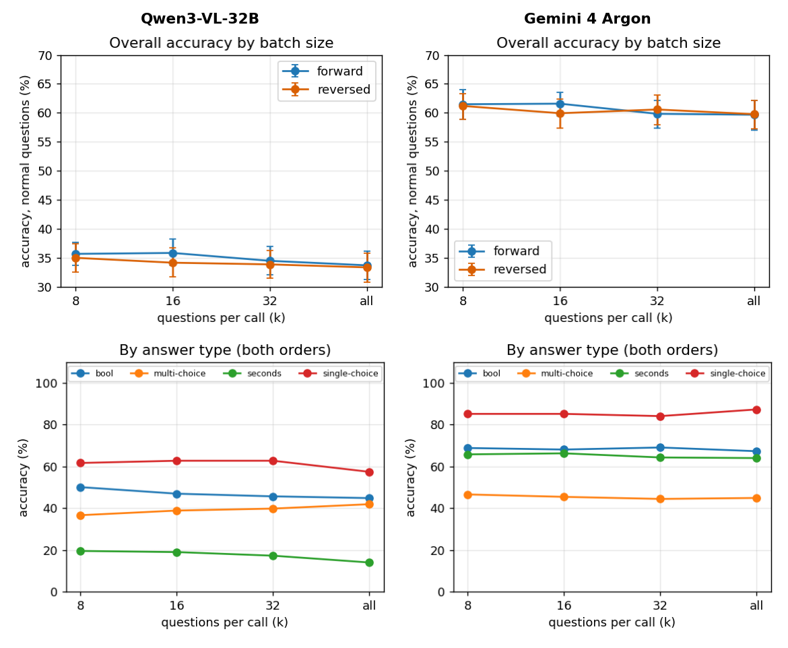
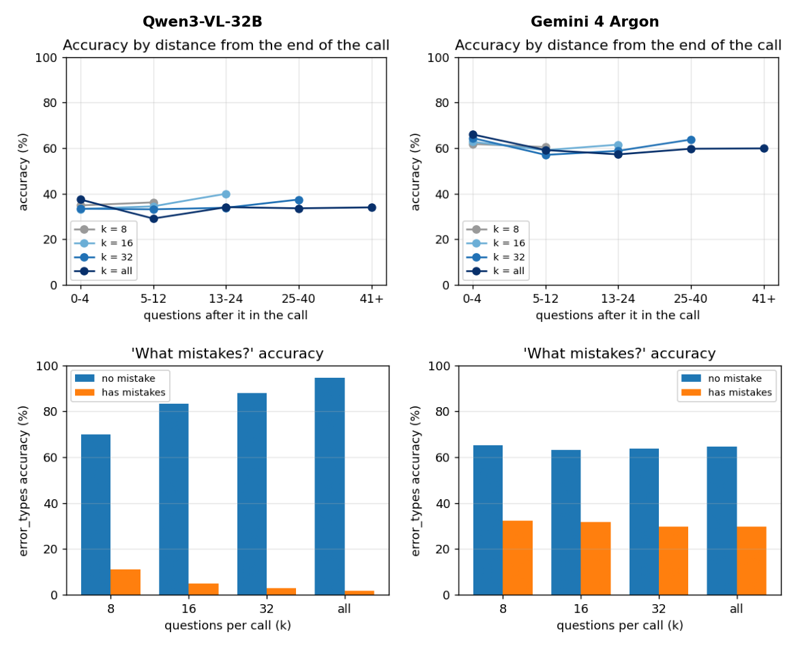
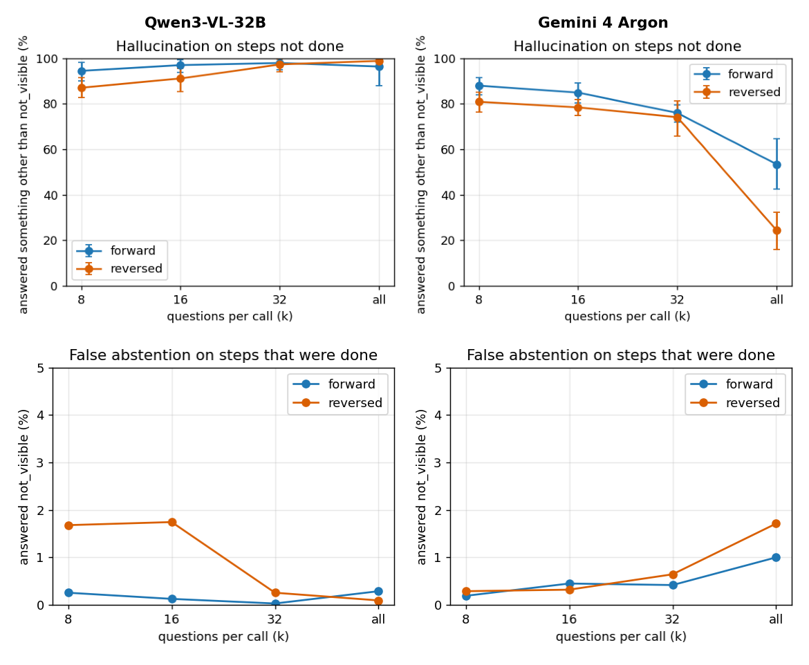
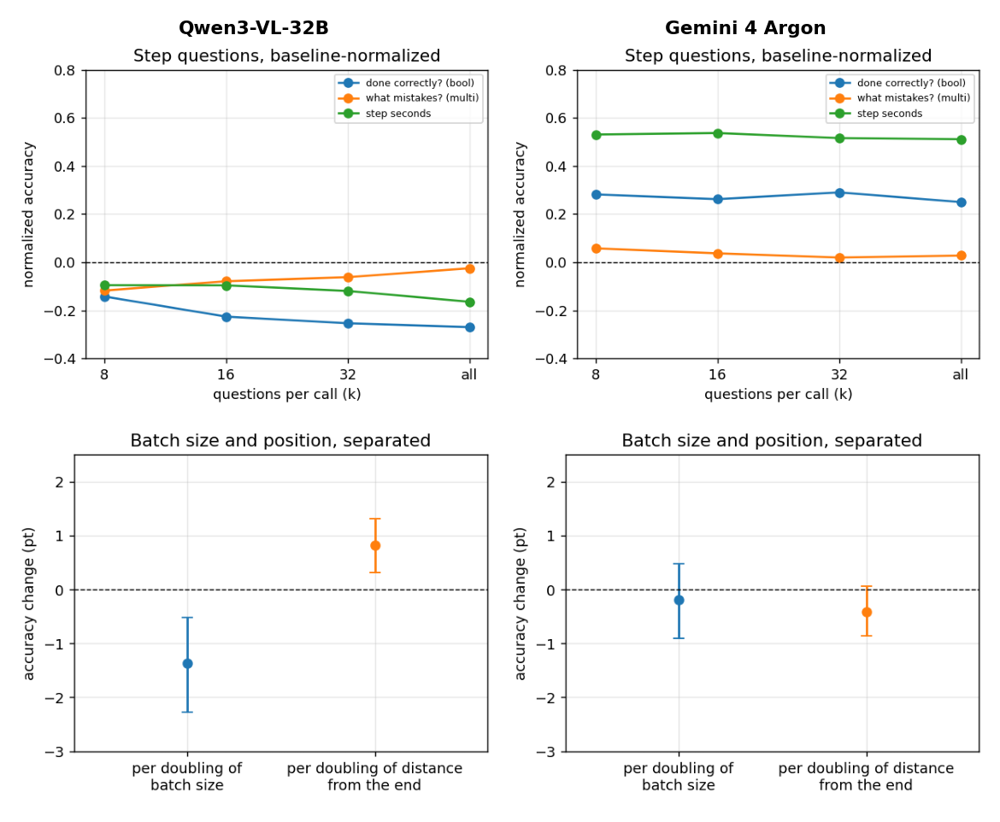

# Q7: Asking a whole report at once vs in batches: accuracy, position, hallucination

Models: Gemini 4 Argon, Qwen3-VL-32B. Data: `cc4d_k32_v1` (the 64 recordings of the main experiment, 31–79 questions per report, median 53). Design: [cc4d_k32_experiment_design.md](cc4d_k32_experiment_design.md).
Scripts: `results/cc4d_k32_rows.py` (turns Qwen evaluation output into rows), `cc4d_k32.py`, `cc4d_k32_reg.py` (outputs `cc4d_k32_out.txt`, `cc4d_k32_reg_out.txt`; for Qwen `_qwen_out.txt`). Raw data: `rows.json.gz` in `results/cc4d_k32_v1_gemini4_argon_20261109/` and `cc4d_k32_v1_qwen3vl32b_20261110/`. Figures: `figs/` (each figure is a 2×2 grid: Qwen left, Argon right; the top and bottom rows are two topics, and each row shares its y axis; `results/cc4d_k32_figs.py` produces the numbers and figures for both models in one run). Chinese version: [q7.zh.md](q7.zh.md).

## The questions

Each report asks about one recording (the preparation of a recipe), with two levels of questions:

| Level | Question (name used below) | Answer type | Counted correct when |
| --- | --- | --- | --- |
| Per step | **Done correctly?** | Bool | Matches the ground truth |
| Per step | **What mistakes?** | Multi-choice (options are mistake types; may select none) | The selection is exactly the ground truth |
| Per step | **Step seconds** | Seconds | Error within max(2 s, 25%) |
| Whole recording | Order violated? | Bool | Matches the ground truth |
| Whole recording | Steps done | Integer | Matches the ground truth |
| Whole recording | Total seconds | Seconds | Error within max(2 s, 25%) |
| Whole recording | Longest step | Single-choice | Matches the ground truth |

- Each report has 31–79 questions, mostly the three per-step questions; the whole-recording questions are only about 4 per report, so the sample is small and they are only leads.
- **Steps not done:** Some steps are not done in the recording at all. For these steps the "done correctly?" and "what mistakes?" questions become abstention questions with the correct answer `not_visible`. If the model still makes up an answer, that counts as a "hallucination" (7.5).
- **k:** How many questions are asked in one call. k = 8, 16, 32 means batches; k = all means the whole report in one call.

## Outline and conclusions

| Sub-question | Argon | Qwen3-VL-32B |
| --- | --- | --- |
| 7.1 How much worse is asking the whole report at once? | **Only slightly:** k = all 59.7%, k = 8 61.3%, −1.8 pt [−3.4, −0.3] | **Also only slightly:** 33.6% vs 35.4%, −1.6 pt [−3.3, +0.1] |
| 7.2 Does forward vs reversed order matter? | **No.** Less than 1.7 pt apart at every k | **No.** Reversed −0.8 pt, interval includes 0 |
| 7.3 Does position matter? | **A little:** about −0.5 pt [−0.92, −0.16] per doubling of the distance from the end; the last few questions are the most accurate | **Not on its own** (+0.11 [−0.20, +0.43]); it shows only together with batch size, see 7.7 |
| 7.4 Which answer type is worst? | Multi-choice "what mistakes?" is the worst (about 45%), single-choice the best (about 85%) | Seconds are the worst (10–20%), bool is close to a coin flip (45–50%) |
| 7.5 Does the model hallucinate on steps not done? | **Yes:** 81–90% at small batch sizes; less with larger batches (k = all: 53% forward, 24% reversed) | **Almost always:** 87–99%, not reduced by larger batches |
| 7.6 What carries the "what mistakes?" accuracy? | **Steps with no mistake:** 63–65% vs 30–32% with mistakes, the same at every k | **Entirely answering "no mistake":** 70% → 94.5% vs 11% → 1.7% (k = 8 → all) |
| 7.7 Can batch size and position be separated? | **No,** both intervals include 0 when put together | **Yes,** batch size −1.37 [−2.27, −0.52], position +0.81 [+0.30, +1.31], opposite signs |
| 7.8 After baseline normalisation? | **+0.34 (k = 8) to +0.32 (k = all)**, conclusions unchanged | **−0.10 to −0.13**, below always answering the most common answer |

**In one sentence:** For both models, asking the whole report at once is only slightly worse than batching (about −2 pt), and forward vs reversed order makes no difference. The level differs a lot: Argon is clearly above the baseline, Qwen below it. Argon's problems are "what mistakes?" and hallucination on skipped steps; Qwen adds seconds and bool answers close to guessing, and a growing tendency to answer "no mistake" in larger batches.

## Method

- 8 conditions (forward / reversed × k = 8, 16, 32, all), 1,770 calls per model, all succeeded (Qwen `rev_k16` had one transport error, retried successfully), none truncated. Argon: 480p, 2 fps, temperature 0. Qwen: vLLM, 4 A100s with tensor parallelism, 2 fps, video token budget 230,000 (resolution is lowered automatically above it), about 15 hours to run.
- Questions: `skipped_steps` removed (its options would give the answers away). For each step that was not done (108), the "done correctly?" and "what mistakes?" questions become abstention questions (correct answer `not_visible`) and a seconds question is added. Every question allows `not_visible`.
- **Difference from the design document:** 53.4 questions per report on average (design: 56.8), at most 79 (design: 83), and 1,770 calls (design: about 1,900).
- Accuracy counts normal questions only (no abstention questions) and is raw accuracy except in 7.8. Confidence intervals are bootstrapped over recordings (1,000 draws, 500 for the regressions); comparisons are paired by recording.

## 7.1 / 7.2 Whole report vs batches, forward vs reversed

**Conclusion:** For both models, asking the whole report at once is only about 2 pt below k = 8; forward and reversed order do not differ.

| k | Argon forward | Argon reversed | Argon both | Qwen forward | Qwen reversed | Qwen both |
| --- | --- | --- | --- | --- | --- | --- |
| 8 | 61.5 | 61.2 | 61.3 [58.9, 63.5] | 35.7 | 35.0 | 35.4 [33.5, 37.2] |
| 16 | 61.6 | 59.9 | 60.8 [58.6, 62.8] | 35.9 | 34.2 | 35.0 [32.9, 37.2] |
| 32 | 59.8 | 60.6 | 60.2 [58.0, 62.3] | 34.5 | 33.9 | 34.2 [31.9, 36.5] |
| all | 59.7 | 59.8 | 59.7 [57.4, 62.0] | 33.8 | 33.4 | 33.6 [31.2, 35.9] |

k = all vs k = 8: Argon is 1.8 pt lower (paired, [−3.4, −0.3]), Qwen 1.6 pt lower ([−3.3, +0.1]); the difference between adjacent k values is within noise.

## 7.3 Position

**Conclusion:** For Argon, accuracy is slightly lower the further a question is from the end (about −0.5 pt per doubling), but the curve is not monotone: the last 0–4 questions are the most accurate, the middle is lowest, and it recovers further forward. For Qwen, position alone has no effect (+0.11); it shows only when put together with batch size (7.7).

Change per doubling (pt, question fixed effects, all k pooled):

| Content | Argon | Qwen |
| --- | --- | --- |
| All | −0.51 [−0.92, −0.16] | +0.11 [−0.16, +0.43] |
| Done correctly? | −0.23 [−0.88, +0.34] | −0.48 [−1.10, +0.19] |
| What mistakes? | −0.60 [−1.25, +0.00] | +0.97 [+0.53, +1.42] |
| Seconds | −0.46 [−0.99, +0.02] | −0.59 [−1.02, −0.12] |
| Recording-level | −1.03 [−1.76, −0.38] | +1.14 [−0.14, +2.75] |

Recording-level has about 4 questions per report, so treat it as a lead only. The positive slope for Qwen's "what mistakes?" comes from answering "no mistake" more and more in larger calls (7.6).

## 7.4 Answer types and content

**Conclusion:** Argon's ranking is the same at every k: single-choice > integer > bool ≈ seconds > multi-choice. Qwen is much lower overall, with seconds the worst and bool at 45–50%.

| Type | Argon k = 8 | 16 | 32 | all | Qwen k = 8 | 16 | 32 | all |
| --- | --- | --- | --- | --- | --- | --- | --- | --- |
| Single-choice | 85.1 | 85.1 | 84.0 | 87.2 | 61.7 | 62.8 | 62.8 | 57.4 |
| Integer | 73.4 | 66.4 | 71.1 | 71.1 | 14.1 | 22.7 | 16.4 | 22.7 |
| Bool | 68.8 | 68.1 | 69.1 | 67.3 | 50.1 | 46.9 | 45.7 | 44.8 |
| Seconds | 65.8 | 66.3 | 64.3 | 64.0 | 19.6 | 19.1 | 17.3 | 14.1 |
| Multi-choice | 46.6 | 45.4 | 44.4 | 44.9 | 36.6 | 38.9 | 39.8 | 41.9 |

- Single-choice and integer have only about 100 questions per cell, so their intervals are wide and the swings are not a trend. Multi-choice is the "what mistakes?" question.
- **Qwen's seconds:** Step seconds are only 15% (k = 8) to 10% (k = all). It is not a scoring problem: of 1,015 step-seconds answers in forward k = 8, 458 (45%) were exactly 10 s, the median prediction is 10 s and the median truth 31 s, while total seconds (e.g. predicted 359, truth 350) are scored correct. The model's sense of time is poor and it falls back on a default value.

## 7.5 Hallucination (steps not done)

**Conclusion:** Both models mostly make up an answer instead of saying they cannot see the step. For Argon, larger batches make this less common and the cost of wrong abstentions is small; for Qwen it does not decrease with batch size.

| k | Argon hallucination fwd | rev | Argon wrong `not_visible` fwd | rev | Qwen hallucination fwd | rev | Qwen wrong fwd | rev |
| --- | --- | --- | --- | --- | --- | --- | --- | --- |
| 8 | 88.0 | 80.9 | 0.2 | 0.3 | 94.4 | 87.0 | 0.3 | 1.7 |
| 16 | 84.9 | 78.4 | 0.5 | 0.3 | 96.9 | 91.0 | 0.1 | 1.7 |
| 32 | 75.9 | 74.1 | 0.4 | 0.6 | 97.8 | 97.2 | 0.0 | 0.3 |
| all | 53.4 [42.4, 64.6] | 24.4 [16.0, 32.4] | 1.0 | 1.7 | 96.3 | 98.8 | 0.3 | 0.1 |

(Hallucination = a question about a skipped step answered with anything but `not_visible`. Wrong `not_visible` = a step that was done answered `not_visible`. Each cell has about 162 questions, so do not over-read it.)

- Argon: bool and multi-choice are hallucinated almost always at k ≤ 16 (98%) and about 50% at k = all; seconds less so (about 57% at k = 8, about 16% at k = all). Reversed k = all is lowest (24%): when the skipped-step questions come together with the later questions, the model answers `not_visible` more often.

## 7.6 Reading "what mistakes?" carefully

**Conclusion:** Argon's 45% comes mainly from steps with no mistake, at every k, in line with Q2. Qwen's accuracy rising with k is a bias: larger batches lean towards answering "no mistake".

| k | Argon no mistake (412 each) | Argon has mistakes (539 each) | Qwen no mistake | Qwen has mistakes |
| --- | --- | --- | --- | --- |
| 8 | 65.3 | 32.3 | 69.9 | 11.2 |
| 16 | 63.3 | 31.7 | 83.3 | 4.9 |
| 32 | 63.7 | 29.7 | 87.9 | 3.1 |
| all | 64.7 | 29.8 | 94.5 | 1.7 |

## 7.7 Separating batch size and position

**Conclusion:** For Argon they cannot be separated: the two effects are correlated (the larger the call, the further its questions are from the end on average), and in one regression both intervals include 0, so "k = all is 1.8 pt lower" may be due to the larger batch or to the greater distance from the end. For Qwen they can be separated, and they have opposite signs: larger batches are worse, being further from the end is better, and on their own they cancel.

Model: accuracy = b1 × log2(questions in the call) + b2 × log2(questions after it + 1) + b3 × reversed, with question fixed effects (units: pt).

| Model | Batch size (per doubling) | Distance from end (per doubling) | Reversed |
| --- | --- | --- | --- |
| Argon, both | −0.19 [−0.91, +0.48] | −0.41 [−0.87, +0.06] | −0.29 [−1.39, +0.79] |
| Argon, batch size only | −0.56 [−1.16, −0.09] | | |
| Argon, position only | | −0.51 [−0.93, −0.14] | |
| Qwen, both | −1.37 [−2.27, −0.52] | +0.81 [+0.30, +1.31] | −0.82 [−2.02, +0.46] |
| Qwen, batch size only | −0.65 [−1.24, −0.06] | | |
| Qwen, position only | | +0.11 [−0.20, +0.43] | |

- Argon: the effects within each content are small and include 0; only the reversed coefficient for "done correctly?", −1.83 [−3.45, −0.01], sits on the edge, so treat it as a lead. Separating them would need a new design (fix the position and change only the batch size).
- Qwen: the batch-size effect is clearest for "done correctly?" (−3.08 [−4.65, −1.45]) and step seconds (−2.56 [−3.35, −1.62]); for "what mistakes?" it is instead +1.79 [+0.81, +2.86], explained in 7.6.

## 7.8 Baseline normalisation and comparison with Q1–Q6

**Conclusion:** For Argon, the k values differ by only 0.02 after normalisation, so the conclusion stands, and "what mistakes?" barely beats always answering "no mistake". For Qwen, pooled normalised accuracy is negative; only "total seconds" and "longest step" beat the baseline.

Normalised accuracy = (accuracy − baseline) / (1 − baseline), where the baseline is the best constant answer for the cell (as in Q1–Q6; for seconds, the best constant chosen after the fact, an upper bound).

| Cell | Baseline | Argon k = 8 | 16 | 32 | all | Qwen k = 8 | 16 | 32 | all |
| --- | --- | --- | --- | --- | --- | --- | --- | --- | --- |
| Done correctly? | 0.57 | +0.28 | +0.26 | +0.29 | +0.25 | −0.14 | −0.23 | −0.25 | −0.27 |
| What mistakes? | 0.43 | +0.06 | +0.04 | +0.02 | +0.03 | −0.12 | −0.08 | −0.06 | −0.03 |
| Step seconds | 0.23 | +0.53 | +0.54 | +0.52 | +0.51 | −0.10 | −0.10 | −0.12 | −0.16 |
| Order violated? | 0.56 | +0.27 | +0.29 | +0.23 | +0.18 | −0.30 | −0.21 | −0.27 | −0.34 |
| Steps done | 0.19 | +0.67 | +0.59 | +0.64 | +0.64 | −0.06 | +0.05 | −0.03 | +0.05 |
| Total seconds | 0.64 | +0.89 | +0.91 | +0.72 | +0.74 | +0.48 | +0.26 | +0.24 | +0.24 |
| Longest step | 0.21 | +0.81 | +0.81 | +0.80 | +0.84 | +0.51 | +0.53 | +0.53 | +0.46 |
| **Pooled** | | **+0.34** | **+0.34** | **+0.33** | **+0.32** [+0.28, +0.35] | **−0.10** | **−0.10** | **−0.11** | **−0.13** [−0.17, −0.09] |

- On steps with mistakes Argon is right 30–32%, while always answering "no mistake" scores 0% there, so "what mistakes?" is not without discrimination, only biased towards "no mistake". Qwen is down to 1.7–11% on these steps, which is almost always answering "no mistake".
- Argon's total seconds dropping from about +0.90 to +0.73 is the only larger decline, but it has only 128 questions per cell, so no firm conclusion. The last four rows have about 100 questions per cell, so treat them as leads.
