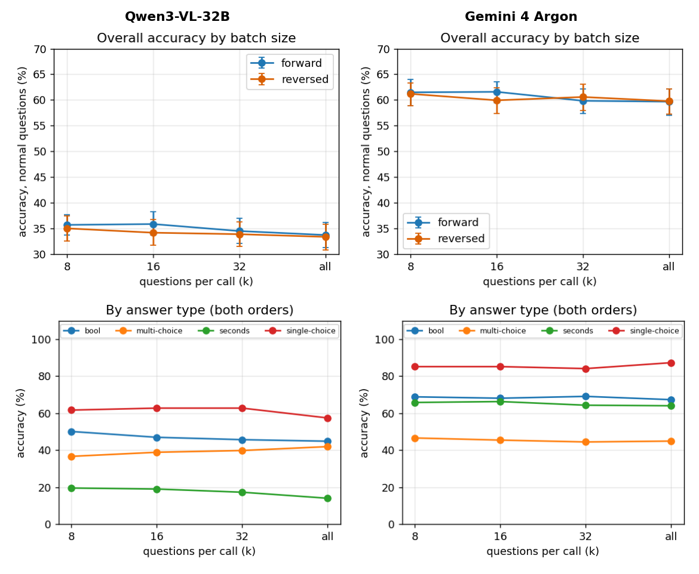
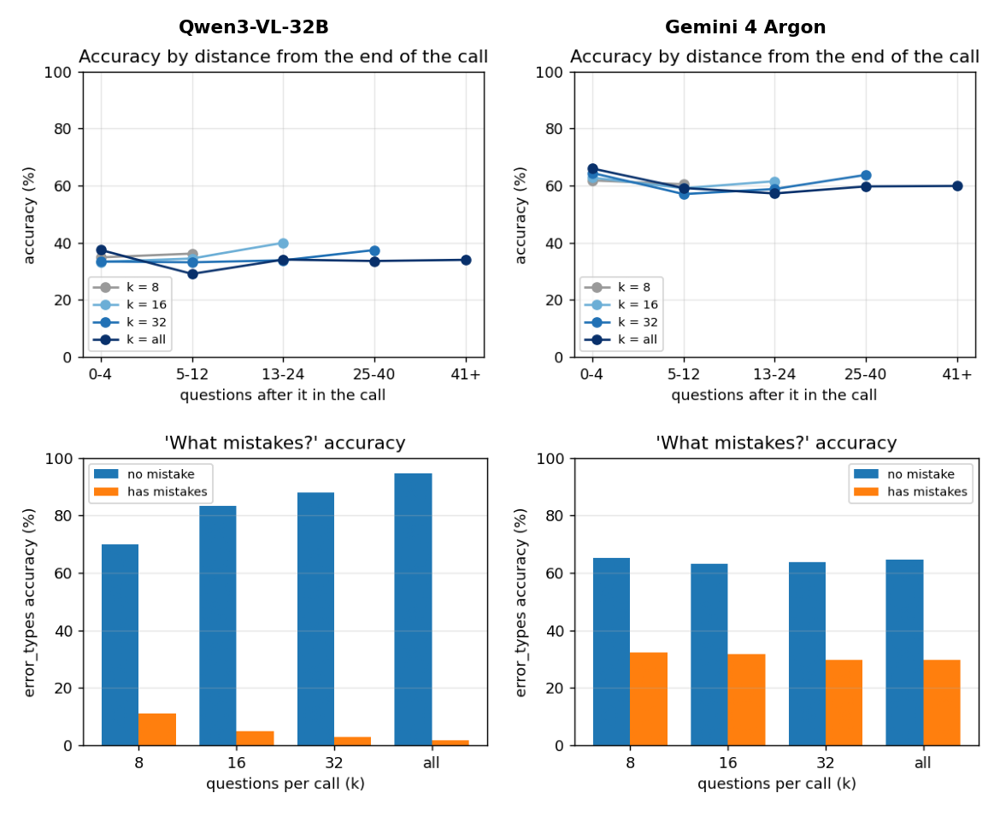
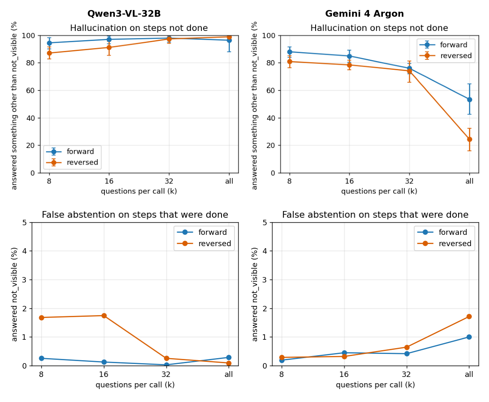
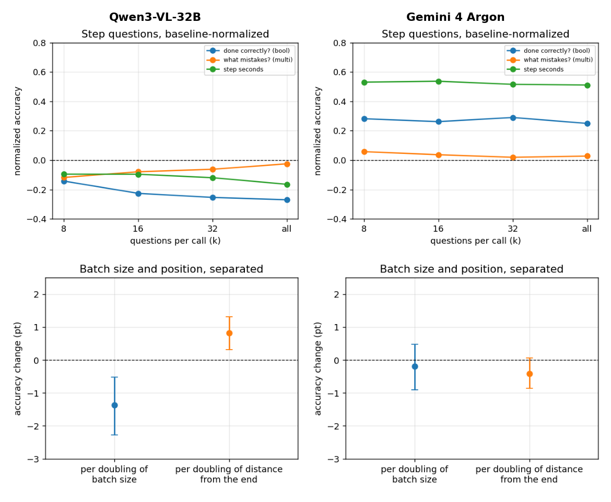

# Q7:整份報告一次問完 vs 分批問,準確率、位置、幻覺

模型:Gemini 4 Argon、Qwen3-VL-32B。資料:`cc4d_k32_v1`(主實驗 64 支錄影,每份報告 31–79 題,中位數 53)。設計:[cc4d_k32_experiment_design.zh.md](cc4d_k32_experiment_design.zh.md)。
腳本:`results/cc4d_k32_rows.py`(Qwen 評分結果轉成列)、`cc4d_k32.py`、`cc4d_k32_reg.py`(輸出 `cc4d_k32_out.txt`、`cc4d_k32_reg_out.txt`,Qwen 為 `_qwen_out.txt`)。原始資料:`results/cc4d_k32_v1_gemini4_argon_20261109/`、`cc4d_k32_v1_qwen3vl32b_20261110/` 的 `rows.json.gz`。圖:`figs/`(每張圖 2×2:左 Qwen、右 Argon,上排與下排各是同一個主題,同一排 y 軸尺度相同;`results/cc4d_k32_figs.py` 一次產生兩個模型的數字與圖)。英文版:[q7.md](q7.md)。

## 題型說明

每份報告問的是同一支錄影(一份食譜的操作過程),題目分兩層:

| 層級 | 題目(文中的名稱) | 答案型態 | 怎麼算對 |
| --- | --- | --- | --- |
| 每個步驟 | **做對了嗎** | 是非 | 和標準答案一致 |
| 每個步驟 | **什麼錯誤** | 多選(選項是錯誤類型,可以不選) | 選的和標準答案完全相同 |
| 每個步驟 | **步驟秒數** | 秒數 | 誤差在 max(2 秒, 25%) 內 |
| 整支錄影 | 順序有沒有錯 | 是非 | 和標準答案一致 |
| 整支錄影 | 做了幾個步驟 | 整數 | 和標準答案一致 |
| 整支錄影 | 總秒數 | 秒數 | 誤差在 max(2 秒, 25%) 內 |
| 整支錄影 | 最久的步驟 | 單選 | 和標準答案一致 |

- 每份報告 31–79 題,大部分是每個步驟的三題;整支錄影的題每份只有約 4 題,所以樣本少,只當線索。
- **漏做的步驟:** 有些步驟錄影裡根本沒做。這些步驟的「做對了嗎」「什麼錯誤」改成 abstention 題,正確答案是 `not_visible`(看不到)。模型如果還是編了答案,就算「幻覺」(7.5)。
- **k:** 一次呼叫問幾題。k = 8、16、32 是分批問,k = all 是整份報告一次問完。

## 大綱與結論

| 子問題 | Argon | Qwen3-VL-32B |
| --- | --- | --- |
| 7.1 整份一次問比分批差多少? | **只差一點:** k = all 59.7%,k = 8 61.3%,−1.8 pt [−3.4, −0.3] | **同樣只差一點:** 33.6% vs 35.4%,−1.6 pt [−3.3, +0.1] |
| 7.2 順向和倒序有差嗎? | **沒有。** 各 k 差不到 1.7 pt | **沒有。** 倒序 −0.8 pt,區間含 0 |
| 7.3 位置有影響嗎? | **有但很小:** 離結尾每遠一倍約 −0.5 pt [−0.92, −0.16];最後幾題最準 | **單獨看沒有**(+0.11 [−0.20, +0.43]);和批次大小一起看才有,見 7.7 |
| 7.4 哪種題型最差? | 多選「什麼錯誤」最差(約 45%),單選最高(約 85%) | 秒數最差(10–20%),是非接近擲硬幣(45–50%) |
| 7.5 沒做的步驟會不會幻覺? | **會:** 批次小時 81–90%;批次越大越少(k = all 順向 53%、倒序 24%) | **幾乎都會:** 87–99%,不隨批次變小 |
| 7.6 「什麼錯誤」靠什麼撐起來? | **沒錯誤的步驟:** 63–65% vs 有錯誤 30–32%,各 k 一樣 | **完全靠答「沒有錯」:** 70% → 94.5% vs 11% → 1.7%(k = 8 → all) |
| 7.7 批次大小和位置能分開嗎? | **分不開,** 一起放兩者區間都含 0 | **分得開,** 批次 −1.37 [−2.27, −0.52]、位置 +0.81 [+0.30, +1.31],方向相反 |
| 7.8 基線校正後? | **+0.34(k = 8)到 +0.32(k = all)**,結論不變 | **−0.10 到 −0.13**,低於「一律答最常見答案」 |

**一句話:** 兩個模型都是「整份一次問」只比分批略差(約 −2 pt),順向倒序無差別。但水準差很多:Argon 明顯高於基線,Qwen 低於基線;Argon 的問題是「什麼錯誤」和漏做步驟的幻覺,Qwen 還要加上秒數、是非都接近亂猜,以及批次越大越傾向答「沒有錯」。

## 方法

- 8 個設定(順向 / 倒序 × k = 8、16、32、all),每個模型 1,770 次呼叫,全部成功(Qwen `rev_k16` 有 1 次傳輸錯誤,重試成功),沒有截斷。Argon:480p、2 fps、溫度 0。Qwen:vLLM,4 張 A100 tensor parallel,2 fps,影片 token 預算 230,000(超過時自動降解析度),約 15 小時跑完。
- 題目:去掉 `skipped_steps`(選項會洩漏答案);每個漏做的步驟(108 個)的「做對了嗎」「什麼錯誤」改成 abstention 題(正確答案 `not_visible`),再補一題秒數;每題都允許 `not_visible`。
- **與設計文件的差別:** 平均 53.4 題(文件 56.8),最多 79 題(文件 83),共 1,770 次呼叫(文件約 1,900)。
- 準確率只算一般題(不含 abstention 題);除 7.8 外是原始準確率。信賴區間依錄影 bootstrap(1,000 次,回歸 500 次),比較依錄影配對。

## 7.1 / 7.2 整份 vs 分批,順向 vs 倒序

**結論:** 兩個模型整份一次問都只比 k = 8 低約 2 pt;順向和倒序沒有差別。

| k | Argon 順向 | Argon 倒序 | Argon 合併 | Qwen 順向 | Qwen 倒序 | Qwen 合併 |
| --- | --- | --- | --- | --- | --- | --- |
| 8 | 61.5 | 61.2 | 61.3 [58.9, 63.5] | 35.7 | 35.0 | 35.4 [33.5, 37.2] |
| 16 | 61.6 | 59.9 | 60.8 [58.6, 62.8] | 35.9 | 34.2 | 35.0 [32.9, 37.2] |
| 32 | 59.8 | 60.6 | 60.2 [58.0, 62.3] | 34.5 | 33.9 | 34.2 [31.9, 36.5] |
| all | 59.7 | 59.8 | 59.7 [57.4, 62.0] | 33.8 | 33.4 | 33.6 [31.2, 35.9] |

k = all 比 k = 8:Argon 低 1.8 pt(配對,[−3.4, −0.3]),Qwen 低 1.6 pt([−3.3, +0.1]);相鄰兩個 k 的差都在誤差內。

## 7.3 位置

**結論:** Argon 離結尾越遠略差(約 −0.5 pt / 加倍),曲線不單調:最後 0–4 題最準,中間最低,更前面又回升。Qwen 單獨看位置沒有效應(+0.11),要和批次大小一起放才看得到(7.7)。

每加倍變化(pt,「題目」固定效應,所有 k 混在一起):

| 內容 | Argon | Qwen |
| --- | --- | --- |
| 全部 | −0.51 [−0.92, −0.16] | +0.11 [−0.16, +0.43] |
| 做對了嗎 | −0.23 [−0.88, +0.34] | −0.48 [−1.10, +0.19] |
| 什麼錯誤 | −0.60 [−1.25, +0.00] | +0.97 [+0.53, +1.42] |
| 秒數 | −0.46 [−0.99, +0.02] | −0.59 [−1.02, −0.12] |
| 記錄層級 | −1.03 [−1.76, −0.38] | +1.14 [−0.14, +2.75] |

記錄層級每份報告約 4 題,只當線索。Qwen「什麼錯誤」的正斜率來自它越問越多越答「沒有錯」(7.6)。

## 7.4 題型與內容

**結論:** Argon 排名在所有 k 都一樣,單選 > 整數 > 是非 ≈ 秒數 > 多選;Qwen 整體低很多,秒數最差,是非 45–50%。

| 型態 | Argon k = 8 | 16 | 32 | all | Qwen k = 8 | 16 | 32 | all |
| --- | --- | --- | --- | --- | --- | --- | --- | --- |
| 單選 | 85.1 | 85.1 | 84.0 | 87.2 | 61.7 | 62.8 | 62.8 | 57.4 |
| 整數 | 73.4 | 66.4 | 71.1 | 71.1 | 14.1 | 22.7 | 16.4 | 22.7 |
| 是非 | 68.8 | 68.1 | 69.1 | 67.3 | 50.1 | 46.9 | 45.7 | 44.8 |
| 秒數 | 65.8 | 66.3 | 64.3 | 64.0 | 19.6 | 19.1 | 17.3 | 14.1 |
| 多選 | 46.6 | 45.4 | 44.4 | 44.9 | 36.6 | 38.9 | 39.8 | 41.9 |

- 單選與整數每格只有約 100 題,區間很寬,起伏不能當趨勢。多選就是「什麼錯誤」。
- **Qwen 的秒數:** 步驟秒數只有 15%(k = 8)到 10%(k = all)。不是評分問題:k = 8 順向 1,015 題步驟秒數中,458 題(45%)答的都是 10 秒,預測中位數 10 秒、真實中位數 31 秒;而總秒數(如預測 359、真實 350)是算對的。是模型的時間感差,並傾向填預設值。

## 7.5 幻覺(漏做的步驟)

**結論:** 兩個模型多半不說「看不到」而是編答案。Argon 批次越大編得越少,誤答代價很小;Qwen 不隨批次變小。

| k | Argon 幻覺 順向 | 倒序 | Argon 誤答 `not_visible` 順向 | 倒序 | Qwen 幻覺 順向 | 倒序 | Qwen 誤答 順向 | 倒序 |
| --- | --- | --- | --- | --- | --- | --- | --- | --- |
| 8 | 88.0 | 80.9 | 0.2 | 0.3 | 94.4 | 87.0 | 0.3 | 1.7 |
| 16 | 84.9 | 78.4 | 0.5 | 0.3 | 96.9 | 91.0 | 0.1 | 1.7 |
| 32 | 75.9 | 74.1 | 0.4 | 0.6 | 97.8 | 97.2 | 0.0 | 0.3 |
| all | 53.4 [42.4, 64.6] | 24.4 [16.0, 32.4] | 1.0 | 1.7 | 96.3 | 98.8 | 0.3 | 0.1 |

(幻覺 = 漏做步驟的題被答了 `not_visible` 以外的答案;誤答 = 有做的步驟被答成 `not_visible`。每格約 162 題,別過度解讀。)

- Argon:是非與多選在 k ≤ 16 幾乎全幻覺(98%),k = all 約 50%;秒數較少(k = 8 約 57%,k = all 約 16%)。倒序的 k = all 最低(24%),漏做步驟的題和後面的題一起出現時,模型更常答 `not_visible`。

## 7.6 「什麼錯誤」要小心解讀

**結論:** Argon 的 45% 主要來自沒錯誤的步驟,各 k 一樣,和 Q2 一致。Qwen 的準確率隨 k 上升是偏誤:批次越大越傾向答「沒有錯」。

| k | Argon 沒錯誤(各 412 題) | Argon 有錯誤(各 539 題) | Qwen 沒錯誤 | Qwen 有錯誤 |
| --- | --- | --- | --- | --- |
| 8 | 65.3 | 32.3 | 69.9 | 11.2 |
| 16 | 63.3 | 31.7 | 83.3 | 4.9 |
| 32 | 63.7 | 29.7 | 87.9 | 3.1 |
| all | 64.7 | 29.8 | 94.5 | 1.7 |

## 7.7 把批次大小和位置分開

**結論:** Argon 分不開:兩個效應彼此相關(批次大的呼叫,題目平均離結尾也比較遠),一起放進回歸時區間都含 0,所以「k = all 低 1.8 pt」可能是批次大,也可能是位置遠。Qwen 分得開,而且方向相反:批次越大越差,離結尾越遠越好,單獨放時互相抵消。

模型:準確率 = b1 × log2(該次呼叫的題數) + b2 × log2(後面還有幾題 + 1) + b3 × 倒序,加「題目」固定效應(單位 pt)。

| 模型 | 批次大小(每加倍) | 離結尾距離(每加倍) | 倒序 |
| --- | --- | --- | --- |
| Argon 兩者一起 | −0.19 [−0.91, +0.48] | −0.41 [−0.87, +0.06] | −0.29 [−1.39, +0.79] |
| Argon 只放批次大小 | −0.56 [−1.16, −0.09] | | |
| Argon 只放位置 | | −0.51 [−0.93, −0.14] | |
| Qwen 兩者一起 | −1.37 [−2.27, −0.52] | +0.81 [+0.30, +1.31] | −0.82 [−2.02, +0.46] |
| Qwen 只放批次大小 | −0.65 [−1.24, −0.06] | | |
| Qwen 只放位置 | | +0.11 [−0.20, +0.43] | |

- Argon 各內容的效應都小且含 0;只有「做對了嗎」的倒序係數 −1.83 [−3.45, −0.01] 壓在邊緣,只當線索。要分開需要新的設計(固定位置、只改批次大小)。
- Qwen:「做對了嗎」批次 −3.08 [−4.65, −1.45]、步驟秒數批次 −2.56 [−3.35, −1.62] 最明顯;「什麼錯誤」批次反而 +1.79 [+0.81, +2.86],原因見 7.6。

## 7.8 基線校正,和 Q1–Q6 比較

**結論:** Argon 校正後各 k 只差 0.02,結論不變,「什麼錯誤」幾乎沒超過「一律答沒有錯」;Qwen 合併校正後為負,只有「總秒數」和「最久的步驟」高於基線。

校正後準確率 = (準確率 − 基線) / (1 − 基線),基線 = 該格子「一律答同一個答案」的最佳準確率(同 Q1–Q6;秒數是事後最佳常數,上界)。

| 格子 | 基線 | Argon k = 8 | 16 | 32 | all | Qwen k = 8 | 16 | 32 | all |
| --- | --- | --- | --- | --- | --- | --- | --- | --- | --- |
| 做對了嗎 | 0.57 | +0.28 | +0.26 | +0.29 | +0.25 | −0.14 | −0.23 | −0.25 | −0.27 |
| 什麼錯誤 | 0.43 | +0.06 | +0.04 | +0.02 | +0.03 | −0.12 | −0.08 | −0.06 | −0.03 |
| 步驟秒數 | 0.23 | +0.53 | +0.54 | +0.52 | +0.51 | −0.10 | −0.10 | −0.12 | −0.16 |
| 順序有沒有錯 | 0.56 | +0.27 | +0.29 | +0.23 | +0.18 | −0.30 | −0.21 | −0.27 | −0.34 |
| 做了幾個步驟 | 0.19 | +0.67 | +0.59 | +0.64 | +0.64 | −0.06 | +0.05 | −0.03 | +0.05 |
| 總秒數 | 0.64 | +0.89 | +0.91 | +0.72 | +0.74 | +0.48 | +0.26 | +0.24 | +0.24 |
| 最久的步驟 | 0.21 | +0.81 | +0.81 | +0.80 | +0.84 | +0.51 | +0.53 | +0.53 | +0.46 |
| **合併** | | **+0.34** | **+0.34** | **+0.33** | **+0.32** [+0.28, +0.35] | **−0.10** | **−0.10** | **−0.11** | **−0.13** [−0.17, −0.09] |

- Argon 在有錯誤的步驟答對 30–32%,而「一律答沒有錯」在這些步驟是 0%,所以「什麼錯誤」不是完全沒辨別力,只是偏向答沒有錯。Qwen 在這些步驟只剩 1.7–11%,幾乎就是一律答沒有錯。
- Argon 總秒數從 +0.90 掉到 +0.73 是唯一較大的退步,但每格只有 128 題,不能下定論。後四列每格約 100 題,只當線索。

