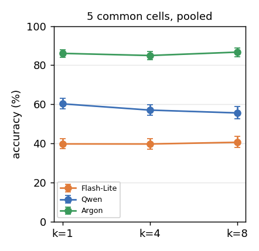
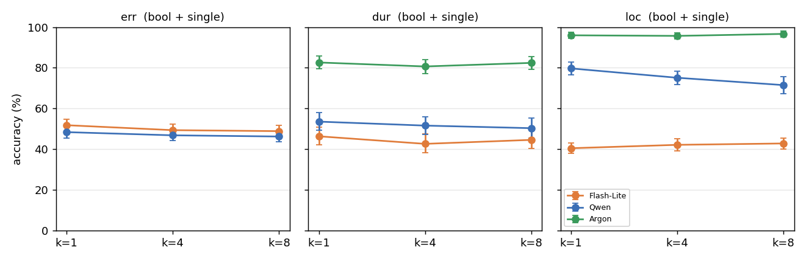
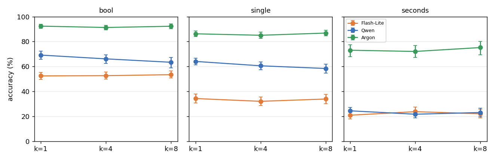
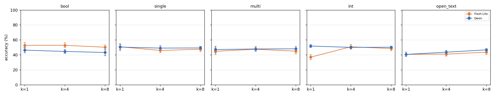
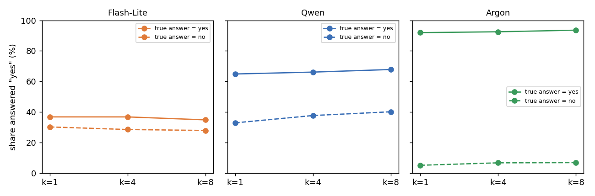

# Q1:每次 call 問更多題,準確率會不會改變?會不會因題型而不同?

模型:Gemini 3.5 Flash-Lite、Qwen3-VL-32B、Gemini 4 Argon(Argon 只跑了 5 個格子)。資料:`cc4d_answer_types_v1`。
腳本:`results/cc4d_q1_logit.py`、`cc4d_q1_logit2.py`、`cc4d_q1_figs.py`;完整輸出:`results/cc4d_q1_logit_out.txt`、`cc4d_q1_logit2_out.txt`。

## 大綱與結論

| 子問題 | 結論 |
| --- | --- |
| 1. 各模型單看題數,準確率是否下降? | **Qwen 會下降**(k = 1 → 8 約 −4.6 pt,每加倍 OR = 0.94,p < 0.001);Flash-Lite 與 Argon 沒有可靠變化。Qwen 的斜率顯著低於 Argon |
| 2. 題數 × 內容:題數效應是否隨內容不同?(控制題型) | **會,且方向因模型而異**(三向交互 p = 0.0002)。Qwen 在 localization 降最多(−2.5 pt / 加倍);Flash-Lite 在 localization 反而小升;Argon 各內容都接近 0 |
| 3. 題數 × 題型:題數效應是否隨題型不同?(控制內容) | **在 duration / localization 內容裡不會**(三向交互 p = 0.85)。error 內容有兩個例外:Flash-Lite 的 int(+4.2 pt / 加倍)和 Qwen 的 open_text(+1.9 pt / 加倍),都來自越來越傾向答「沒有錯」 |
| 4a. 題數延伸到 16(E5) | Qwen 的 localization 下降更明顯(bool、single 各約 −2.5 pt / 加倍);Flash-Lite 方向相反。Argon 沒跑 |
| 4b. 題目位置 | Argon 越後面越差(p = 0.03);Qwen 的題數效應約四成可由位置解釋;Flash-Lite 沒有位置效應 |
| 4c. bool 的答案偏誤 | Qwen 隨題數越來越傾向答「是」,下降來自真答案為「否」的題,不是辨識力下降 |
| 4d. 影片長度 | 沒有「長影片加多題更差」的證據;Qwen 的下降反而集中在 ≤ 17 分鐘的影片 |

**一句話總結:題數效應是模型特有的,不是普遍現象。** Qwen 隨題數增加而變差,集中在 localization,並部分來自 bool 的答「是」偏誤;兩個 Gemini 模型在已測範圍內都沒有可靠的題數效應。題型大多不調節這個效應。

## 方法

- 一列一題(答對 = 1),只用有影片的題目,不含「沒做的步驟」(hallucination 題,屬於 Q5)。open_text 只在 error 內容有(Flash-Lite 與 Qwen),Qwen 的 open_text 已於 11/8 用與 Flash-Lite 相同的評審補評分。
- 主實驗使用 base 組 k = 1 / 4 / 8,正序。三個模型共有的 5 個格子(dur bool、dur single、loc bool、loc single、loc seconds)共 2,560 題,每個 k 都問同一批題(配對)。Flash-Lite 與 Qwen 另有 error 的 5 個格子(bool、single、multi、int、open_text),共 11 格。
- 邏輯斯回歸,解釋變數 `lk = log2(k)`,係數代表**題數加倍**的效應。標準誤依錄影(video)分群,與其他分析的「依錄影 bootstrap」同一單位。
- 「AME」是模型預測的準確率,題數每加倍的平均變化(百分點)。
- 圖中的區間是依錄影 bootstrap 2,000 次的 95% 區間。
- 沒有做多重比較校正。p 值在 0.01 到 0.05 之間的結果只當線索。

### 回歸用了哪些變項

所有模型都是邏輯斯回歸(`statsmodels` 的 `Logit`),標準誤依錄影群集。

| 角色 | 變項 | 說明 |
| --- | --- | --- |
| 依變項 | `y` | 該題是否答對(1 / 0);bool 偏誤分析(4c)改用「是否答『是』」 |
| 主要解釋變項 | `lk` | log2(每次 call 的題數 k),k = 1 / 4 / 8,所以 lk = 0 / 2 / 3;E5 另有 k = 16(lk = 4)。係數 = 題數加倍的效應 |
| 因子 | `model` | Flash-Lite、Qwen、Argon;以 Argon(或 Qwen)為參考組 |
| 因子 | `content` | err / dur / loc;以 err(或 dur)為參考組 |
| 因子 | `type` | bool / single / multi / int / seconds / open_text;以 bool 為參考組 |
| 因子 | `cell` | content × type 的組合(如 dur bool),在不分內容或題型的模型中當固定效應,吸收各格子的基本難度 |
| 位置(4b) | `posfrac` | 題目在 call 內的位置,(第幾題 − 1)/(k − 1),0 = 第一題、1 = 最後一題;k = 1 記為 0。用到倒序資料(同一題出現在 p 與 k + 1 − p) |
| 影片長度(4d) | `v10` / `cls` | 影片長度(分鐘)除以 10 並置中;或分成 A(≤ 11 分)、B(11–17 分)、C(> 17 分) |
| 群集 | `rec` | 錄影編號,不放進模型,只用來算群集穩健標準誤 |

各小節的公式(`*` 表示主效應加所有交互項):

| 小節 | 公式 | 範圍 |
| --- | --- | --- |
| 1 | `y ~ lk`(每個模型各一個);`y ~ lk * model + cell`(三模型合併,比斜率) | 5 或 11 格 |
| 2 | `y ~ lk * model * content + type` | bool + single |
| 3 | `y ~ lk * model * type + content`;err 內容為 `y ~ lk * model * type` | dur + loc;err |
| 4a | `y ~ lk * type`,dur、loc 各自一個模型 | E5,k = 1 / 4 / 8 / 16 |
| 4b | `y ~ lk + posfrac + cell`;`y ~ lk + posfrac * model + cell` | 正序 + 倒序,k = 4、8 |
| 4c | `P(答是) ~ lk * 真答案 + cell` | bool |
| 4d | `y ~ lk * v10 + cell`;`y ~ lk * cls + cell` | 5 個共同格子 |

- 「三向交互」是對 `lk:model:content`(或 `lk:model:type`)的全部係數做聯合 Wald 檢定,不是單看某一個係數。
- 因子有交互項時,`lk` 一列只是參考組的效應,不是整體效應。整體效應看 AME(模型預測準確率,題數每加倍的平均變化)。
- 沒有放進模型的:錄影或食譜的固定效應、題目本身(fact)的隨機效應、問題文字長度。配對設計(同一批題在三個 k 都問)只靠群集標準誤處理,沒有用條件邏輯斯回歸。

## 1. 各模型單看題數

**結論:** 只有 Qwen 會隨題數下降(k = 1 → 8 約 −4.6 pt,p < 0.001),Flash-Lite 與 Argon 沒有可靠變化;Qwen 的斜率顯著低於 Argon。

三個模型,5 個共同格子:

| 模型 | k = 1 | k = 4 | k = 8 | 每加倍的 log-odds [95% CI] | p |
| --- | --- | --- | --- | --- | --- |
| Flash-Lite | 39.7% | 39.7% | 40.5% | +0.010 [−0.014, +0.033] | 0.42 |
| Qwen | 60.2% | 57.0% | 55.6% | **−0.064 [−0.091, −0.037]** | <0.001 |
| Argon | 86.1% | 85.0% | 86.7% | +0.008 [−0.025, +0.041] | 0.62 |

- 三個模型放進同一個模型檢定斜率差:Qwen 比 Argon 低 0.078 [−0.126, −0.031](p = 0.001);Flash-Lite 與 Argon 沒有差別(p = 0.94)。
- 用 11 個格子(含 error 與 open_text)重跑,結論相同:Qwen −0.031(p < 0.001),Flash-Lite +0.017(p = 0.08)。
- Flash-Lite 大多接近亂猜,「沒有效應」也可能只是看不出來。Argon 的 localization 接近上限(95–97%),同樣不太能偵測下降。Argon 的 dur single(75%)與 loc seconds(73%)還有空間,它們也沒下降,這是較有力的證據。

## 2. 題數 × 內容:題數效應是否隨內容不同?(控制題型)

**結論:** 題數效應的大小隨內容不同,且方向因模型而異(三向交互 p = 0.0002)。Qwen 降在 localization(−2.5 pt / 加倍),Flash-Lite 的 localization 反而小升,Argon 各內容都接近 0。這只說明下降發生在哪裡,不能說內容本身造成下降(內容與題目、影片、選項設計綁在一起)。

只用三種內容都有的題型(bool + single),控制題型後比較內容。

| 模型 | err | dur | loc |
| --- | --- | --- | --- |
| Flash-Lite | −1.0 pt | −0.8 pt | **+0.8 pt** |
| Qwen | −0.7 pt | −1.1 pt | **−2.5 pt** |
| Argon | 沒跑 | −0.2 pt | +0.2 pt |

(每加倍題數的準確率變化,AME。)

- 模型 × 內容 × 題數的三向交互:dur 對 loc、三個模型 χ² = 16.9,df = 2,**p = 0.0002**;加上 err、只比 Flash-Lite 與 Qwen,**p = 0.0001**。所以「題數效應隨內容改變」成立,但改變的方式因模型而異。
- Qwen:loc 比 err 低(交互項 p = 0.002)。k = 1 → 8,loc bool 74.4% → 66.6%(−7.8 pt),loc single 85.0% → 76.4%(−8.6 pt)。
- Flash-Lite:loc 比 err 高(交互項 p = 0.002)。loc bool 48.4% → 52.7%(+4.3 pt)。它的 loc bool 本來就在亂猜線上。
- Qwen 的 loc 是它準確率最高的內容,下降最多,所以不是「難的內容才會被題數拖累」。

## 3. 題數 × 題型:題數效應是否隨題型不同?(控制內容)

**結論:** 在 duration 與 localization 內容裡,題數效應的大小不隨題型不同(三向交互 p = 0.85)。error 內容有兩個例外:Flash-Lite 的 int(+4.2 pt / 加倍)和 Qwen 的 open_text(+1.9 pt / 加倍)。兩者的「進步」都來自越來越傾向答「沒有錯」,不是偵測力變好。

### duration + localization(bool、single、seconds)

| 模型 | bool | single | seconds |
| --- | --- | --- | --- |
| Flash-Lite | +0.3 pt | −0.3 pt | +0.5 pt |
| Qwen | −1.8 pt | −1.8 pt | −0.6 pt |
| Argon | −0.1 pt | +0.1 pt | +0.6 pt |

- 模型 × 題型 × 題數的三向交互:χ² = 1.4,df = 4,**p = 0.85**。題型不調節題數效應。
- Qwen 的 bool 與 single 降得比 seconds 多,但差異不顯著(單獨檢定 p = 0.13 與 0.87)。
- 這個模型是在控制內容下做的(內容有加性項),因為內容與題型沒有完全交叉(Argon 沒有 dur seconds)。

### error(bool、single、multi、int、open_text;只有 Flash-Lite 與 Qwen)

| 模型 | bool | single | multi | int | open_text |
| --- | --- | --- | --- | --- | --- |
| Flash-Lite | −0.7 pt | −1.3 pt | +0.3 pt | **+4.2 pt** | +0.9 pt |
| Qwen | −1.0 pt | −0.4 pt | +0.3 pt | −0.6 pt | **+1.9 pt** |

- 三向交互 p < 0.0001(χ² = 46.6,df = 4),來自 Flash-Lite 的 int(37% → 51% → 48%)和 Qwen 的 open_text(40.6% → 43.6% → 46.7%,k8 − k1 +6.1 pt [+3.7, +8.6])。其他格子都在 ±1.3 pt 內。
- **open_text 的上升是答「none」增加造成的**。error 的 open_text 基線(一律答沒有錯)是 50%,下表是 k = 1 → 4 → 8:

| 模型 | 答「none」的比例 | 有錯的步驟答對 | 沒錯的步驟答對 |
| --- | --- | --- | --- |
| Qwen | 81% → 87% → 93% | 2.0% → 0.4% → 0.4% | 79% → 87% → 93% |
| Flash-Lite | 58% → 71% → 77% | 12.5% → 4.7% → 4.7% | 69% → 77% → 82% |

- 兩個模型都是題數越多越傾向答「none」:沒有錯的步驟答對率上升,有錯的步驟答對率下降。Flash-Lite 的總準確率只多 +0.9 pt,是因為兩邊互相抵銷;Qwen 的有錯步驟本來就接近 0,所以只看到上升。
- Flash-Lite 的 int 也是同一類現象(猜 0 的機率增加),我沒有另外驗證。
- Flash-Lite 的 err int 是 count 題,基線只有 37%,較可能是模型回答分布改變,不是看影片的能力變好。這點我沒有進一步驗證。

## 4a. E5:題數延伸到 16

**結論:** 延伸到 k = 16,Qwen 在 localization 的下降沒有趨緩(bool −11.4 pt、single −9.7 pt),Flash-Lite 的方向相反;Argon 沒跑。

E5 用另一批錄影(較長),k = 1 / 4 / 8 / 16,只有 bool、single、seconds,Argon 沒跑。E5 只在自己內部比較,不與主實驗接成同一條曲線。

| 模型 / 內容 | 每加倍 log-odds | AME bool | AME single | AME seconds |
| --- | --- | --- | --- | --- |
| Qwen loc | **−0.132**(p < 0.001) | −2.7 | −2.3 | +0.6 |
| Qwen dur | −0.028(p = 0.075) | −0.7 | −0.5 | **−2.0** |
| Flash-Lite loc | +0.040(p = 0.02) | +1.0 | +2.2 | +0.1 |
| Flash-Lite dur | **−0.059**(p < 0.001) | −1.5 | +0.6 | −0.1 |

- Qwen 在 k = 16 的 loc bool 比 k = 1 低 11.4 pt [−18.1, −5.2],loc single 低 9.7 pt [−13.1, −5.9],與主實驗的 loc 下降一致,而且沒有在 k = 8 後趨緩。
- Qwen 的 loc seconds 不降(+2.5 pt [−0.8, +5.8]);dur seconds 降 6.5 pt [−9.4, −3.8]。
- Flash-Lite 的方向與 Qwen 相反(loc 小升、dur 小降),與主實驗一致。

## 4b. 題目在 call 中的位置

**結論:** 位置效應因模型而異:Argon 越後面越差(p = 0.03),Flash-Lite 沒有位置效應,Qwen 的位置係數不顯著,但加入位置後它的題數效應縮小約四成。

用正序與倒序、k = 4 與 8 的資料(同一題會出現在 p 與 k + 1 − p 兩個位置)。`posfrac` 從 0(第一題)到 1(最後一題)。

| 模型 | posfrac 係數 [95% CI] | p |
| --- | --- | --- |
| Flash-Lite | −0.035 [−0.107, +0.036] | 0.34 |
| Qwen | +0.040 [−0.043, +0.123] | 0.35 |
| Argon | **−0.166 [−0.318, −0.014]** | 0.03 |

- 三個模型的位置斜率差異是邊緣顯著(p = 0.055)。
- 在正序 k = 1 / 4 / 8 的模型中加入位置,題數係數:Qwen −0.073 → −0.045,Argon +0.009 → +0.046,Flash-Lite +0.010 → +0.014。Qwen 的題數效應約有四成可以用「題目排得比較後面」解釋。k = 1 的位置記為 0,與 k 有部分共線,所以這個比例只是粗估。
- Qwen 的位置係數本身不顯著,但它倒序比正序低 4.6 pt(見 Q6)。所以它的順序效應不是單純的「越後越差」。
- Argon 準確率接近上限,位置效應的大小我沒有另外換算成百分點。

## 4c. bool 的答案偏誤

**結論:** Qwen 在 bool 上的下降來自越來越偏向答「是」(尤其真答案為「否」的題),不是辨識力下降;Argon 有極小的類似趨勢;Flash-Lite 沒有變化。

把 bool 題的回答拆成「真答案為是」與「真答案為否」兩組,看回答「是」的比例。

| 模型 | 整體答「是」 k = 1 → 8 | 真答案為「是」 | 真答案為「否」 |
| --- | --- | --- | --- |
| Flash-Lite | 33% → 31% | 37% → 35% | 30% → 28% |
| Qwen | 49% → 54% | 65% → 68% | 33% → 40% |
| Argon | 48% → 50% | 92% → 94% | 5.1% → 6.8% |

- Qwen 答「是」的比例隨題數上升(每加倍 OR = 1.25,p < 0.001),而且「否」題上升比「是」題快(交互項 p = 0.001)。所以它在 bool 上的準確率下降,是越來越偏向答「是」,不是辨識力退步。
- Argon 有小幅類似的趨勢(p = 0.011),幅度很小。
- Flash-Lite 整體偏向答「否」,不隨題數改變。

## 4d. 影片長度

**結論:** 沒有「長影片加多題更差」的證據。Qwen 的題數效應反而在較短的影片(≤ 17 分鐘)上較大;Flash-Lite 與 Argon 沒有長度交互作用。

影片長度(每 10 分鐘)與題數的交互項,5 個共同格子:

| 模型 | 題數 × 長度 | p | AME:≤ 11 分 / 11–17 分 / > 17 分 |
| --- | --- | --- | --- |
| Flash-Lite | +0.008 | 0.80 | 0.0 / +0.5 / −0.1 pt |
| Qwen | **+0.079** | 0.018 | −1.9 / −1.9 / +0.4 pt |
| Argon | +0.055 | 0.14 | −0.4 / +0.4 / +0.4 pt |

- 沒有「長影片加多題更差」的證據。Qwen 反而是長影片的題數效應較小。
- Qwen 的長影片(> 17 分鐘)解析度被降到 224–320p,與短影片不是同一條件。所以這個結果我不會當成因果解釋。

## 限制

1. Argon 只有 5 個格子,沒有 error 內容、沒有 E5。「Argon 沒有題數效應」只對 duration 與 localization 成立。
2. Flash-Lite 大多接近亂猜,看不出效應不等於沒有效應。
3. Argon 的 localization 接近上限(95–97%),偵測下降的能力有限。
4. 內容與題型沒有完全交叉,所以分成「控制題型比內容」與「控制內容比題型」兩個模型,而不是一個全因子模型。
5. 沒有多重比較校正。
6. 位置分析的 k = 1 編碼為 0,與題數部分共線。
7. Flash-Lite 的評分器 `typed_v3` 是看過結果之後才定的(例如把 1004 讀成 10:04),可能影響 seconds 格子。open_text 由 `gemini-3.5-flash-lite` 評審,與 100 題人工標註一致率 78%,評審偏嚴;Qwen 的 open_text 只有 135 題答案送評審,其餘大多是「none」,不需評審。
