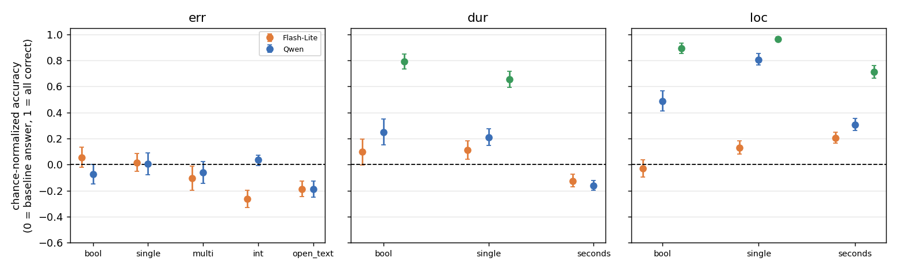
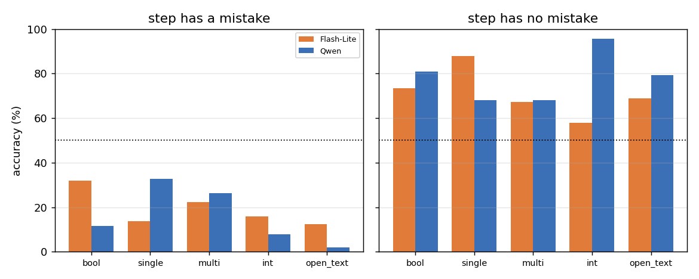

# Q2: Does asking the same fact in a different answer type change accuracy?

Models: Gemini 3.5 Flash-Lite, Qwen3-VL-32B, Gemini 4 Argon (5 duration/localization cells). Data: `cc4d_answer_types_v1`, base group, k = 1 (E1).
Script: `results/cc4d_q2.py`; output: `results/cc4d_q2_out.txt`.

## Outline and conclusions

| Sub-question | Conclusion |
| --- | --- |
| 2.1 Does normalized accuracy differ by type? | **Yes; direction depends on content and model.** In error content almost no type beats the baseline; duration seconds is far worse than bool; localization single beats bool in all three models. |
| 2.2 Ability or answer bias? | **Mostly bias.** In error content accuracy comes almost entirely from no-mistake steps; mistake steps are correct <33% in every type. Changing type changes the tendency to say "no mistake". |
| 2.3 Do models agree? | **No** (model × type p < 0.0001). E.g. localization seconds vs bool: better for Flash-Lite, worse for Qwen and Argon. |
| 2.4 Is correctness consistent across types for the same fact? | **Only slightly.** Overall phi 0.1–0.5, mostly from the mistake/no-mistake split; within a split only 0.16–0.32. |

**Summary:** type changes accuracy, but in error content it mainly changes the tendency to answer "no mistake", not the ability to read the video; type rankings differ by model, so there is no universally better type.

## Method

- k = 1 data. Each fact is asked once per type in independent calls, paired by (recording, fact id); the same fact points to the same step in every type.
- **Comparable types:** error: bool, single, multi, int, open_text (all ask whether a step is wrong and how). Duration/localization: bool, single, seconds only (same step's timing, not identical questions, e.g. "over 31 s?" vs "how many seconds?"). multi and int ask 8 steps at once and are excluded.
- **Normalized accuracy** = (accuracy − baseline)/(1 − baseline); 0 = baseline, 1 = perfect, negative = below baseline. Baseline = max(chance, always-the-majority-answer). Error baseline is 50%; seconds baseline is the best constant chosen after the fact (an upper bound, so duration seconds is harshly negative).
- Intervals: bootstrap over recordings (2,000); differences from bool are paired on the same fact.
- Regression (2.3 only): logistic, `y ~ model * type` (+ `content` for dur/loc), SEs clustered by recording. No multiple-comparison correction.

## 2.1 Normalized accuracy by type

**Conclusion:** the effect of type depends on content and model. Error: nothing clearly above baseline. Duration seconds: below baseline for Flash-Lite and Qwen. Localization single: better than bool in all three models.

**error** (difference from bool in brackets, bold = interval excludes 0 for the difference):

| Type | Flash-Lite | Δ vs bool | Qwen | Δ vs bool |
| --- | --- | --- | --- | --- |
| bool | +0.05 [−0.02, +0.13] | — | −0.07 [−0.15, +0.00] | — |
| single | +0.02 [−0.05, +0.09] | −0.04 | +0.01 [−0.08, +0.09] | +0.08 |
| multi | −0.11 [−0.20, −0.01] | **−0.16** | −0.06 [−0.14, +0.02] | +0.02 |
| int | −0.26 [−0.33, −0.20] | **−0.32** | +0.04 [−0.01, +0.07] | **+0.11** |
| open_text | −0.19 [−0.25, −0.12] | **−0.24** | −0.19 [−0.25, −0.12] | **−0.11** |

- Flash-Lite's multi, int and open_text are worse than "always no mistake". Qwen's int beats bool, its open_text is worse.

**duration and localization** (Δ vs bool in brackets, bold = excludes 0):

| Cell | Flash-Lite | Qwen | Argon |
| --- | --- | --- | --- |
| dur bool | +0.10 | +0.25 | +0.79 |
| dur single | +0.11 (+0.02) | +0.21 (−0.04) | +0.66 (**−0.14**) |
| dur seconds | −0.13 (**−0.22**) | −0.16 (**−0.41**) | not run |
| loc bool | −0.03 | +0.49 | +0.89 |
| loc single | +0.13 (**+0.16**) | +0.81 (**+0.32**) | +0.96 (**+0.07**) |
| loc seconds | +0.21 (**+0.24**) | +0.31 (**−0.18**) | +0.71 (**−0.18**) |

- Localization seconds vs bool flips: Flash-Lite's bool is at chance (−0.03), so seconds looks better; Qwen and Argon have high bool, so seconds is worse.

## 2.2 Ability or bias: error content split

**Conclusion:** mostly bias. In every type, accuracy comes almost entirely from no-mistake steps; mistake steps are correct <33% of the time.

| Model / type | Correct on mistake steps | Correct on no-mistake steps |
| --- | --- | --- |
| Flash-Lite bool | 32.0% | 73.4% |
| Flash-Lite single | 13.7% | 87.9% |
| Flash-Lite multi | 22.3% | 67.2% |
| Flash-Lite int | 16.0% | 57.8% |
| Flash-Lite open_text | 12.5% | 68.8% |
| Qwen bool | 11.7% | 80.9% |
| Qwen single | 32.8% | 68.0% |
| Qwen multi | 26.2% | 68.0% |
| Qwen int | 7.8% | **95.7%** |
| Qwen open_text | 2.0% | 79.3% |

- 256 questions per group. "Always no mistake" would score 0% / 100%; all rows lean that way. Most extreme: Qwen int (almost always 0). Qwen single has the best mistake accuracy (33%) at the cost of no-mistake accuracy (68%).

**Bool in duration/localization: share answering "yes" (k = 1)**

| Model / content | True = yes | True = no |
| --- | --- | --- |
| Argon dur | 90% | 8% |
| Argon loc | 94% | 2% |
| Qwen dur | 40% | 6% |
| Qwen loc | 66% | 7% |
| Flash-Lite dur | 21% | 7% |
| Flash-Lite loc | 14% | 16% |

- Argon discriminates; Qwen leans "no" on dur; Flash-Lite has almost no discrimination on loc bool (14–16% "yes" whatever the truth).

## 2.3 Do models rank types the same way?

**Conclusion:** no; model × type is significant in both blocks.

| Test | Scope | χ² | df | p |
| --- | --- | --- | --- | --- |
| Model × type | duration + localization (bool, single, seconds; 3 models) | 93.6 | 4 | < 0.0001 |
| Model × type | error (5 types; Flash-Lite, Qwen) | 74.0 | 4 | < 0.0001 |

- Error int: worst for Flash-Lite (−0.32 vs bool), best for Qwen (+0.11). Common ground: localization single > bool (3 models), duration seconds < bool (Flash-Lite, Qwen).

## 2.4 Consistency across types for the same fact

**Conclusion:** only slightly. Error content looks consistent overall (phi 0.45–0.53) but that is mostly the mistake/no-mistake split; within each split, 0.16–0.32.

Mean pairwise phi of correct/incorrect across types:

| Model | error all | mistake steps | no-mistake steps | duration | localization |
| --- | --- | --- | --- | --- | --- |
| Flash-Lite | 0.45 | 0.16 | 0.32 | 0.29 | 0.11 |
| Qwen | 0.53 | 0.25 | 0.29 | 0.30 | 0.15 |
| Argon | — | — | — | — | 0.28 |

- Mostly positive even within splits: some facts are easier across types. Small in size; no intervals computed; duration/localization types are not identical questions.

## Limitations

1. k = 1 only; type × k is in Q1 section 3.
2. Seconds baseline is an after-the-fact upper bound.
3. Duration/localization types share a step, not an identical question.
4. open_text judge (`gemini-3.5-flash-lite`) agrees 78% with 100 human labels, strict; may underestimate open_text. Flash-Lite's `typed_v3` scorer was fixed after seeing results.
5. Argon: no error content, no duration seconds. 2.4 has no intervals; no multiple-comparison correction.
