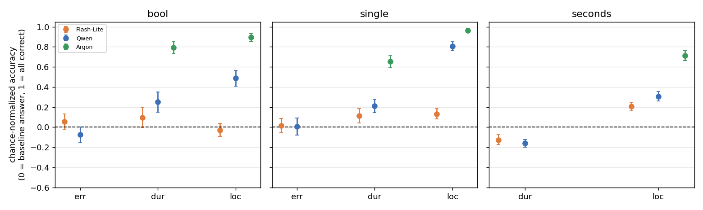
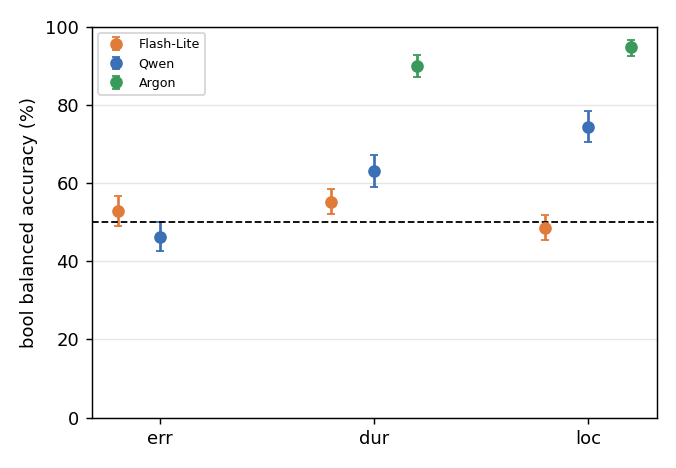

# Q3: How does each model perform on each content?

Models: Gemini 3.5 Flash-Lite, Qwen3-VL-32B, Gemini 4 Argon (duration, localization only). Data: `cc4d_answer_types_v1`, base group, k = 1 (E1); 3.4 also uses k = 4, 8.
Script: `results/cc4d_q3.py` (reuses data and baselines from `cc4d_q2.py`); output: `results/cc4d_q3_out.txt`.

## Outline and conclusions

| Sub-question | Conclusion |
| --- | --- |
| 3.1 Which content is high or low (normalized)? | **Qwen and Argon: localization > duration > error** (Qwen's error is around baseline). **Flash-Lite has no consistent order:** bool near baseline on all three; on single, duration and localization slightly above error. |
| 3.2 Real discrimination or baseline/answer habit? | **Real for Qwen and Argon** (bool balanced accuracy localization > duration > error). **Flash-Lite is about 0.5 everywhere.** |
| 3.3 Do models agree? | **No** (model × content p < 0.001). "Localization best" is clear for Qwen and Argon, barely visible for Flash-Lite. |
| 3.4 Same ranking at k = 4, 8? | **Largely.** Qwen's and Argon's order holds; Qwen's localization falls with k but stays far above the others; Flash-Lite's duration and localization swap. |

**Summary:** on this question set, Qwen and Argon do best on localization, then duration, worst on error; Flash-Lite is near chance on all.

**Important:** descriptive only. The three contents use different facts, wording, options and criteria, so this is "on this set", not "localization is inherently easier".

## Method

- k = 1 data, the same 64 recordings for all contents, so content differences are paired by recording (shared bootstrap draws).
- Only bool and single exist in all three contents, so the main comparison uses them; seconds compares duration vs localization only; multi, int, open_text are not compared.
- **Normalized accuracy** = (accuracy − baseline)/(1 − baseline), baseline = max(chance, majority answer), as in Q2 (seconds baseline is an after-the-fact upper bound). Intervals: bootstrap over recordings (2,000).
- **Balanced accuracy (3.2)** = mean of accuracy on true-"yes" and true-"no" items; 0.5 = no discrimination.
- **Regression (3.3):** logistic, `y ~ model * content` (+ `type` for bool + single), SEs clustered by recording; the seconds test uses Flash-Lite and Qwen only (Argon has no duration seconds). No multiple-comparison correction.

## 3.1 Normalized accuracy by content

**Conclusion:** Qwen and Argon: localization > duration > error. Flash-Lite: no consistent order.

**bool:**

| Model | error | duration | localization | loc − dur |
| --- | --- | --- | --- | --- |
| Flash-Lite | +0.05 | +0.10 | −0.03 | **−0.13** [−0.24, −0.01] |
| Qwen | −0.07 | +0.25 | +0.49 | **+0.24** [+0.12, +0.35] |
| Argon | not run | +0.79 | +0.89 | **+0.10** [+0.03, +0.18] |

**single:**

| Model | error | duration | localization | loc − dur |
| --- | --- | --- | --- | --- |
| Flash-Lite | +0.02 | +0.11 | +0.13 | +0.02 [−0.06, +0.10] |
| Qwen | +0.01 | +0.21 | +0.81 | **+0.60** [+0.52, +0.68] |
| Argon | not run | +0.66 | +0.96 | **+0.31** [+0.25, +0.38] |

**seconds:** Flash-Lite duration −0.13, localization +0.21; Qwen duration −0.16, localization +0.31. Duration seconds is below the best-constant baseline; localization seconds is above it.

- Single, error vs duration: Flash-Lite +0.10 [+0.02, +0.18], Qwen +0.20 [+0.11, +0.29] (duration higher). Error vs localization: Flash-Lite +0.12, Qwen +0.80.
- Flash-Lite's bool localization (−0.03) is below duration (+0.10). Qwen's error is near baseline on bool (−0.07) and single (+0.01).

## 3.2 Real discrimination? Bool balanced accuracy

**Conclusion:** Qwen's and Argon's differences are real; Flash-Lite is about 0.5 on all three.

| Model / content | Balanced acc. [95% CI] | Correct when true = yes | Correct when true = no |
| --- | --- | --- | --- |
| Flash-Lite error | 0.527 [0.490, 0.566] | 0.73 | 0.32 |
| Flash-Lite duration | 0.552 [0.520, 0.584] | 0.21 | 0.90 |
| Flash-Lite localization | 0.484 [0.453, 0.520] | 0.14 | 0.83 |
| Qwen error | 0.463 [0.426, 0.500] | 0.81 | 0.12 |
| Qwen duration | 0.631 [0.591, 0.673] | 0.40 | 0.86 |
| Qwen localization | 0.744 [0.705, 0.783] | 0.65 | 0.84 |
| Argon duration | 0.900 [0.871, 0.927] | 0.89 | 0.91 |
| Argon localization | 0.947 [0.926, 0.967] | 0.93 | 0.96 |

(Error bool asks whether the step was done correctly, so "true = yes" means no mistake.)

- Qwen: loc − dur +0.114 [+0.062, +0.163]; dur − err +0.168 [+0.112, +0.221]; loc − err +0.281 [+0.221, +0.334]. Argon: loc − dur +0.047 [+0.012, +0.084]. Flash-Lite: loc − dur −0.068 [−0.113, −0.018], small.
- Flash-Lite almost always answers "no" on duration/localization bool (14–21% correct when true = yes), so ~50% is a habit, not skill. Qwen leans "no" on duration but still discriminates; on error it leans "no mistake" (81% vs 12%).

## 3.3 Do models rank contents the same way?

**Conclusion:** no; model × content is significant in all three tests.

| Test | Scope | χ² | df | p |
| --- | --- | --- | --- | --- |
| Model × content | duration vs localization (bool + single), 3 models | 152.0 | 2 | < 0.0001 |
| Model × content | error / duration / localization (bool + single), Flash-Lite and Qwen | 240.9 | 2 | < 0.0001 |
| Model × content | seconds, duration vs localization, Flash-Lite and Qwen | 12.0 | 1 | 0.0005 |

- Direction broadly agrees (localization not below duration, except Flash-Lite bool), but sizes differ: single loc − dur is 0.02 (Flash-Lite), 0.31 (Argon), 0.60 (Qwen).

## 3.4 Same ranking at k = 4, 8?

**Conclusion:** largely. Qwen's and Argon's order holds; Flash-Lite's duration and localization swap.

Normalized accuracy, mean of bool and single, same questions at every k:

| Model / content | k = 1 | k = 4 | k = 8 |
| --- | --- | --- | --- |
| Argon duration | 0.72 | 0.69 | 0.72 |
| Argon localization | 0.93 | 0.92 | 0.94 |
| Flash-Lite error | 0.04 | −0.01 | −0.02 |
| Flash-Lite duration | 0.11 | 0.04 | 0.07 |
| Flash-Lite localization | 0.05 | 0.08 | 0.10 |
| Qwen error | −0.03 | −0.06 | −0.08 |
| Qwen duration | 0.23 | 0.20 | 0.17 |
| Qwen localization | 0.65 | 0.57 | 0.51 |

- Flash-Lite flips from duration > localization (k = 1) to the reverse (k = 8) by a small margin; do not over-read. No intervals; the k effect itself is in Q1.

## Limitations

1. Different facts per content; conclusions hold "on this set" only.
2. Only bool and single span all three contents.
3. Argon has no error content or duration seconds; Flash-Lite is mostly near chance.
4. Seconds baseline is an upper bound, so duration seconds is harshly negative.
5. Qwen's long-video resolution was reduced (see Q1). 3.4 has no intervals; no multiple-comparison correction.
