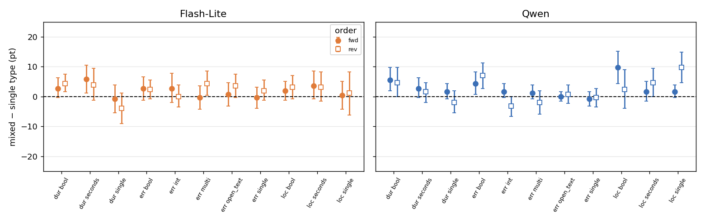
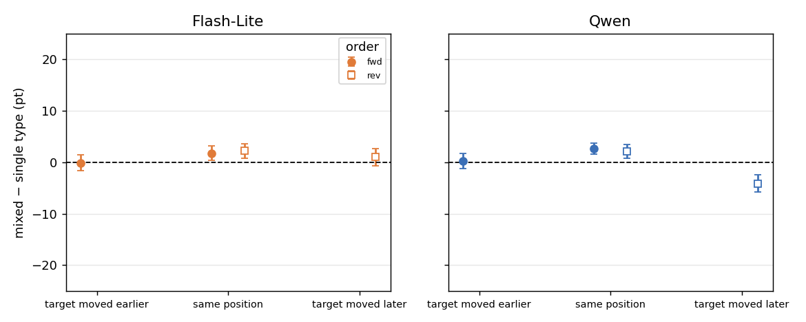

# Q4: Does mixing answer types in one call affect answers to the same questions?

Models: Gemini 3.5 Flash-Lite, Qwen3-VL-32B (Argon has no E4). Data: `cc4d_answer_types_v1`, E4 (mixed types, k = 8) vs E3 (single type, k = 8), forward and reversed.
Script: `results/cc4d_q4.py`; output: `results/cc4d_q4_out.txt`.

## Outline and conclusions

| Sub-question | Conclusion |
| --- | --- |
| 4.1 Does mixing change accuracy on the same questions? | **No harm; a small gain** (both models about +2 pt, interval excludes 0). |
| 4.2 Does it depend on type or content? | **Concentrated in bool** (about +3 to +6 pt); other types near 0. Significant for Qwen (p < 0.0001), borderline for Flash-Lite (p = 0.09). |
| 4.3 Mixing or position change? | **+2 pt appears on position-matched questions, so it is not position.** But moving a target later costs Qwen 4 pt. |
| 4.4 Do models agree? | **Yes** (model × mixing p = 0.62). |

**Summary:** mixing types in one call does not hurt and slightly helps on bool, consistently across models. The cause is unknown and it is not a change in answer bias.

## Method

- **Design:** each E4 call has 8 questions: 4 targets (all type T) and 4 fillers of other types. Only targets are scored, paired with the same (report, fact) in E3 (all 8 questions of type T). In reversed runs the whole order is reversed.
- **Position quirk:** E4 targets are always at positions 1–4 (forward) or 5–8 (reversed); in E3, F1–F4 are at 1–4 and F5–F8 at 5–8. Only half the pairs keep their position:
  - **Position-matched** (clean test of mixing): forward half0, reversed half0.
  - **Position-changed:** forward half1 (moves earlier, 5–8 → 1–4), reversed half1 (moves later, 1–4 → 5–8). An earlier Q4 summary pooled both; here they are separated.
- **Metric:** mixed − single accuracy (pt) with bootstrap-over-recordings 95% intervals (2,000); also counts of right→wrong and wrong→right.
- **Regression:** logistic on stacked E3 + E4 (two rows per fact); `y ~ mixed + cell`; 4.2 adds `mixed × cell`, 4.4 adds `mixed × model`; SEs clustered by recording. No multiple-comparison correction.

## 4.1 Does mixing change accuracy?

**Conclusion:** no harm, small gain: about +2 pt in both models on position-matched questions, consistent in forward and reversed.

| Model | Forward | Reversed | Pooled | Right→wrong | Wrong→right |
| --- | --- | --- | --- | --- | --- |
| Flash-Lite | +1.7 [+0.4, +3.2] | +2.2 [+0.7, +3.6] | **+2.0 [+1.0, +3.1]** | 298 | 408 |
| Qwen | +2.6 [+1.6, +3.7] | +2.1 [+0.7, +3.4] | **+2.4 [+1.4, +3.3]** | 196 | 330 |

(Position-matched pairs, 5,632 per model.) Small: most answers do not change, and changes favor wrong→right. This shows no harm, not that mixing helps.

## 4.2 Does it depend on type or content?

**Conclusion:** the gain is concentrated in bool (about +3 to +6 pt) and a few other cells; single, multi, int, open_text are near 0.

(Position-matched, mixed − single; filled circle = forward, open square = reversed.)

Forward + reversed pooled, 512 per cell:

| Cell | Flash-Lite | Qwen |
| --- | --- | --- |
| dur bool | **+3.5** [+1.2, +6.2] | **+5.1** [+1.8, +8.8] |
| dur single | −2.3 [−5.7, +1.2] | −0.2 [−2.7, +2.3] |
| dur seconds | **+4.9** [+1.4, +8.4] | +2.1 [−0.4, +4.7] |
| err bool | +2.5 [+0.0, +5.1] | **+5.7** [+2.9, +8.6] |
| err single | +0.8 [−1.6, +3.1] | −0.6 [−2.5, +1.4] |
| err multi | +2.0 [−1.0, +4.9] | −0.4 [−2.9, +2.3] |
| err int | +1.4 [−1.8, +4.7] | −0.8 [−2.9, +1.4] |
| err open_text | +2.1 [−0.8, +5.3] | +0.4 [−1.4, +2.1] |
| loc bool | **+2.5** [+0.2, +4.9] | **+6.1** [+1.9, +10.4] |
| loc single | +0.8 [−3.7, +4.9] | **+5.7** [+2.7, +8.6] |
| loc seconds | +3.3 [−0.4, +7.6] | **+3.1** [+0.0, +6.2] |

- Mixed × cell: Qwen χ² = 42.4, df = 10, **p < 0.0001**; Flash-Lite χ² = 16.5, df = 10, p = 0.087.
- Bool is positive in all three contents for both models.
- Answer bias did not change: "yes" rate single → mixed is 29.6% → 31.3% (fwd) and 34.5% → 36.2% (rev) for Flash-Lite, 51.4% → 52.8% and 47.4% → 44.5% for Qwen, all within 3 pt. So the gain is not a habit shift; the cause is unclear.

## 4.3 Mixing or position?

**Conclusion:** the +2 pt is present with position held fixed, so it is not position. Position change itself matters for Qwen: a target moved later loses 4 pt.

| Model | Same (fwd) | Moved earlier (fwd half1) | Same (rev) | Moved later (rev half1) |
| --- | --- | --- | --- | --- |
| Flash-Lite | +1.7 [+0.4, +3.2] | −0.2 [−1.7, +1.4] | +2.2 [+0.7, +3.6] | +1.0 [−0.7, +2.6] |
| Qwen | +2.6 [+1.6, +3.7] | +0.2 [−1.2, +1.7] | +2.1 [+0.7, +3.4] | **−4.1 [−5.8, −2.5]** |

- In position-changed pairs, mixing and position are confounded. Moving earlier shows no change in either model, so the +2 pt is either cancelled or moving earlier gives no benefit.
- Moving later: Flash-Lite no change; Qwen −4.1 pt, consistent with Qwen doing worse later in the call (Q1, Q6). This also explains why the earlier pooled Qwen reversed figure was negative (−1.2 pt): it mixed in moved-later pairs.

## 4.4 Do models agree?

**Conclusion:** yes. Mixed × model: χ² = 0.25, df = 1, p = 0.62; both show a small gain concentrated in bool.

## Limitations

1. No E4b (single-type fillers), so which filler type matters is unknown; filler types rotate across reports and were not split.
2. Two models; Argon has no E4.
3. Targets in one call are not independent; handled by bootstrap/clustering over recordings.
4. Cause of the gain unknown. Position-changed pairs (4.3) confound mixing and position.
5. open_text judge agrees 78% with 100 human labels, strict. No multiple-comparison correction.
