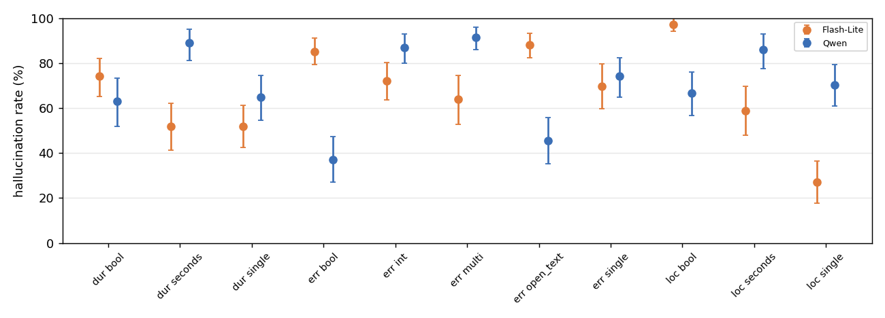
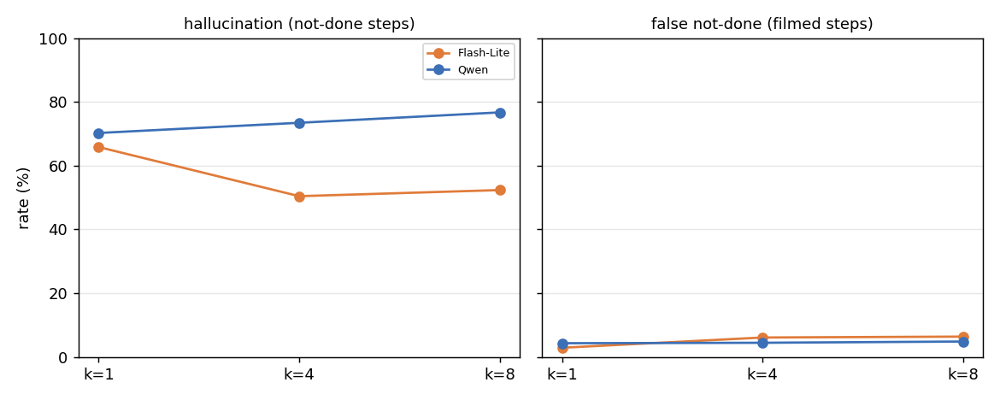
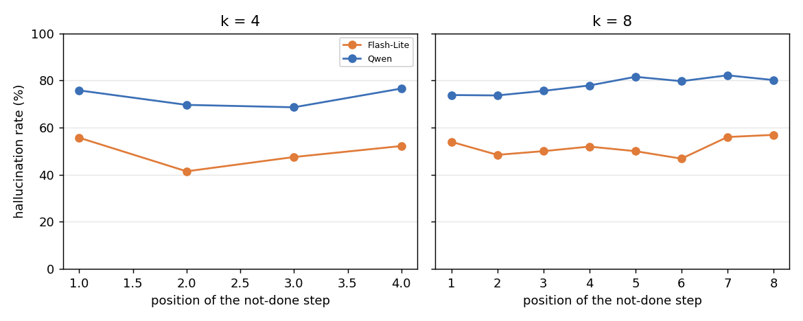

# Q5: Do answer type and k affect hallucination? Does the position of a not-done step matter?

Models: Gemini 3.5 Flash-Lite, Qwen3-VL-32B (Argon not run). Data: `cc4d_answer_types_v1` not_done (k = 1), h4, h8 (k = 4, 8; forward and reversed) and the matching E5 groups (k up to 16).
Script: `results/cc4d_q5.py`; output: `results/cc4d_q5_out.txt`.

## Outline and conclusions

| Sub-question | Conclusion |
| --- | --- |
| 5.1 Hallucination by type | **Type matters a lot and rankings differ by model.** Flash-Lite is worst on loc bool (97%), err open_text (88%), err bool (85%) and best on loc single (27%); Qwen is worst on err multi (91%), dur seconds (89%) and best on err bool (37%), err open_text (45%). |
| 5.2 Effect of k | **Opposite directions.** Flash-Lite hallucinates less with k (66% → 50% → 52%) but falsely calls filmed steps not visible more (2.9% → 6.4%); Qwen rises slightly (70% → 74% → 77%). |
| 5.3 Position of the not-done step | **No clear effect.** Flash-Lite none; Qwen slightly higher later (k = 8: 74% → 82%), not significant (p = 0.098). |
| 5.4 Does a not-done step disturb other questions? | **Almost never.** Other questions change within ±1.1 pt; only two cells have intervals excluding 0. |
| 5.5 False alarms in error content | **Fall with k** in both models: more "no mistake" answers as k grows. |

**Summary:** hallucination is driven mainly by answer type, with a different best and worst type per model. More questions help Flash-Lite (while it also misses more filmed steps) but not Qwen, which gets slightly worse. Where the not-done step sits in the call makes no clear difference.

## Method

- **Not-done step:** in the recipe but not filmed (Missing Step). Every question allows `not_visible`, which is the correct answer for these.
- **Hallucination rate:** share of not-done steps answered with anything other than `not_visible`. The denominator is valid answers only (about 4% invalid excluded), so numbers differ slightly from the earlier Qwen analysis (73/73/77%).
- **False not-done:** share of filmed steps answered `not_visible`.
- **E1 (k = 1):** 108 not-done steps × 11 cells, asked individually.
- **H batch (k > 1):** one question of an original batch is swapped for the report's not-done step; the swapped position rotates across reports, covering all positions at k = 4 and 8.
- **Across k (5.2):** same not-done steps present at k = 1, 4, 8 (about 500 per model), forward.
- Intervals: bootstrap over recordings (2,000). Regression: 5.2 `hall ~ log2(k) + cell`; 5.3 `hall ~ posfrac + log2(k) + cell`; SEs clustered by recording. No multiple-comparison correction.

## 5.1 Hallucination by type (k = 1)

**Conclusion:** type matters a lot, but rankings disagree; no type is always the worst.

| Cell | Flash-Lite | Qwen |
| --- | --- | --- |
| All | 67.4% [61.5, 73.2] | 70.4% [63.3, 76.8] |
| dur bool | 74.1% | 63.0% |
| dur single | 51.9% | 64.8% |
| dur seconds | 51.9% | 88.9% |
| err bool | 85.2% | **37.0%** |
| err single | 69.7% | 74.1% |
| err multi | 64.0% (n = 75) | **91.3%** |
| err int | 72.2% | 87.0% |
| err open_text | **88.0%** | **45.4%** |
| loc bool | **97.2%** | 66.7% |
| loc single | **27.1%** | 70.4% |
| loc seconds | 58.9% | 86.1% |

- Flash-Lite almost never says "not visible" on loc bool; why loc single is so low is not confirmed.
- Qwen's low rates on err bool and err open_text are the cells where it always says "no mistake" (Q2), so it is not better judgment.
- Flash-Lite err multi has only 75 valid answers (33 format errors), so that estimate is unstable.

**False not-done (filmed step called not visible), k = 1:** Flash-Lite 2.9% overall (loc single highest, 13.9%; others ≤ 2.3%); Qwen 4.3% (err open_text 17.4%, err bool 10.5%; others mostly ≤ 5%). Cells with low hallucination often have higher false not-done: the model buys a lower rate by saying "not visible" more.

## 5.2 Effect of k

**Conclusion:** opposite directions. Flash-Lite's hallucination falls with k while false not-done rises; Qwen's rises slightly.

(Same not-done steps at every k; right panel = filmed steps answered `not_visible`.)

| Model | k = 1 | k = 4 | k = 8 | Log-odds per doubling [95% CI] |
| --- | --- | --- | --- | --- |
| Flash-Lite hallucination | 65.8% [58.9, 73.3] | 50.4% [41.8, 60.2] | 52.4% [44.2, 60.8] | **−0.246** [−0.332, −0.160] |
| Qwen hallucination | 70.3% [61.0, 78.8] | 73.5% [63.5, 82.7] | 76.7% [68.6, 84.5] | **+0.113** [+0.044, +0.181] |
| Flash-Lite false not-done | 2.9% | 6.1% | 6.4% | — |
| Qwen false not-done | 4.3% | 4.5% | 4.8% | — |

**By type (k = 1 → 4 → 8, same steps):**

| Type | Flash-Lite | Qwen |
| --- | --- | --- |
| bool | 91% → 69% → 72% | 60% → 64% → 68% |
| single | 50% → 32% → 35% | 69% → 73% → 75% |
| multi | 50% → 41% → 42% | 90% → 86% → 83% |
| int | 62% → 52% → 68% | 83% → 88% → 98% |
| open_text | 91% → 70% → 62% | 51% → 57% → 62% |
| seconds | 44% → 39% → 38% | 83% → 84% → 86% |

- Flash-Lite drops most on bool and open_text; Qwen rises most on int (83% → 98%). Flash-Lite single false not-done goes 6% → 12%, the clearest sign of more conservatism.

**E5 (longer videos, k up to 16, forward):**

| Model / content | k = 1 | k = 4 | k = 8 | k = 16 |
| --- | --- | --- | --- | --- |
| Flash-Lite loc | 81% | 64% | 65% | 62% |
| Flash-Lite dur | 61% | 40% | 43% | 53% |
| Qwen loc | 94% | 89% | 88% | 83% |
| Qwen dur | 95% | 96% | 97% | 97% |

- E5 has few not-done steps (24–144 per cell), so trends only. Flash-Lite dur rebounds at k = 16.

## 5.3 Position of the not-done step

**Conclusion:** no clear position effect.

Position within the H batch (k = 4, 8; forward + reversed):

| Model | `posfrac` [95% CI] | p | k = 8 hallucination by position 1–8 |
| --- | --- | --- | --- |
| Flash-Lite | −0.007 [−0.154, +0.140] | 0.93 | 54 / 48 / 50 / 52 / 50 / 47 / 56 / 57% |
| Qwen | +0.153 [−0.028, +0.333] | 0.098 | 74 / 74 / 76 / 78 / 82 / 80 / 82 / 80% |

- Qwen is slightly higher later (74% → 80–82%), interval includes 0; k = 4 shows no trend (76 / 70 / 69 / 77%).
- **Not done:** the proposal also wanted the step's position in the recipe (distance from video end). Step ids are global across recipes, not recipe order, so this would need a separate mapping.

## 5.4 Does a not-done step disturb other questions?

**Conclusion:** almost never. Other k − 1 questions vs the same ones in the original batch change by ≤ 1.1 pt.

| Model / k / order | Change (pt) [95% CI] | Right→wrong | Wrong→right |
| --- | --- | --- | --- |
| Flash-Lite k = 4 fwd | −0.3 [−1.3, +0.8] | 210 | 201 |
| Flash-Lite k = 4 rev | **−1.1 [−2.2, −0.1]** | 216 | 182 |
| Flash-Lite k = 8 fwd | +0.2 [−0.9, +1.2] | 218 | 224 |
| Flash-Lite k = 8 rev | +1.0 [−0.2, +2.2] | 179 | 216 |
| Qwen k = 4 fwd | **−1.0 [−1.8, −0.1]** | 106 | 76 |
| Qwen k = 4 rev | −0.5 [−1.6, +0.6] | 108 | 92 |
| Qwen k = 8 fwd | −0.7 [−1.7, +0.4] | 92 | 68 |
| Qwen k = 8 rev | −0.1 [−1.3, +1.1] | 129 | 127 |

- Only two of eight intervals exclude 0 (both about −1 pt); the rest have mixed signs.

## 5.5 False alarms in error content

**Conclusion:** the share of no-mistake steps called mistakes falls with k in most types for both models, consistent with Q1/Q2 (more "no mistake" at higher k).

k = 1 → 4 → 8:

| Type | Flash-Lite | Qwen |
| --- | --- | --- |
| bool | 27% → 18% → 21% | 19% → 16% → 19% |
| single | 12% → 16% → 13% | 32% → 12% → 8% |
| multi | 33% → 13% → 16% | 32% → 14% → 9% |
| int | 42% → 20% → 14% | 4% → 1% → 0% |
| open_text | 31% → 23% → 18% | 21% → 13% → 7% |

- For Qwen, false alarms fall while hallucination rises: it gives a confident answer more often ("no mistake", or a concrete answer for a not-done step) rather than being uniformly more conservative. Flash-Lite is conservative overall: fewer false alarms, more false not-done, less hallucination.

## Limitations

1. Two models only (no Argon).
2. Same not-done step recurs across types, so questions are not independent (bootstrap over recordings); E5 counts are small.
3. Hallucination depends on the prompt's `not_visible` wording (Flash-Lite's first multi_choice run lacked it; re-run, see Flash-Lite README). Flash-Lite err multi has 33 format errors.
4. Recipe position of not-done steps not analysed. No multiple-comparison correction.
