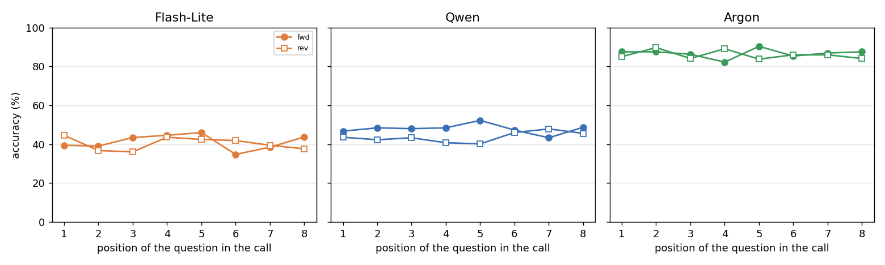
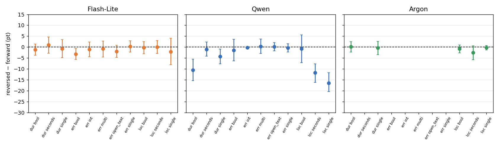

# Q6:題目在 call 裡的位置(順序)會不會影響準確率?

模型:Gemini 3.5 Flash-Lite、Qwen3-VL-32B(k = 4、8;E5 到 k = 16)、Gemini 4 Argon(只有 base 組 k = 8,5 個格子)。資料:`cc4d_answer_types_v1` 每個 k > 1 的 batch 各跑一次正序、一次倒序;同一題在正序是第 p 題,在倒序是第 k + 1 − p 題。
腳本:`results/cc4d_q6.py`、`results/cc4d_q6_shift.py`;完整輸出:`results/cc4d_q6_out.txt`、`results/cc4d_q6_shift_out.txt`。

## 大綱與結論

| 子問題 | 結論 |
| --- | --- |
| 6.1 倒序後,同一題的準確率有沒有變? | **只有 Qwen 會變差,而且題數越多越嚴重**:k = 8 是 −4.2 pt,E5 的 k = 16 localization 是 −19.0 pt。Flash-Lite 與 Argon 看不出差異 |
| 6.2 是「排在後面比較差」嗎? | **不是。** 同一題排在後面或前面,準確率幾乎沒差(多數 ±1 pt 內)。Qwen 的下降來自「倒序」本身,不是位置 |
| 6.3 倒序的影響是否隨內容、題型、題數不同? | **會,只出現在 Qwen。** 集中在 localization 的 single / seconds 與 duration 的 bool(−10 到 −16 pt),error 內容幾乎沒有;題數越多越嚴重 |
| 6.4 是不是格式錯誤造成的? | **不是。** Qwen 倒序的格式錯誤幾乎為 0;Flash-Lite 在 E5 倒序有 2.7 到 3.0% 格式錯誤,扣掉之後結論不變 |
| 6.5 模型是否一致? | **不一致**(倒序 × 模型交互 p < 0.0001),Qwen 與另外兩個模型不同 |

**一句話總結:** 題目排列順序的影響是 Qwen 特有的:把題目順序反過來會讓它變差,題數越多越嚴重(k = 16 的 localization 掉約 19 pt);原因不是「排在後面比較差」。兩個 Gemini 模型不受影響。

## 方法

- **配對:** 同一個(報告, 事實)在正序與倒序各問一次,逐題配對比較(倒序 − 正序)。只用有影片的題目,不含沒做的步驟。
- **位置:** 由題目在報告欄位順序中的位置算出,正序第 p 題,倒序為第 k + 1 − p 題。
- **指標:** 準確率差(百分點),依錄影 bootstrap 2,000 次的 95% 區間。
- **「晚 − 早」(6.2):** 對每一題,比較它排在較後面時與較前面時的答對與否(奇數 k 的正中間那題不算)。這個比較在同一題內,所以不受題目難度影響。
- **回歸:** 邏輯斯回歸,依變項 `y` = 是否答對;解釋變項 `posfrac`(位置,0 = 第一題、1 = 最後一題)、`rev`(0 = 正序、1 = 倒序)、`cell`(內容 × 題型);6.3 加 `rev × cell` 與 `rev × log2(k)`,6.5 加 `rev × model`。標準誤依錄影群集。
- 沒有多重比較校正。
- **資料範圍:** Flash-Lite 與 Qwen 有主實驗(k = 4、8,11 格,各 5,632 題)與 E5(localization、duration,k = 4、8、16);Argon 只有 base 組 k = 8 的 5 格(2,560 題)。

## 6.1 倒序後準確率有沒有變

**結論:** 只有 Qwen 會變差,而且題數越多越嚴重。

倒序 − 正序,百分點:

| 模型 / 資料 | k = 4 | k = 8 | k = 16 |
| --- | --- | --- | --- |
| Qwen 主實驗 | +0.7 [−0.5, +1.8] | **−4.2 [−5.6, −2.7]** | — |
| Qwen E5 localization | +0.2 | −2.1 [−4.7, +0.6] | **−19.0 [−22.5, −14.9]** |
| Qwen E5 duration | +0.1 | −1.9 [−3.6, +0.1] | **−6.8 [−9.4, −4.2]** |
| Flash-Lite 主實驗 | −0.0 [−1.2, +1.3] | −0.9 [−2.0, +0.3] | — |
| Flash-Lite E5 localization | +0.5 | −0.6 | −1.4 [−3.8, +1.2] |
| Flash-Lite E5 duration | +0.1 | +0.4 | **−2.6 [−4.5, −0.5]** |
| Argon 主實驗(5 格) | — | −0.7 [−2.1, +0.4] | — |

- Qwen 在 k = 4 看不出差異,k = 8 開始變差,k = 16 時 localization 的倒序準確率只有 34.5%,正序是 53.5%。
- Flash-Lite 只有 E5 duration 的 k = 16 有一格區間不含 0(−2.6 pt),其他都在零附近。
- Argon 的 −0.7 pt 區間含 0。

## 6.2 是「排在後面比較差」嗎

**結論:** 不是。同一題排在後面或前面,準確率幾乎沒差;Qwen 的倒序下降不能用位置解釋。

(主實驗 k = 8,各位置的準確率,實心圓 = 正序,空心方塊 = 倒序。縱軸已對齊。)

同一題「晚 − 早」(百分點,正值代表排後面比較好):

| 模型 / 資料 | k = 4 | k = 8 | k = 16 |
| --- | --- | --- | --- |
| Flash-Lite 主實驗 | +0.6 | −0.4 | — |
| Flash-Lite E5 localization | +1.7 | −0.6 | +0.7 |
| Flash-Lite E5 duration | +0.8 | −0.3 | −1.2 |
| Qwen 主實驗 | +0.2 | **+1.2 [+0.2, +2.1]** | — |
| Qwen E5 localization | −0.8 | −0.5 | **+3.2 [+0.4, +6.0]** |
| Qwen E5 duration | +0.3 | −1.6 | −0.7 |
| Argon 主實驗 | — | −0.2 | — |

- 所有值都在 ±3.2 pt 內,區間多數含 0;有兩格顯著的 Qwen 反而是排後面比較好。
- 迴歸(主實驗 k = 8),`posfrac` 是位置效應,`rev` 是在相同位置下的倒序效應:

| 模型 | posfrac [95% CI] | p | rev [95% CI] | p |
| --- | --- | --- | --- | --- |
| Flash-Lite | −0.030 [−0.100, +0.040] | 0.40 | −0.039 [−0.088, +0.011] | 0.13 |
| Qwen | +0.073 [+0.004, +0.142] | 0.039 | **−0.187 [−0.252, −0.122]** | < 0.0001 |
| Argon | −0.088 [−0.245, +0.069] | 0.27 | −0.069 [−0.187, +0.049] | 0.25 |

- 控制了位置之後,Qwen 的 `rev` 仍然顯著負。也就是說,把題目順序反過來這件事本身讓 Qwen 變差,不是因為某些題被排到後面。

**一個診斷(只做了 Qwen、E5 localization 的單選題,640 題):** 看 Qwen 對第 i 題給的答案,是否更像第 i ± 1 題的正確答案。

| 條件 | 對自己那題的準確率 | 對前一題的答案命中率 | 對後一題的答案命中率 |
| --- | --- | --- | --- |
| 正序 k = 16 | 68.8% | 19.0% | 21.2% |
| 倒序 k = 16 | **45.9%** | **25.7%** | **24.2%** |
| 正序 k = 8 | 70.3% | 19.2% | 20.5% |
| 倒序 k = 8 | 66.4% | 21.5% | 25.0% |

- 正序時,對前一題與後一題的命中率約 19 到 21%,是亂猜水準;倒序 k = 16 時升到 24 到 26%,代表倒序時有一部分答案被錯放到相鄰題(差一格)。
- 這只解釋了一小部分下降(準確率掉了 23 pt,錯位的額外命中約 5 到 6 pt),大部分下降的原因還不清楚。這個診斷只做了一種題型,我不會把它當成結論。

## 6.3 倒序的影響是否隨內容、題型、題數不同

**結論:** 會,而且只出現在 Qwen。集中在 localization 的 single 與 seconds、duration 的 bool,error 內容幾乎沒有;題數越多越嚴重。

(k = 8,倒序 − 正序,縱軸已對齊。)

Qwen,k = 8,每格 512 題:

| 格子 | 倒序 − 正序(pt) | 格子 | 倒序 − 正序(pt) |
| --- | --- | --- | --- |
| loc single | **−16.4** [−20.4, −11.7] | err bool | −1.4 [−6.2, +3.6] |
| loc seconds | **−11.7** [−16.1, −7.6] | err single | −0.4 [−2.3, +1.6] |
| dur bool | **−10.5** [−15.4, −5.5] | err multi | +0.4 [−2.9, +3.7] |
| dur single | **−4.3** [−7.7, −0.9] | err open_text | +0.2 [−1.7, +2.0] |
| dur seconds | −1.0 [−4.2, +2.3] | err int | −0.2 [−0.6, +0.0] |
| loc bool | −0.8 [−7.1, +5.6] | | |

- 倒序 × 格子的交互:Qwen χ² = 140.2,df = 10,**p < 0.0001**;Flash-Lite χ² = 5.5,df = 10,p = 0.86;Argon χ² = 1.6,df = 4,p = 0.80。
- 倒序 × log2(k):Qwen 係數 −0.219,**p < 0.0001**;Flash-Lite −0.038,p = 0.24。
- Qwen 下降的格子正是它準確率較高的 duration 與 localization(見 Q3);error 內容原本就在基線附近,沒有可以掉的空間。

## 6.4 是不是格式錯誤造成的

**結論:** 不是。格式錯誤的答案算答錯,如果倒序格式錯誤比較多,可能製造假的差異。

| 模型 / 資料 | 格式錯誤:正序 | 格式錯誤:倒序 | 只用兩邊都有效的題,倒序 − 正序 |
| --- | --- | --- | --- |
| Qwen 主實驗 k = 8 | 0.0% | 0.1% | −4.2 [−5.6, −2.7] |
| Qwen E5 localization k = 16 | 0.0% | 0.0% | −19.0 [−22.5, −14.9] |
| Flash-Lite 主實驗 k = 8 | 0.8% | 0.5% | −1.1 [−2.2, +0.1] |
| Flash-Lite E5 localization k = 16 | 0.0% | 2.7% | −0.4 [−2.5, +1.7] |
| Flash-Lite E5 duration k = 16 | 0.0% | 3.0% | −1.6 [−3.6, +0.6] |

- Qwen 的格式錯誤幾乎為 0,所以下降是真實的答案錯誤。
- Flash-Lite 在 E5 倒序有 2.7 到 3.0% 格式錯誤;扣掉之後,duration k = 16 的 −2.6 pt 縮小到 −1.6 pt,區間含 0。

## 6.5 模型是否一致

**結論:** 不一致。倒序 × 模型的交互 χ² = 36.5,df = 2,p < 0.0001。

在三個模型共有的 5 個格子(k = 8):

| 模型 | 倒序 − 正序(pt) |
| --- | --- |
| Flash-Lite | −0.9 [−2.5, +0.8] |
| Qwen | **−8.8 [−11.2, −6.3]** |
| Argon | −0.7 [−2.1, +0.4] |

## 限制

1. 倒序只反轉題目順序,選項順序不變;所以只回答「題目順序反過來」,沒有分開檢驗其他位置排列(提案已把隨機洗牌列為延後)。
2. Argon 只有 k = 8 的 5 個格子,沒有 k = 4、E5、error 內容。
3. 6.2 的位置診斷只做了 Qwen 的 E5 localization 單選題,不能推論到其他題型。
4. Qwen 倒序變差的主要原因還不清楚。差一格的錯位只解釋了一部分。
5. Qwen 的長影片解析度被降低(見 Q1),與其他兩個模型不是同一個條件。
6. 沒有多重比較校正。
