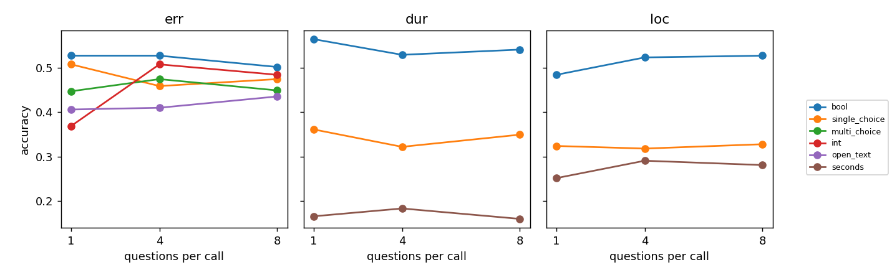
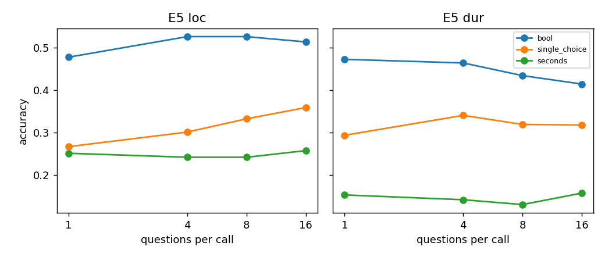
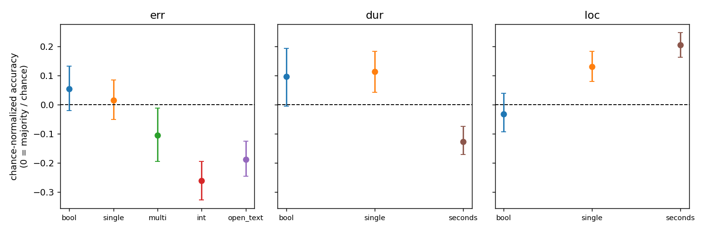
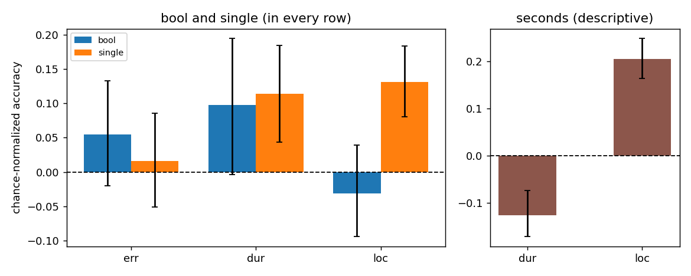
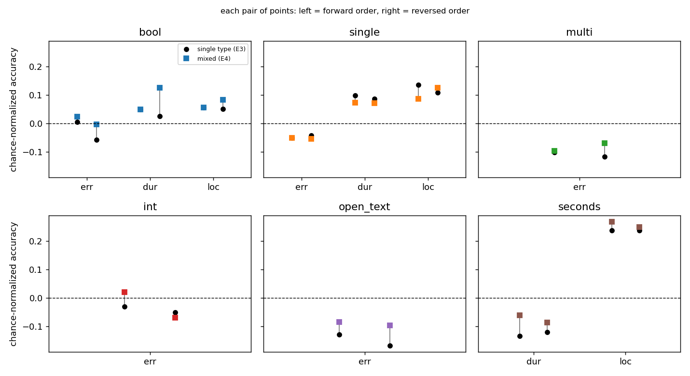
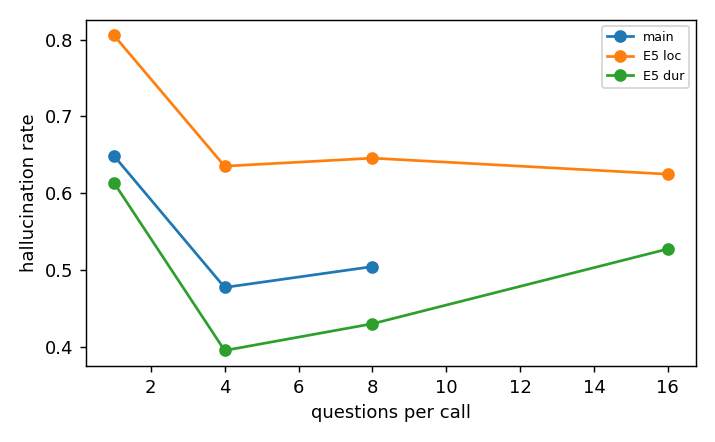
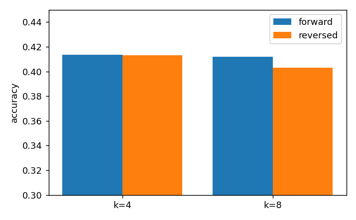

# Flash-Lite results summary (Q1–Q6 of `docs/cc4d_answer_type_proposal.md`)

Chinese version: `analysis.md`. Both say the same thing.

Overall: accuracy is mostly close to chance, and the effects for Q1, Q2, Q4 and Q6 are mostly not significant. The clear signals are the answer bias in bool/single and hallucination. All comparisons are paired on the same question. Figures are rebuilt by `make_figs.py` and `make_q234.py`.

## Research questions and current conclusions

| Question | Current conclusion (Flash-Lite) | Confidence |
| --- | --- | --- |
| Q1 Does accuracy change with more questions per call? | Almost no change in the main experiment (40.1 → 41.3 → 41.2%, borderline). Only err_int rises; in E5 up to 16 questions, localization single rises and duration bool falls | Low: the model is near chance |
| Q2 Does accuracy change when the same fact is asked in a different answer type? | Yes, and the direction depends on the content: in the err row only bool and single reach the baseline, while multi, int and open_text fall below "always answer no mistake"; in the dur row seconds is below the best constant answer; in the loc row seconds and single are above the baseline and bool is at it. Most of the difference comes from answer bias (towards "no mistake" / "no") | Medium |
| Q3 How does the model do on each content? | No consistent difficulty order: bool is near the baseline on all three contents; single is higher on dur and loc than on err (+0.10, +0.12); err has the weakest mistake detection | Medium (descriptive only) |
| Q4 Does mixing answer types affect the same question? | No harm; pooled +0.8 pt (forward, interval includes 0) and +1.6 pt (reversed, [+0.6, +2.6]), a small effect | Medium |
| Q5 Do answer type and question count affect hallucination? | Answer type matters a lot (bool is worst); hallucination falls as the question count rises, but false not-done rises with it, so it is not monotone | Medium |
| Q6 Does question position / order matter? | No clear effect (k = 8: −0.9 pt, z = −1.8, borderline) | Low |

## Q1 Question count

- Overall 40.1% → 41.3% → 41.2%; k1→k4 +1.2 pt (z = 2.1), k1→k8 +1.1 pt (z = 1.9), borderline.
- The only clear change is err_int: 37% → 51% → 48%; everything else is within ±5 pt.

- E5: localization single 27% → 36% (rises); duration bool 47% → 42% (falls); no trend elsewhere. No confidence intervals computed.

## Q2 The same fact in a different answer type (E1, k = 1)

Correction: corrected accuracy = (accuracy − baseline) / (1 − baseline). 0 means only the baseline answer, 1 means all correct, and negative means worse than the baseline. The baseline is the larger of chance and majority: for bool, 0.5 or the majority class; for single, 1 / number of options (err 6, dur 4, loc 5, weighted by the number of accepted answers) or the letter that is correct most often; for multi and int, the most common target; for open_text, always answering "none"; for seconds, the "best constant answer" (a constant picked after the fact, without seeing the video, so an upper bound). The same fact has the same baseline in every type. Intervals are bootstrap over recordings (64 videos, 2,000 draws), with the baseline held fixed and no multiple-comparison correction.

| Content | Type | Accuracy | Baseline (chance / majority) | Corrected [95% CI] |
| --- | --- | --- | --- | --- |
| err | bool | 0.527 | 0.50 / 0.50 | +0.05 [−0.02, +0.13] |
| err | single | 0.508 | 0.18 / 0.50 | +0.02 [−0.05, +0.09] |
| err | multi | 0.447 | – / 0.50 | −0.11 [−0.20, −0.01] |
| err | int | 0.369 | – / 0.50 | −0.26 [−0.33, −0.20] |
| err | open_text | 0.406 | – / 0.50 | −0.19 [−0.25, −0.12] |
| dur | bool | 0.564 | 0.50 / 0.52 | +0.10 [−0.00, +0.19] |
| dur | single | 0.361 | 0.25 / 0.28 | +0.11 [+0.04, +0.18] |
| dur | seconds | 0.166 | – / 0.26 | −0.13 [−0.17, −0.07] |
| loc | bool | 0.484 | 0.50 / 0.50 | −0.03 [−0.09, +0.04] |
| loc | single | 0.324 | 0.20 / 0.22 | +0.13 [+0.08, +0.18] |
| loc | seconds | 0.252 | – / 0.06 | +0.21 [+0.16, +0.25] |

Difference from bool (corrected, paired on the same fact): err: single −0.04 [−0.12, +0.05], multi −0.16 [−0.27, −0.05], open_text −0.24 [−0.34, −0.14], int −0.32 [−0.41, −0.22]; dur: single +0.02 [−0.06, +0.10], seconds −0.22 [−0.31, −0.13]; loc: single +0.16 [+0.07, +0.25], seconds +0.24 [+0.16, +0.31].

**Conclusions:**
- The answer type changes the result, and the direction depends on the content. In the err row only bool and single reach the baseline, and multi, int and open_text are all below "always answer no mistake". In the dur row bool and single are above the baseline and seconds is below the best constant answer. In the loc row seconds and single are above the baseline, while bool is at it.
- In the err row, accuracy comes almost entirely from steps with no mistake (accuracy, mistake / no mistake): bool 32% / 73%, single 14% / 88%, multi 22% / 67%, int 16% / 58%, open_text 13% / 69%. The model is very poor at detecting mistakes; changing the type mostly changes how often it says "no mistake".
- In the loc row bool is at the baseline but seconds is above the best constant answer, although both ask about the same time point. Bool answers "yes" only 15% of the time: the bias outweighs the ability.
- Limits: the err-row baseline is 50% by design; the seconds baseline is an upper bound, so the negative dur seconds value is harsh; the +0.21 for loc seconds depends on the mm:ss rule added after the fact (see "Rerun").

## Q3 Content (E1, k = 1)

Contents are compared only for bool and single (the types present in all three rows). Seconds exists only for dur and loc and is shown separately as descriptive.

| Comparison (corrected) | Difference [95% CI] |
| --- | --- |
| bool: dur − err | +0.04 [−0.09, +0.17] |
| bool: loc − err | −0.09 [−0.18, +0.02] |
| single: dur − err | +0.10 [+0.02, +0.18] |
| single: loc − err | +0.12 [+0.03, +0.19] |
| seconds: loc − dur (descriptive) | +0.33 [+0.28, +0.38] |

**Conclusions:**
- Bool is near the baseline on all three contents, with no distinguishable difference between them.
- Single is higher on dur and loc than on err (+0.10, +0.12); err is the worst of the three, consistent with Q2: the model does not detect mistakes.
- No content is best or worst for every type; the order depends on the type, so error / duration / localization cannot be ranked by difficulty.
- Seconds is higher on loc than on dur, but the two have different baselines and loc depends on the mm:ss rule, so this is descriptive only.

## Q4 Mixed answer types (E4 vs E3, target questions only)

The accuracy of a target question in a mixed call is paired with the accuracy of the same question in a single-type call (E3), in the same order (forward with forward, reversed with reversed, so the targets sit at the same positions). Differences are in percentage points; intervals are bootstrap over recordings.

| Order | Content | Type | Single type | Mixed | Difference (pt) [95% CI] | r→w | w→r |
| --- | --- | --- | --- | --- | --- | --- | --- |
| fwd | err | bool | 0.502 | 0.512 | +1.0 [−2.0, +3.9] | 44 | 49 |
| fwd | err | single | 0.475 | 0.475 | +0.0 [−3.1, +3.1] | 25 | 25 |
| fwd | err | multi | 0.449 | 0.451 | +0.2 [−2.7, +3.1] | 26 | 27 |
| fwd | err | int | 0.484 | 0.510 | +2.5 [−0.6, +5.9] | 25 | 38 |
| fwd | err | open_text | 0.436 | 0.457 | +2.1 [−1.0, +5.5] | 23 | 34 |
| fwd | dur | bool | 0.541 | 0.541 | +0.0 [−3.1, +2.9] | 23 | 23 |
| fwd | dur | single | 0.350 | 0.332 | −1.8 [−4.9, +1.4] | 45 | 36 |
| fwd | dur | seconds | 0.160 | 0.215 | +5.5 [+2.0, +8.8] | 33 | 61 |
| fwd | loc | bool | 0.527 | 0.527 | +0.0 [−2.1, +2.1] | 23 | 23 |
| fwd | loc | single | 0.328 | 0.289 | −3.9 [−8.4, +0.6] | 63 | 43 |
| fwd | loc | seconds | 0.281 | 0.311 | +2.9 [+0.0, +6.4] | 28 | 43 |
| rev | err | bool | 0.471 | 0.498 | +2.7 [+0.2, +5.3] | 26 | 40 |
| rev | err | single | 0.479 | 0.473 | −0.6 [−2.9, +1.6] | 21 | 18 |
| rev | err | multi | 0.441 | 0.465 | +2.3 [−1.2, +6.1] | 17 | 29 |
| rev | err | int | 0.475 | 0.465 | −1.0 [−4.1, +2.1] | 28 | 23 |
| rev | err | open_text | 0.416 | 0.451 | +3.5 [+0.8, +6.4] | 20 | 38 |
| rev | dur | bool | 0.529 | 0.578 | +4.9 [+2.1, +7.6] | 13 | 38 |
| rev | dur | single | 0.342 | 0.330 | −1.2 [−4.9, +2.3] | 48 | 42 |
| rev | dur | seconds | 0.170 | 0.195 | +2.5 [−1.4, +6.6] | 45 | 58 |
| rev | loc | bool | 0.525 | 0.541 | +1.6 [−1.6, +4.7] | 30 | 38 |
| rev | loc | single | 0.307 | 0.320 | +1.4 [−3.1, +5.9] | 55 | 62 |
| rev | loc | seconds | 0.281 | 0.293 | +1.2 [−2.0, +4.5] | 34 | 40 |

Pooled over the 11 cells: forward +0.8 pt [−0.3, +1.9], reversed +1.6 pt [+0.6, +2.6]; forward r→w 358, w→r 402; reversed 337, 426.

**Conclusions:**
- Mixing types caused no visible harm: no cell is significantly worse (the worst, loc single forward, is −3.9 pt with an interval that includes 0).
- If there is an effect, it is a small improvement (about +1–2 pt), mainly from the 5 cells whose interval excludes 0, all positive (dur seconds, dur bool, err bool, err open_text, loc seconds). Among 22 tests about 1 is expected to be significant by chance, so 5 is more than pure noise, but the effect is small and there is no multiple-comparison correction, so it should not be written up as "mixing helps".
- For this model the filler types more likely changed the answer bias than the ability, so this question needs to be checked again on a stronger model.

## Q5 Hallucination

- k = 1: 65% still answer for a step that was not filmed; bool is worst (loc 97%, err 85%), single loc is best (27%).
- k = 4 / 8: about 48–50%; E5 k = 16 still 53–62% (loc 62%, dur 53%).
- The reverse error, false not-done (answering not_visible on a filmed step), rises with question count: single 6% → 12%, multi 2% → 7%. The drop in hallucination is partly bought by saying "can't see" more often, so both must be reported.

## Q6 Order

- k = 4: 0.0 pt; k = 8: −0.9 pt (z = −1.8, borderline).

## Rerun and scoring rules (4 Nov)

The `seconds` and `multi_choice` fields were rerun with the new prompt (9,633 calls, US$171); every other field keeps its first-pass result. **The prompt fix did not work**, so the scoring rules were changed (`typed_v3`, written into `docs/scoring_rules.md`) and both passes were rescored with them:

- **Timestamps (loc seconds):** the model wrote 10:04 as `1004`. Such an integer is now also read as minutes and seconds, and the answer is correct if either reading is within the tolerance. This applies to timestamp fields only; durations are unchanged. Loc seconds rises from 4.5% to about 25%, about the same at every question count (k = 1/4/8: 25 / 29 / 28%). In 2,515 fields the answer is correct only under the mm:ss reading.
- **multi_choice:** an option's text (`["Timing"]`) counts as its letter; anything else that is not a letter is still invalid. err_multi invalid at k = 1 falls from 23 to 18, and accuracy rises only 0–1 pt.
- Both rules were set after seeing the results, and the report must say so. The strict scores (`typed_v2`) are in `summary_typed_v2.json`.
- Other cells move by 1 pt or less. Overall k = 1/4/8 is 40.1% → 41.3% → 41.2% (k1→k4 +1.2 pt, z = 2.1; k1→k8 z = 1.9), and reversed k = 8 is −0.9 pt (z = −1.8). Q4 is in its own section above. The conclusion is still "close to chance, small effects".

## To do

1. The invalid rate in reversed E5 k = 8/16 is high (up to 48 questions, about 7%). These count as wrong and affect Q6.
2. The open_text judge agrees with the hand labels 78% of the time (kappa 0.49) and is too strict; the decision is to keep the original judge, so err_open_text is probably underestimated.
3. The model is too weak: it is good for validating the pipeline and finding biases, and the main conclusions wait for the second Gemini model.
