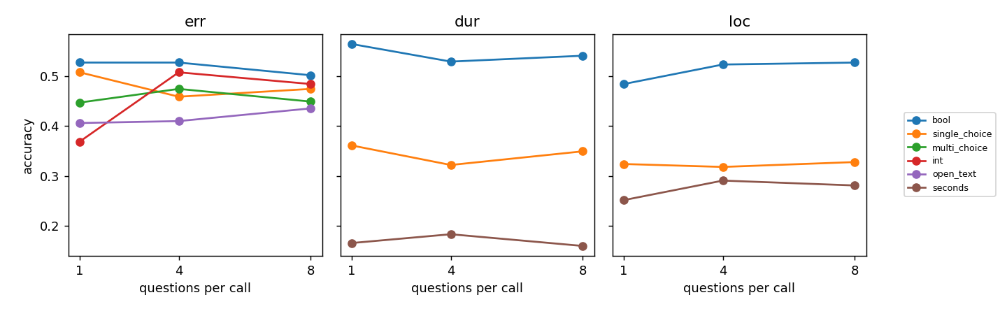
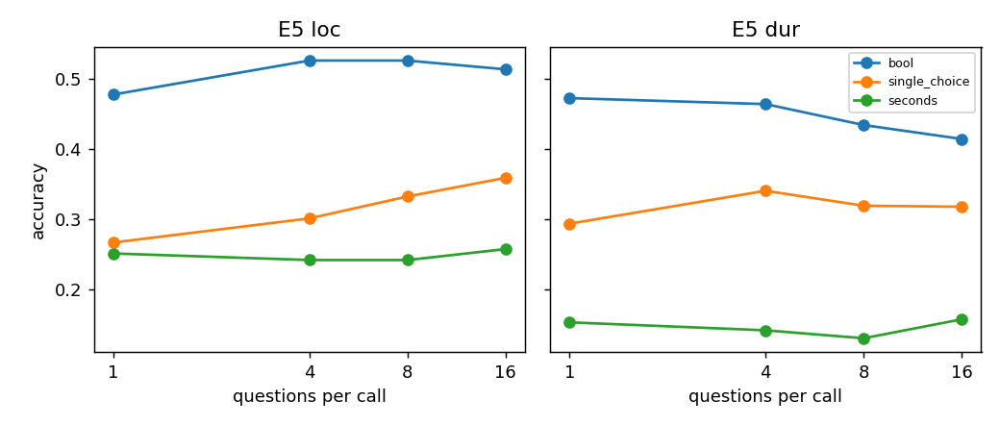
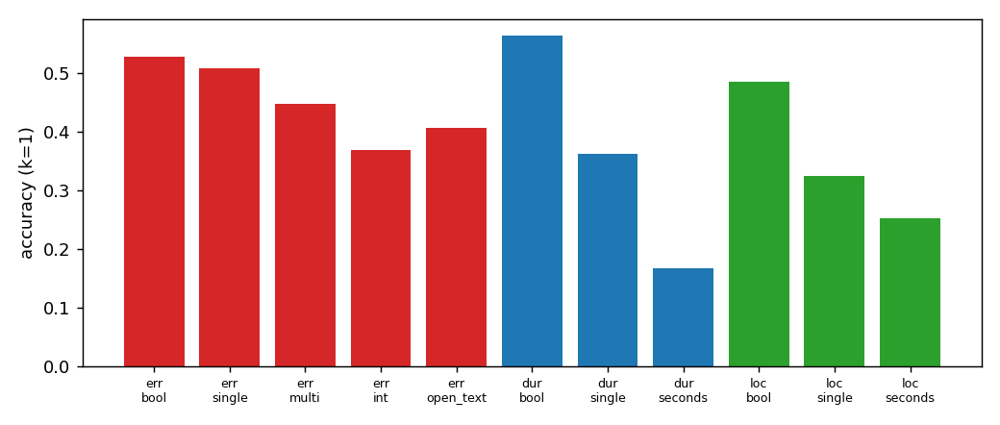
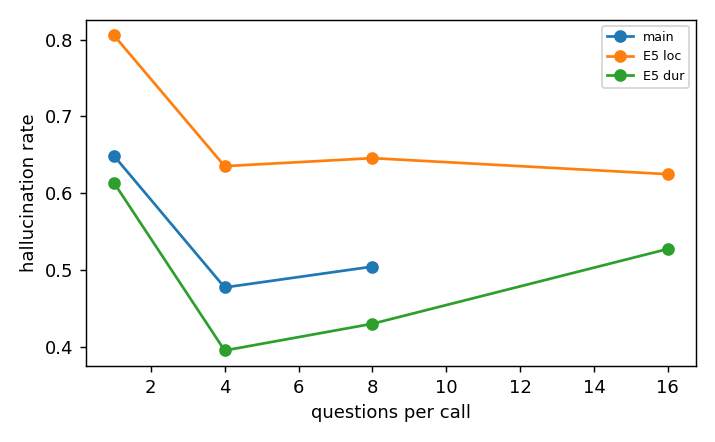
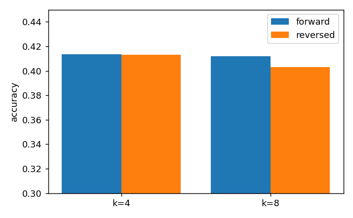

# Flash-Lite 結果摘要（依 `docs/cc4d_answer_type_proposal.md` 的 Q1–Q6）

整體：準確率大多接近 chance，Q1、Q2、Q4、Q6 的效應多半不顯著；清楚的訊號是 bool/single 的作答偏好與 hallucination。比較皆為同題配對；圖由 `make_figs.py` 重建。

## 研究問題與目前結論

| 問題 | 目前結論（Flash-Lite） | 信心 |
| --- | --- | --- |
| Q1 題數增加，準確率會變嗎？ | 主實驗幾乎沒變（40.1 → 41.3 → 41.2%，邊緣）。僅 err_int 上升；E5 到 16 題時，定位 single 上升、時長 bool 下降 | 低：模型接近 chance |
| Q2 同一事實換答案型別，準確率會變嗎？ | 會，但主要來自作答偏好而非理解力（bool 偏「否」、single 偏單一選項）；seconds 最差 | 中 |
| Q3 各內容表現如何？ | 時長 bool 最高；時長 seconds 17%、定位 seconds 25%（定位以分:秒讀法重評，見「重跑」） | 中（僅描述性） |
| Q4 混合型別會影響同一題嗎？ | 沒有可見影響（配對 z = +1.6 / +1.3） | 中 |
| Q5 型別與題數會影響 hallucination 嗎？ | 型別影響很大（bool 最嚴重）；題數增加時 hallucination 下降，但 false not-done 同步上升，不單調 | 中 |
| Q6 題目位置／順序會影響嗎？ | 沒有明顯影響（k=8 差 −0.9pt，z=−1.8，邊緣） | 低 |

## Q1 題數

- 整體 40.1% → 41.3% → 41.2%；k1→k4 +1.2pt（z=2.1），k1→k8 +1.1pt（z=1.9），邊緣。
- 唯一明顯變化是 err_int：37% → 51% → 48%；其餘在 ±5pt 內。

- E5：定位 single 27% → 36%（上升）；時長 bool 47% → 42%（下降）；其餘無趨勢。未算信賴區間。

## Q2 / Q3 型別與內容（k=1）

- bool 的 50% 來自偏好：dur / loc 只有 13–15% 答「是」（真實約 50%）；err 有 70% 答「是」，有錯步驟答對 73%，無錯步驟僅 32%。
- single：dur 63% 答 A（真實 28%），err 82% 答 F（真實 50%）。
- 比較型別時需做 chance / majority 校正。

## Q4 混合型別（E4 vs E3，只看目標題）
- 正向 r→w 358、w→r 402（z=+1.6）；反向 400、439（z=+1.3）。各格子在 ±4pt 內且方向不一致。

## Q5 hallucination

- k=1：65% 對沒拍到的步驟仍給答案；bool 最差（loc 97%、err 85%），single loc 最好（27%）。
- k=4 / 8 約 48–50%；E5 k=16 仍有 53–62%（loc 62%、dur 53%）。
- 反向的 false not-done（拍到卻答 not_visible）隨題數上升：single 6% → 12%，multi 2% → 7%。下降部分是以更常說「看不到」換來的，需一併報告。

## Q6 順序

- k=4 差 0.0pt；k=8 差 −0.9pt（z=−1.8，邊緣）。

## 重跑與評分規則（11/4）

seconds 與 multi_choice 欄位以新 prompt 重跑（9,633 次呼叫，US$171），其餘維持第一次的結果。**prompt 修正無效**，所以改了評分規則（`typed_v3`，已寫進 `docs/scoring_rules.md`），兩批結果都用新規則重評：

- **時間點（loc seconds）：** 模型把 10:04 寫成 `1004`；這類整數也當作分:秒讀，兩種讀法任一在容差內即算對。只用於時間點欄位，時長不變。loc seconds 從 4.5% 升到約 25%，且各題數都差不多（k=1/4/8：25 / 29 / 28%）。共 2,515 個欄位是以分:秒讀法算對。
- **multi_choice：** 答選項文字（`["Timing"]`）視同其字母；其餘不是字母的仍為 invalid。err_multi k=1 的 invalid 從 23 降到 18，準確率只升 0–1pt。
- 這兩條規則是看過結果後才定的，報告中要註明。嚴格評分（`typed_v2`）的數字存在 `summary_typed_v2.json`。
- 其他格子變動 ≤ 1pt。整體 k=1/4/8 為 40.1% → 41.3% → 41.2%（k1→k4 +1.2pt，z=2.1；k1→k8 z=1.9），反向 k=8 差 −0.9pt（z=−1.8）。Q4 配對 z=+1.6 / +1.3。結論仍是「接近 chance，效應微小」。

## 待處理
1. 反向 E5 k=8/16 的 invalid 率偏高（最高 48 題，約 7%），被算成答錯，會影響 Q6。
2. open_text judge 與人工標註一致率 78%（kappa 0.49），偏嚴；決定維持原 judge，err_open_text 可能低估。
3. 模型太弱，適合驗證 pipeline 與找出偏好；主結論等第二個 Gemini 模型。
