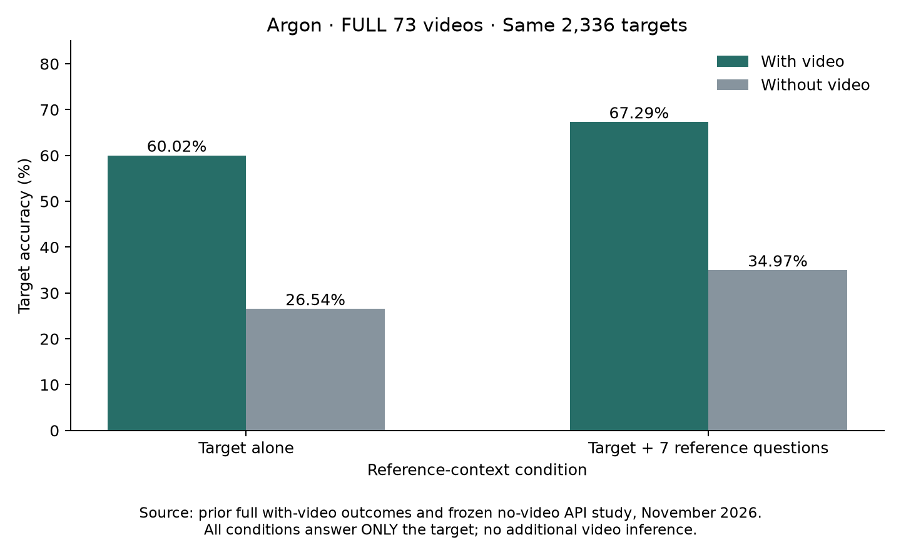

# Full73: reference context × video control — COMPLETE

Same **73 baseline videos / 2,336 localization targets** in all four conditions. Every call answers only the target. The seven references include questions and options, with no ground-truth answers. Existing video results are reused; 4,672 no-video successes include 640 retained and 4,032 new.

- With video: target alone **1,402/2,336 (60.02%)**; +7 references **1,572/2,336 (67.29%)**. Gain **+7.28 pp**, 95% CI **[5.57, 8.99]**.
- Without video: target alone **620/2,336 (26.54%)**; +7 references **817/2,336 (34.97%)**. Gain **+8.43 pp**, 95% CI **[6.12, 10.87]**.
- Interaction: (video context gain) − (no-video context gain) = **−1.16 pp**, 95% CI **[−4.20, 1.80]**.

**Interpretation:** Reference questions help even without video. This study finds no evidence that the context gain is larger with video. That does not establish equivalence or prove that text cues fully explain the batching gain. Video still adds **33.48 pp** for target alone and **32.32 pp** with references. All intervals use 10,000 paired recording-bootstrap draws, seed 20261112; no multiple-comparison adjustment. Historical video and new no-video calls are not contemporaneous, and reference context also changes framing and target position.

## Execution and spending

All **4,672** final calls succeeded, **0 invalid answers**. **18** unsuccessful transport attempts are separately archived (17 new, one imported); their billing is unknown. Successful-call estimated spending is **$14.646742** including retained calls; this expansion added **$12.624522**. These use frozen historical rates, not an invoice, and exclude failed-attempt billing.

Input tokens: **6,016,986**. Completion tokens including reasoning: **261,277** (reasoning **176,974**, counted once). Successful request latency: median **3.95 s**, p95 **18.69 s**. These are API roundtrips, not experiment elapsed time; downtime and failed requests are excluded.

## Inspect and reproduce

- [Standalone HTML with embedded downloads](report.html) — download and open locally.
- [Paired target predictions](paired_predictions.csv): all four conditions on the same targets.
- [Per-call usage/cost/latency](per_call.csv), [summary and intervals](summary.json).
- [Exact successful requests and raw responses](experiment_log.jsonl.gz), [failed attempts and reviews](attempt_history/).
- [Experiment settings and offline reproduction](../../../experiments/hd_epic_argon_reference_video_control_20261112/README.md).

The earlier progress_snapshot.json remains a timestamped historical snapshot, superseded by this completed result.
