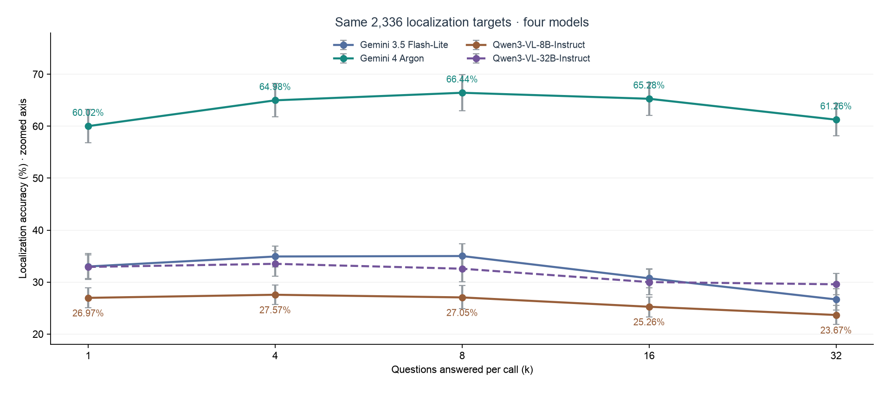

# HD-EPIC q40_v1: four-model baseline

Download [the standalone HTML report](baseline_report.html) and open it in a browser. The charts, tables, and CSV downloads work offline.



The comparison covers Gemini 3.5 Flash-Lite, Gemini 4 Argon, Qwen3-VL-8B-Instruct, and Qwen3-VL-32B-Instruct. All five batch sizes use the same 2,336 localization targets across 73 videos. The question-type comparison instead uses all 3,212 original single-question targets across 76 videos. The report also retains the Argon target-only versus reference-question comparison.

Qwen32B completed all 4,307 calls. The run retained 1,962 Transformers results and completed 2,345 calls using vLLM with tensor parallelism and prefix caching. The model weights, prompts, and canonical frames were fixed. Backend, cache state, and GPU placement vary across the run, so the curve describes observed scores and does not isolate the effect of batch size. The timing panels use different measurement boundaries; Qwen compute cost is unknown.

## Data and reproducibility

- [Batch summary](batch_summary.csv) and [question-type summary](question_type_summary.csv): scores and intervals.
- [Per-question predictions](per_field.csv) and [per-call metrics](per_call.csv): join on model, batch size, and call ID, or use report ID and field ID for matched accuracy.
- [Qwen32B completion audit](qwen32b_completion_audit.json) and [accepted call export](qwen32b_calls.jsonl.gz): checks, inputs, responses, scores, and snapshot references. Videos and full input token arrays are outside this package.
- [Analysis JSON](analysis.json): computed metrics and comparison metadata.

From this directory, use Python 3.12 or newer with the pinned dependencies:

```sh
python -m pip install -r requirements.txt
python update_report.py
python test_report.py
```

The update script joins the verified Qwen32B export with the preserved three-model inputs (`previous_*`). Rebuilding and testing the report makes no inference calls.
