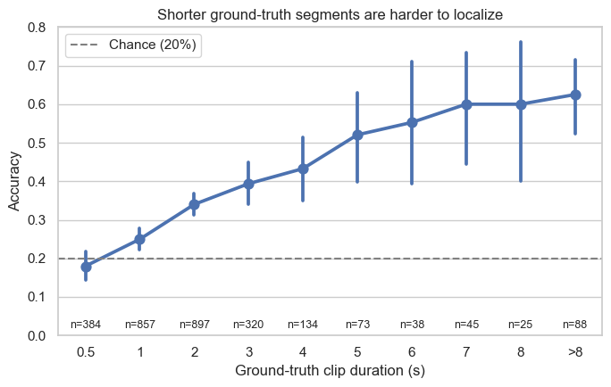
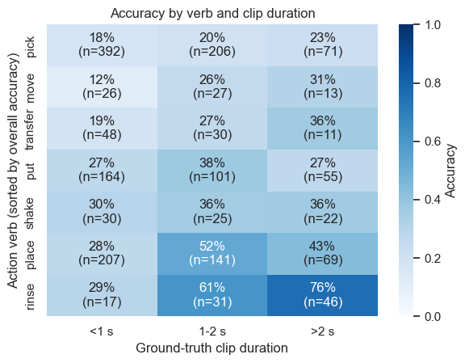
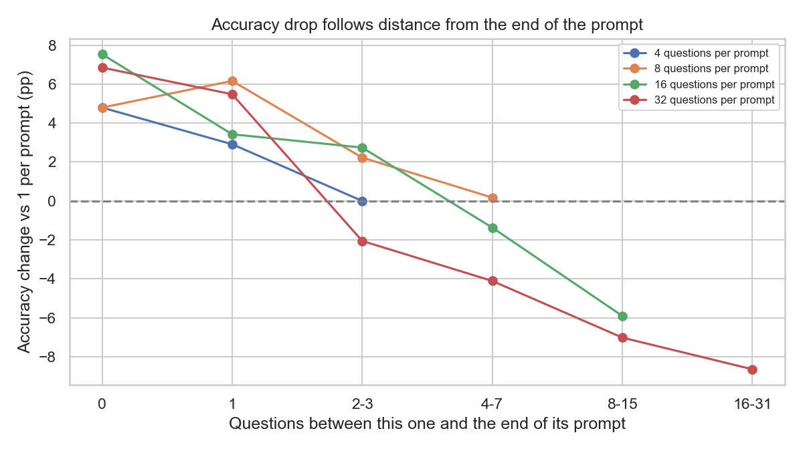
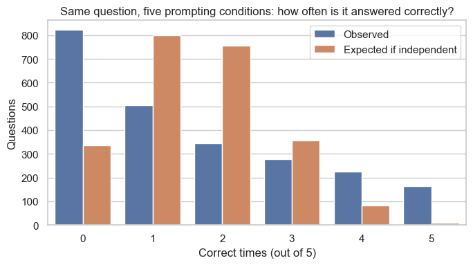
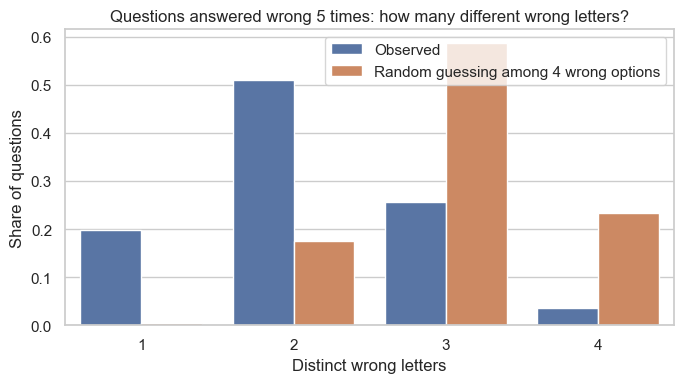
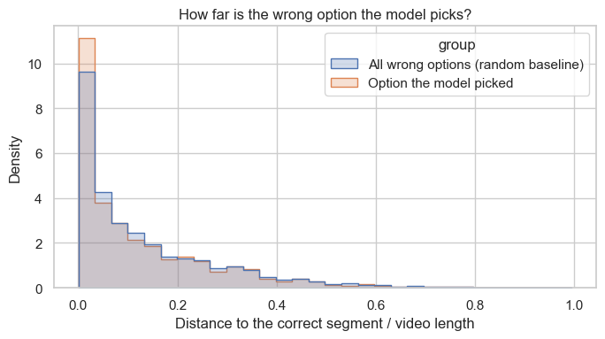
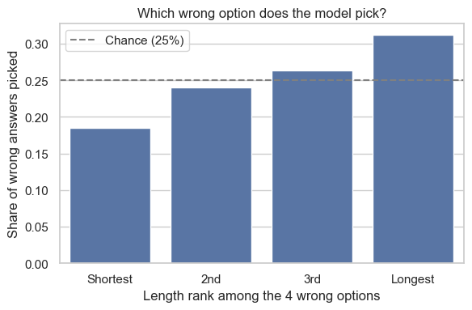
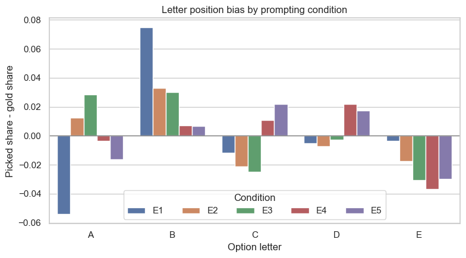

# 錯題分析:Gemini 3.5 Flash Lite 在哪些情況下答錯、錯在哪

模型 Gemini 3.5 Flash Lite | 題庫 hd_epic_q40_v1 | 2026-10-21

## 目錄

- [摘要](#摘要)
- [背景:資料與名詞](#背景資料與名詞)
- **A. 什麼情況下容易錯**
  - [A1 片段長度](#a1-片段長度)
  - [A2 動作類型](#a2-動作類型)
  - [A3 一次問幾題與題目位置](#a3-一次問幾題與題目位置)
- **B. 錯的時候錯在哪**
  - [B1 錯誤很穩定,不是碰運氣](#b1-錯誤很穩定不是碰運氣)
  - [B2 錯得多遠,選到什麼](#b2-錯得多遠選到什麼)
  - [B3 偏好最長的選項](#b3-偏好最長的選項)
  - [B4 字母位置偏差](#b4-字母位置偏差)
- [其他觀察](#其他觀察)
- [建議的後續實驗](#建議的後續實驗)

---

## 摘要

分析對象是「定位題」:給一段影片,問某個動作發生在哪個時段,五個選項選一個,亂猜的準確率是 20%。

| | 問題 | 結論 | 不能說 |
|---|---|---|---|
| **A1** | 片段越短越難嗎? | 是。正確片段短於 0.5 秒時準確率 18%,超過 8 秒時 62.5% | 原因是取樣率(2 FPS) |
| **A2** | 動作類型有影響嗎? | 有。控制片段長度後,pick 仍接近亂猜,rinse 最容易 | 原因是動作本身 |
| **A3** | 一次問多題為什麼會變差? | 批次變大讓多數題目離 prompt 結尾變遠,下降是透過位置發生的:離結尾的距離每變成兩倍,答對勝算 ×0.81;同樣離結尾幾題時,批次大小沒有額外影響 | 為什麼靠近結尾比較準 |
| **B1** | 答錯是碰運氣嗎? | 不是。同一題常常每次都錯,而且常常錯在同一個選項 | 模型有固定的錯誤想法 |
| **B2** | 錯得離譜還是差一點? | 離譜。答錯時選到的片段離正解中位 33.5 秒 | 模型是因為選項「真實」才選它 |
| **B3** | 選項長度有偏好嗎? | 有。答錯時偏好最長的錯誤選項(31.1% vs 隨機 25%) | 原因是選項長度本身 |
| **B4** | 字母位置有偏好嗎? | 有。一題一問時偏愛 B(27.1% vs 19.6%);批次提問時少選 E | 原因是字母本身 |

所有結論都是**相關性,不是因果**。每個條件只跑一次,只用了一個模型。

---

## 背景:資料與名詞

**資料。** 全部是離線分析,沒有呼叫 API。

| 資料 | 內容 |
|---|---|
| `data/per_field.csv` | 每題的預測、標準答案、對錯 |
| `data/frozen_requests/` | 實際送給模型的題目與選項 |
| `data/frozen_ground_truth/` | 標準答案 |

除非另外註明,分析對象是 E1(一次調用只問一題)的 2,861 題定位題。批次相關的分析(A3、B1)使用 E1–E5 共同的 2,336 題。E1–E5 的差別只在每次調用問幾題:E1 = 1、E2 = 4、E3 = 8、E4 = 16、E5 = 32。程式與完整輸出在 [error_trend_analysis.ipynb](error_trend_analysis.ipynb)。

**選項長什麼樣。** 每個選項本身就是影片裡的一段時間:

```
Question: When did the action <transfer bowls> happen in this clip?
A. this clip from 0:00:54.684 to 0:00:56.654
...
E. this clip from 0:00:52.384 to 0:00:52.853   ← 標準答案
```

- **正確片段長度**:正確選項的結束時間減開始時間。上例是 0.47 秒。
- **錯得多遠**:所選選項與正確選項的時段中點相距幾秒。
- 時間都是相對於送給模型的那段影片,不是原始長影片。時段來自 HD-EPIC 的標注,標注本身準不準我們無法驗證。

**名詞。**

| 名詞 | 意思 |
|---|---|
| p 值 | 如果「沒有這個效應」(虛無假設)為真,看到這麼極端的結果的機率。越小越能拒絕虛無假設。**它不代表效應大不大** |
| 勝算比(OR) | 答對的機率 ÷ 答錯的機率,稱為勝算。OR = 2 表示勝算變成 2 倍 |
| 95% 區間 / bootstrap | 重複抽樣算出的「合理範圍」。同一支影片的題目彼此相關,所以以「整支影片」為單位重抽 |

**p 值的共同限制。** 多數檢定假設每題互相獨立,但同一支影片(共 76 支)的題目彼此相關,所以 p 值偏樂觀。判斷時看效應大小和圖,不要只看 p。

---

# A. 什麼情況下容易錯

## A1 片段長度

**想回答的問題**:正確片段越短,模型是不是越容易答錯?

**現在能回答什麼**:是,而且關聯穩定。

| 正確片段長度 | 準確率 | 題數 |
|---|---|---|
| < 0.5 秒 | 18.0% | 384 |
| 0.5–1 秒 | 25.0% | 857 |
| 1–2 秒 | 34.0% | 897 |
| 2–4 秒 | 40.5% | 454 |
| 4–8 秒 | 55.8% | 181 |
| > 8 秒 | 62.5% | 88 |

- 1,241 題(43%)的正確片段短於 1 秒,這可能是定位題整體準確率只有約 32% 的主因。
- 這個效應不只是 B3「偏好最長選項」造成的。在「正確答案剛好是最長選項」的題目中,片段越長仍然越準(短於 1 秒 28.6%、1–2 秒 41.3%、超過 2 秒 52.1%)。

**不能回答什麼**:原因是不是 2 FPS 取樣(影片每 0.5 秒才有一格,短於 0.5 秒的動作可能只出現在一格或一格都沒有)。這只是合理的猜測,資料沒有驗證。

**怎麼回答的**

- **Spearman 相關**(片段長度與對錯的單調關係):ρ = 0.23,p ≈ 5e-37。
- **logistic 迴歸**(以 log2 片段長度預測對錯)加上整支影片重抽的 bootstrap:長度每加倍,答對的勝算變成 1.53 倍(95% 區間 1.41–1.68)。



程式與完整輸出:[error_trend_analysis.ipynb](error_trend_analysis.ipynb) 的 A1 節。

---

## A2 動作類型

**想回答的問題**:不同動作(動詞)的難度不一樣嗎?還是只是因為有些動作的片段比較短?

**現在能回答什麼**:動詞本身有影響。控制片段長度後,動詞仍然顯著改善預測(p ≈ 7e-16)。

只列出題數 ≥ 60 的動詞(共 7 個,涵蓋 1,732 / 2,861 題):

| 動詞 | 題數 | 準確率 | 同樣長度下,相對 pick 的勝算 |
|---|---|---|---|
| pick | 669 | 19% | 1(基準) |
| move | 66 | 21% | 1.0(與 pick 無顯著差異) |
| transfer | 89 | 24% | 1.3(與 pick 無顯著差異) |
| put | 320 | 31% | 1.8 |
| shake | 77 | 34% | 1.9 |
| place | 417 | 39% | 2.6 |
| rinse | 94 | 63% | 5.6 |

- pick、move、transfer 在片段變長時也沒有變好,接近亂猜。
- rinse、place 則會隨片段變長而提高。

**不能回答什麼**:剩下的差異是不是「動作本身的性質」造成的。「動詞」背後綁著很多因素,例如動作速度與位移(pick 手部動作快、位移大,在 2 FPS 下可能只捕捉到前後兩格)、同一動作在影片裡重複出現很多次而難以分辨是哪一次、干擾選項太像、場景不同等。這些假設目前都沒有檢驗。

**怎麼回答的**

- **分層熱力圖**:動詞 × 片段長度(< 1 秒、1–2 秒、> 2 秒),格內是準確率與題數 n。n 很小的格子不要過度解讀。
- **logistic 迴歸** `對錯 ~ log2(片段長度) + 動詞`:放入片段長度,讓模型在「長度相同」的題目之間比較動詞。用概似比檢定判斷加入動詞是否有幫助。



程式與完整輸出:[error_trend_analysis.ipynb](error_trend_analysis.ipynb) 的 A2 節。

---

## A3 一次問幾題與題目位置

**想回答的問題**:一次問很多題時準確率下降,批次大小是怎麼造成的?是批次大本身就有影響,還是因為批次變大後,多數題目離 prompt 結尾變遠?

**現在能回答什麼**:批次大小是根因,但它主要透過位置起作用:批次變大 → prompt 變長 → 多數題目離結尾變遠 → 準確率下降。同樣離結尾幾題時,批次大小沒有額外的負面影響。

同一組 2,336 題,每題在 E1–E5 都被問過(題目內容、影片、選項相同,32 題的順序也相同;E2–E4 是把同一份 32 題依序切成 4、8、16 題):

| 一次問幾題 | 1 | 4 | 8 | 16 | 32 |
|---|---|---|---|---|---|
| 準確率 | 33.0% | 34.9% | 35.0% | 30.7% | 26.7% |

題序固定,但同一題在不同條件下離結尾的距離不同。例如 32 題清單的第 20 題:E5、E4 都離結尾 12 題,E3 離結尾 4 題,E2 是最後一題。所以可以用同一題自己跟自己比,把位置和批次大小分開:

| 變數(相對 E1 的勝算比) | 勝算比 | 95% 區間 |
|---|---|---|
| **離結尾的距離每變成兩倍** | **0.81** | **0.75–0.87** |
| 批次 4 題 | 1.45 | 1.23–1.72 |
| 批次 8 題 | 1.71 | 1.39–2.17 |
| 批次 16 題 | 1.52 | 1.16–2.03 |
| 批次 32 題 | 1.35 | 0.95–1.93 |

- **越靠近 prompt 結尾越準**:離結尾的距離每變成兩倍,答對的勝算變成 0.81 倍。
- **批次大小沒有額外的直接影響**:控制位置後,四種批次大小的勝算比都不低於 1。同樣是 prompt 的最後一題,放在批次裡反而比一題一問好。
- **位置效果和批次大小無關**:在 32 題和其他批次大小下,位置的斜率幾乎一樣(交互作用勝算比 0.98,p = 0.75)。
- **所以批次大小透過位置拉低準確率**:批次 8 題時,每題離結尾最多 7 題;批次 32 題時,有 24 題離結尾 8 題以上,那些題目就變差了。批次大小決定了題目最遠會離結尾多遠。
- **實務上的意義**:要避免退步,限制的應該是「每題離結尾最多幾題」,而批次大小正是控制它的方法。目前的資料支持一次最多約 8 題。

下表是相對 E1 的準確率變化(百分點),依「離結尾幾題」分組。同樣離結尾幾題時,不同批次大小的變化量接近:

| 離結尾幾題 | 一次 4 題 | 一次 8 題 | 一次 16 題 | 一次 32 題 |
|---|---|---|---|---|
| 0(最後一題) | +4.8 | +4.8 | +7.5 | +6.8 |
| 1 | +2.9 | +6.2 | +3.4 | +5.5 |
| 2–3 | 0.0 | +2.2 | +2.7 | −2.1 |
| 4–7 | | +0.2 | −1.4 | −4.1 |
| 8–15 | | | −5.9 | −7.0 |
| 16–31 | | | | −8.6 |

**不能回答什麼**

- **為什麼靠近結尾比較準。** 「離結尾近」和「離輸出格式說明近」、「離模型開始寫答案的地方近」在這份資料裡是同一件事,分不開。
- **小批次的題目如果離結尾很遠,是否也會變差。** 離結尾 8 題以上只出現在 16 題和 32 題的 prompt,「小批次也一樣」是模型的推論,不是直接觀察。
- **為什麼批次裡的最後幾題比一題一問好。**
- **因果。** 題序從沒打亂過;同一題在各條件的前後鄰居也不同,題目之間的干擾沒有單獨檢驗。

**怎麼回答的**

- **條件式 logistic 迴歸** `對錯 ~ 批次大小 + log2(離結尾幾題 + 1)`,加**題目固定效果**:每題有自己的基準難度,所以係數只從「同一題在不同條件下的對錯變化」估計。五次全對或全錯的 985 題沒有變化,自動排除。
- **位置的寫法用 AIC 選**(越小越貼近資料):log2(離結尾幾題 + 1) 5108.6;不在最後 8 題(0/1)5115.5;離結尾幾題(直線)5117.2;相對位置 5121.4;不放位置 5137.8。相對位置最差,因為受保護的是「最後約 8 題」這個絕對題數,不是 prompt 的後半段。直線的「從開頭數」和「離結尾數」配適完全相同(批次大小已在模型裡,兩者只差一個常數),所以要用非線性寫法才分得出是「靠近結尾」。
- **區間**:以整份報告(73 份)為單位重抽 200 次 bootstrap,每次重新擬合。
- **交互作用**:加入「位置 × 批次 32 題」,用概似比檢定看斜率是否不同。



程式與完整輸出:[error_trend_analysis.ipynb](error_trend_analysis.ipynb) 的 A3 節(本節數字來自 A3-2 主分析;A3-1 是依 32 題清單位置分 4 段的初步分析)。

---

# B. 錯的時候錯在哪

## B1 錯誤很穩定,不是碰運氣

**想回答的問題**:答錯是每次碰運氣,還是同一題反覆錯、而且錯在同一處?

**現在能回答什麼**:不是碰運氣。可以拒絕兩個「亂打」的假設:(1) 各次對錯互相獨立;(2) 答錯時在錯誤選項中均勻亂選。

**每題答對幾次**(同一批 2,336 題,在 E1–E5 各答一次):

| 答對次數 | 0 | 1 | 2 | 3 | 4 | 5 |
|---|---|---|---|---|---|---|
| 實際題數 | **821** | 504 | 344 | 278 | 225 | **164** |
| 若各次對錯獨立 | 336 | 798 | 756 | 355 | 83 | 8 |

五次全錯的題數是獨立情況的 2.4 倍,全對是 20 倍。難易主要由題目決定。

**五次全錯的 821 題,五次選了幾種不同的錯誤字母**:

| 不同字母數 | 1(每次同一個) | 2 | 3 | 4 |
|---|---|---|---|---|
| 實際 | **162** | **419** | 211 | 29 |
| 若在 4 個錯誤選項中亂猜 | 3 | 144 | 481 | 192 |

五次都選同一個錯誤選項的有 162 題,亂猜只期望約 3 題。85% 的題目有同一個錯誤字母出現 3 次以上。

**不能回答什麼**

- 模型是否有「固定的錯誤想法」。五個條件共用同一支影片與選項,不是五次獨立實驗,第一個檢定只能證明「題目有難易之分」。
- 第二個檢定的基準是均勻亂選,但 B3、B4 顯示模型對長選項、特定字母有共同偏好,這些偏好也會讓不同次選到同一個選項。所以「被某個錯誤選項吸引」不能全歸因於題目內容。

**怎麼回答的**

- **排列檢定**:把每個條件的對錯在題目之間隨機洗牌 2,000 次(每個條件的準確率不變),看「五次全錯」的題數。實際 821,洗牌平均 336,2,000 次洗牌沒有一次達到實際值(p ≤ 0.0005)。
- **二項檢定**:假設每次在 4 個錯誤選項中均勻亂選,「五次選同一個」的期望只有約 3 題,實際 162 題(p ≈ 2e-216)。





程式與完整輸出:[error_trend_analysis.ipynb](error_trend_analysis.ipynb) 的 B1 節。

---

## B2 錯得多遠,選到什麼

**想回答的問題**:答錯時,模型是時間點差一點,還是選到了完全不同的動作?

**現在能回答什麼**:錯得離譜,選到的多半是另一個動作。

- 所選片段與正確片段的中點距離,中位數 33.5 秒,約影片長度的 7%。只有 19% 在 5 秒以內,36% 超過 60 秒。
- 對照:4 個錯誤選項本身離正解的中位數是 38.4 秒(8.0%),模型選的只比隨機稍近。
- 模型有一點偏向離正解近的選項:選到「最近的錯誤選項」的比例是 30.1%,高於隨機的 25%(p ≈ 4e-7),但只多 5 個百分點。
- 35% 的錯誤選項,正好是同一份報告裡另一題的正確時段,也就是影片裡真實標注過的動作。

**不能回答什麼**

- 模型是不是「因為選項是真實動作才選它」:沒有比較過真實與非真實的干擾選項哪個更容易被選。
- 另外 65% 的錯誤選項是什麼不清楚:可能是同一支影片裡真實標注、但沒被抽成題目的動作,也可能是別的時段。資料不足以分辨。
- 相對距離的分母是**模型實際看到的片段長度**(205–886 秒,中位數約 500 秒),不是整支原始影片(原始總長沒有記錄)。

**怎麼回答的**

- **描述統計**:距離的秒數與相對距離(距離 ÷ 該題影片長度)。影片長度不一,所以兩種都看。
- **二項檢定**:每題 4 個錯誤選項,隨機挑的話,選到最近者的機率是 25%。



程式與完整輸出:[error_trend_analysis.ipynb](error_trend_analysis.ipynb) 的 B2 節。

---

## B3 偏好最長的選項

**想回答的問題**:模型挑選項時,是否偏好時段較長的選項?

**現在能回答什麼**:是,偏好明確而且隨長度排名單調上升。

| | 比例 | 隨機基準 | p |
|---|---|---|---|
| 所有題目:選到最長選項 | 27.5%(787 / 2,861) | 20% | 5e-22 |
| 只看答錯的題目:選到最長的錯誤選項 | 31.1%(602 / 1,933) | 25% | 1e-9 |

答錯時,依選項長度由短到長,被選中的比例是 18.5%、24.0%、26.4%、31.1%。

**不能回答什麼**:原因是「選項長度」本身。長度可能只是另一個真正起作用因素的替代指標,例如:與正解時間的距離、長片段含較多畫面(2 FPS)、錯誤選項的生成方式。檢定只能拒絕「均勻隨機挑選」。

**怎麼回答的**

- 選項長度只存在於送給模型的 prompt 文字裡,所以從 `data/frozen_requests/E1.jsonl.gz` 解析每題 5 個選項的長度。
- **二項檢定**兩次:(1) 是否選最長選項,基準 20%;(2) 只看答錯時,是否選最長的錯誤選項,基準 25%。



程式與完整輸出:[error_trend_analysis.ipynb](error_trend_analysis.ipynb) 的 B3 節。

---

## B4 字母位置偏差

**想回答的問題**:模型選字母時,是否偏愛某幾個字母?

**現在能回答什麼**:有偏差,而且會隨提問方式改變。

標準答案在五個字母間分布平均,但模型的選擇不平均:

| | A | B | C | D | E |
|---|---|---|---|---|---|
| 標準答案(E1) | 20.2% | 19.6% | 20.2% | 20.3% | 19.6% |
| 模型選擇 E1(1 題/次) | **14.8%** | **27.1%** | 19.0% | 19.8% | 19.3% |
| E2(4 題/次) | 21.5% | 22.9% | 18.1% | 19.6% | 17.9% |
| E3(8 題/次) | 23.1% | 22.6% | 17.7% | 20.0% | **16.6%** |
| E4(16 題/次) | 19.9% | 20.4% | 21.2% | 22.5% | **16.0%** |
| E5(32 題/次) | 18.6% | 20.3% | 22.3% | 22.0% | **16.7%** |

- 一題一問(E1)時,明顯偏愛 B、避開 A:選 B 的比例 27.1%,標準答案是 B 的只有 19.6%。
- 批次提問時沒有偏愛 B,改為每個條件都少選 E。
- B 的偏好和選項長度無關:模型選 B 時,B 並沒有比較長。

**不能回答什麼**:原因是字母本身。選項順序從沒有打亂過,字母位置和選項內容綁在一起,無法分開。

**怎麼回答的**

- **卡方適合度檢定**:模型選擇的字母分布和標準答案的分布是否一樣。E1 的卡方值 126,其他條件 22–37,p 都小於 0.001。卡方值越大,偏離越多。
- **二項檢定**:E1 選 B 的次數 776 / 2,861(27.1%),基準是標準答案為 B 的比例 19.6%,p ≈ 4e-22。



程式與完整輸出:[error_trend_analysis.ipynb](error_trend_analysis.ipynb) 的 B4 節。

---

## 其他觀察

- **影片之間差異大**:單一影片的定位準確率從 5% 到 57%,中位數 32%。按受試者分組則在 26–39% 之間。
- **時間位置影響小**:正確答案落在影片最後 20% 時準確率略高(36%,其他區段約 31%)。正確選項是時間上最晚的選項時,準確率也較高(39.9%)。
- **How/Why 沒有明顯偏差**:兩者都沒有字母或長度偏差。Why 題的正確答案是最長選項時較準(80.6%,其他情況 67.4%),但只有 31 題。
- **Weight 樣本太少**:16 題錯 11 題,而且選項常常只差幾克(例如 229 g 和 230 g),單看影片幾乎無法分辨,不足以下結論。

## 建議的後續實驗

| 想確認的事 | 做法 |
|---|---|
| A1:短片段錯誤是否因為取樣率 | 對短於 1 秒的題目改用較高 FPS 重跑 |
| A2:pick 難是不是因為動作快、位移大 | 用光流或手部追蹤量化片段內的動作幅度,放進迴歸;也可對 pick 題改用較高 FPS 重跑 |
| A3:靠近結尾為什麼比較準 | 反轉 32 題 prompt 的題目順序重跑,看效應跟著位置還是跟著題目;把輸出格式說明移到題目前面,區分「靠近格式說明」和「靠近作答處」 |
| B2:干擾選項是否因為「真實」才被選 | 比較真實動作與非真實動作的干擾選項被選中的機率;查 HD-EPIC 原始標注確認其餘 65% 的來源 |
| B3、B4:長度與字母偏差 | 打亂選項順序,或讓選項長度與實際片段脫鉤,重跑同一批題目 |
