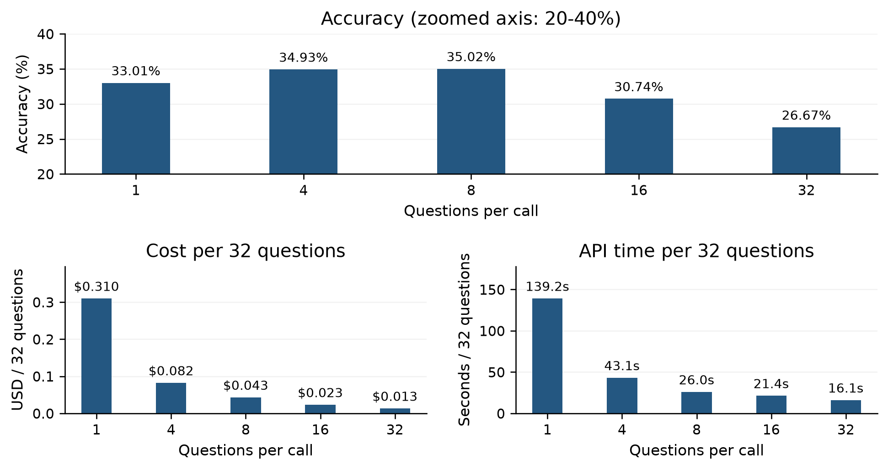
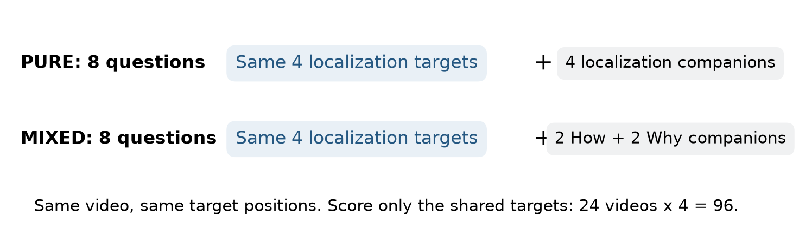

# Baseline Results

21 October 2026 | Gemini 3.5 Flash Lite | Question dataset hd_epic_q40_v1

## Q1  Does asking more questions change accuracy and efficiency?

Answer: accuracy is similar at 1-8 questions, then falls at 16-32. Batching sharply reduces completion cost.

Gemini 3.5 Flash Lite. Same 73 videos and 2,336 localization targets at every size. Same fixed video bytes, model, prompts and question ordering. One run per condition. Dataset: hd_epic_q40_v1.

Q / call | Accuracy | USD / 32 Q | API seconds / 32 Q | Speedup vs 1
--- | --- | --- | --- | ---
1 | 33.01% | 0.30994 | 139.15 | 1.00x
4 | 34.93% | 0.08237 | 43.15 | 3.22x
8 | 35.02% | 0.04322 | 25.99 | 5.35x
16 | 30.74% | 0.02335 | 21.39 | 6.50x
32 | 26.67% | 0.01341 | 16.08 | 8.65x

Size 8 -> 32: -8.35 percentage points; paired 95% video-bootstrap interval -11.04 to -5.65. Sizes 4 and 8 differ by only two correct answers; this does not establish an optimum at eight.

Cheapest and fastest observed: size 32 ($0.01341 and 16.08 s per 32 targets), with lower accuracy. Highest observed accuracy: size 8 (35.02%; size 4 is almost identical). Size 8 is the candidate balance: $0.04322 and 25.99 s, saving 86.1% cost and 81.3% API time versus size 1. No single setting is best on all three metrics.

API time is the sum of serial request round trips to complete 32 targets, averaged over 73 videos. It includes upload/network/provider time; it excludes local preprocessing and is not backend-only inference time. This compares 32 size-1 calls with one size-32 call fairly. Input/output tokens and latency distributions remain in the appendix and CSVs.

Execution: 4,355 effective calls; 0 provider failures; 0 missing/invalid outputs. Effective API cost $43.49; 148.53M tokens. Prior v1 E5 reruns, earlier pilots and VM costs are excluded. Latency and all raw outputs are in the appendix and CSVs.

## Q2  How does the model perform on each question subtype?

Answer: Why and How score higher than Localization in this run. Weight is too sparse for a stable estimate.

E1 ran ALL 3,212 prepared questions across 76 videos, one question per call. This is the entire hd_epic_q40_v1 input pool, not the full official HD-EPIC benchmark. Primary accuracy weights videos equally within each subtype.

Subtype | Video mean | 95% interval | Pooled correct / Q | Videos
--- | --- | --- | --- | ---
Localization | 32.42% | 30.26-34.55% | 928/2861 | 76
How | 56.19% | 46.68-65.38% | 97/175 | 52
Why | 69.19% | 60.64-77.28% | 112/160 | 60
Weight | 18.33% | 0.00-40.00% | 5/16 | 10

Gray whiskers = 95% confidence intervals from 10,000 video-bootstrap resamples. They show uncertainty across sampled videos, not the range of individual answers or a 95% guarantee about model correctness. Weight has the widest uncertainty because it has only 10 videos.

Why are How/Why higher? Not established by this experiment. Saved How/Why prompts identify the action and give a narrow time segment; localization must choose a precise temporal alternative. Some Why answers may also benefit from everyday action knowledge. At 2 FPS, fine time distinctions may be harder. These are plausible explanations, not measured causes; no text-only or higher-FPS control was run.

Weight has only 16 questions from 10 videos, with a 0-40% interval. Do not use its rank as a general conclusion. This study covers four subtypes, not all HD-EPIC question types.

Cost and speed do not depend on subtype: each one-question call costs about $0.01 and takes a median of about 4 s, because the ~32K input tokens are almost all video. Within the same videos, How, Why and Weight calls cost 1.00-1.02x and take 0.95-0.97x the API time of Localization calls.

Actual prompt example: how_279 asks how the person rinses a chopping board and supplies a 1.09-second segment. This gives a temporal pointer that localization is being asked to recover. Raw input and predictions are unchanged; pooled rates remain in summary.json.

## Q3  Does subtype mixing affect the same localization questions?

Answer: no clear mixing effect was observed. Mixed companions changed the net score by one question.

Question: when the SAME four localization questions are accompanied by different question types, do their answers change? Both conditions contain eight questions; only the four companion questions change.

Condition | Correct / targets | Target accuracy
--- | --- | ---
Pure localization | 41 / 96 | 42.71%
Mixed subtypes | 40 / 96 | 41.67%

Result: pure answers 41/96 correctly; mixed answers 40/96. Five targets change correct -> wrong and four wrong -> correct. Net change: -1.04 pp. The 95% interval (-7.29 to +5.21) crosses zero: this run does not establish benefit or harm, and does not prove equivalence.

Cost and speed are also unaffected by mixing: mixed calls cost 1% less ($0.2449 vs $0.2473 for 24 calls) because their question text is ~300 tokens shorter. Mixed calls had a lower median API time (6.8 vs 10.1 s), but the two conditions ran at different times and size-8 E3 calls on the same videos took 4.9 s, so this gap reflects provider load rather than mixing.

Read the figure: bars compare the SAME 96 targets; gray whiskers show 95% video-bootstrap intervals. The all-192-field mixed/pure totals are excluded because companion questions differ.

Outputs: per_field.csv = every prediction/target/score; per_call.csv = tokens/cost/timing; all_model_inputs_outputs.jsonl.gz = exact prompts and responses; logs/ = full logs. Open report.html for direct links. Full settings, the four planned figures plus accuracy-vs-cost, and actual output examples are in technical_appendix.pdf.

Validity is not hallucination: zero invalid option outputs does not establish zero semantic hallucinations. All inference evidence is unchanged.
