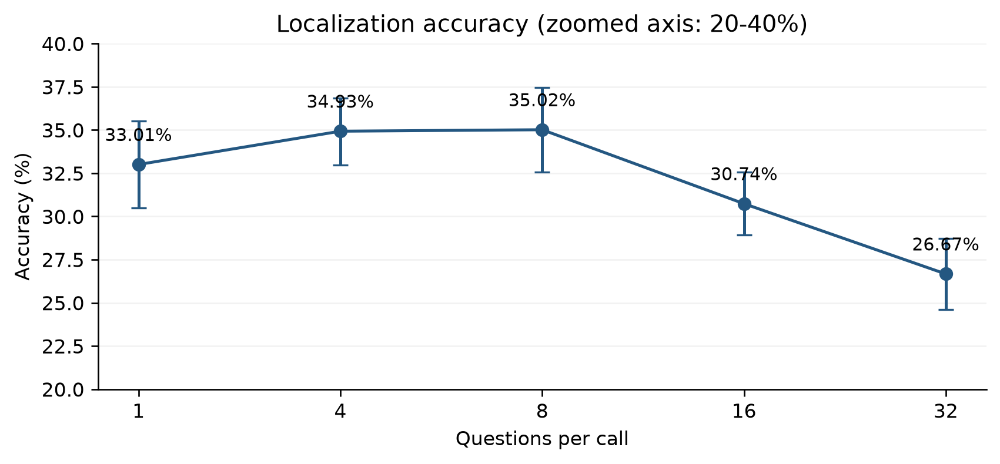
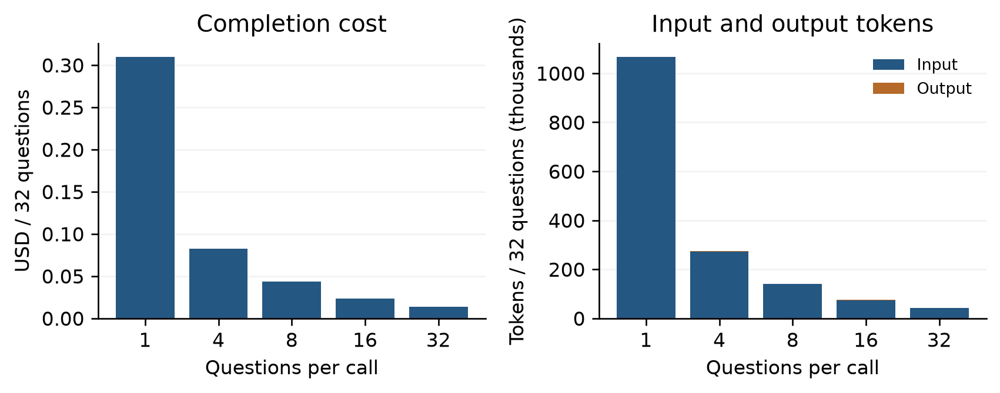
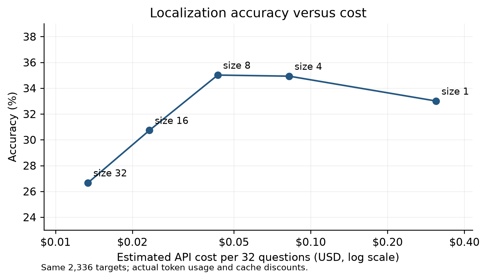
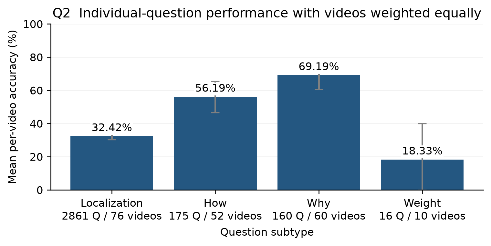
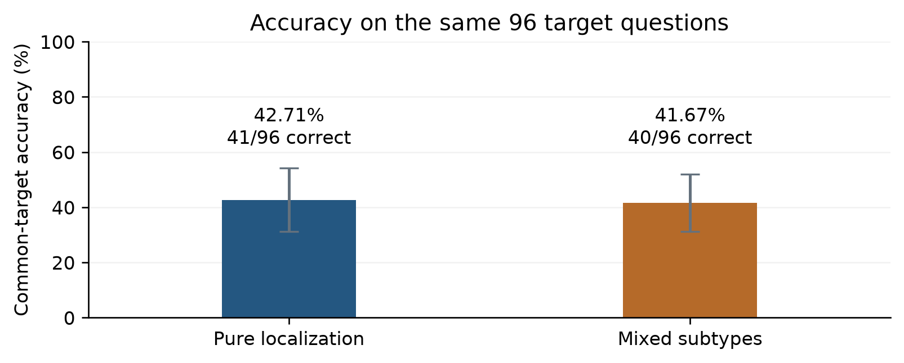

# HD EPIC Baseline Experiment Report

Prepared 20 October 2026 | Gemini 3.5 Flash Lite | E1 to E6 | Final v2 results

## Executive findings

On the same 2,336 localization questions from 73 reports and 73 original videos, accuracy was 33.01%, 34.93%, 35.02%, 30.74%, and 26.67% at sizes 1, 4, 8, 16, and 32. The curve is not monotonically decreasing: performance is similar at sizes 4 and 8, then declines at 16 and 32.

The size 8 to size 32 difference is -8.35 percentage points (exploratory 95% paired original-video bootstrap interval: -11.04 to -5.65 points). This supports investigating a large-batch accuracy penalty in this prepared subset; it does not establish a universal effect across models, question families, or orderings.

All 4,355 effective API calls completed successfully. All 12,940 scored field outputs were valid option answers in complete JSON objects. Effective baseline cost was US$43.48539 for 148,526,221 tokens. These figures exclude superseded v1 results and earlier pilots.

E6 common-target accuracy was 41/96 (42.71%) with pure localization and 40/96 (41.67%) with mixed question types. A one-question difference provides little evidence of a composition effect in this run. Table scope: E1 uses the full prepared pool; E2-E5 use matched localization; E6 rows use common targets only.

Condition | Calls | Correct / scored | Accuracy | API cost USD
--- | --- | --- | --- | ---
E1 | 3,212 | 1,142 / 3,212 | 35.55% | 31.14212
E2 | 584 | 816 / 2,336 | 34.93% | 6.01293
E3 | 292 | 818 / 2,336 | 35.02% | 3.15490
E4 | 146 | 718 / 2,336 | 30.74% | 1.70430
E5 | 73 | 623 / 2,336 | 26.67% | 0.97899
E6 pure | 24 | 41 / 96 | 42.71% | 0.24728
E6 mixed | 24 | 40 / 96 | 41.67% | 0.24487

## Scope and experimental design

E1 covers all 3,212 questions in the prepared hd_epic_q40_v1 pool across 76 original videos. This is the full prepared input pool used in this project, not the complete official HD-EPIC VQA benchmark. E1 includes 2,861 localization, 175 how, 160 why, and 16 ingredient-weight questions.

E2 to E5 use 73 eligible reports with at least 32 localization questions. One fixed batch of 32 targets is selected per report. Size 4 makes eight calls, size 8 four calls, size 16 two calls, and size 32 one call for that same target set. The size 1 comparison filters E1 to those exact 2,336 report/field pairs; the E1 headline 35.55% covers a different population and is not used on the batch-size curve.

The selection seed is 20261017. There is one frozen question order, with smaller batches cut from the same ordering; three shuffles were intentionally not run. For each report the video window and prepared clip bytes are held fixed across conditions. All 73 shared clips use output-duration-v2.

E6 uses 24 reports, eight questions per call, and four common localization targets per report in positions 1 through 4 in both conditions. Pure reports add four localization companions; mixed reports add two how and two why companions. Only the common 96 targets support the paired comparison.

## Execution workflow and inference configuration

Frozen questions and ground truth -> validate selection and source hashes -> assemble exact system/user prompts -> snapshot requests and call plan -> prepare and validate v2 clips -> send one API request per planned call -> checkpoint raw responses, usage, and timing -> parse JSON and score offline -> audit and aggregate matched results.

Model: gemini-3.5-flash-lite through the Vertex Express generateContent backend. Temperature: 0; max output tokens: 2,048; JSON response format. Top-p and generation seed were unset. Execution: concurrency 1, one attempt per call, 300-second request timeout. No automatic retries were used.

Local video preparation uses H.264, CRF 30, veryfast preset, 480-pixel height with aspect ratio preserved, 2 FPS, and no audio. The report's dataset-derived start/end window is passed to FFmpeg; duration is constrained on the output side. This window is shared by the report's calls, rather than cropping separately around each question's correct answer. The question text may also contain an original dataset segment or time-option range; that is distinct from the shared input clip window.

The canonical manifest stores source video, requested window, FPS, clip path, byte count, and SHA-256. The remaining-phase wrapper checks prepared bytes against the E5 manifest before HTTP for all shared reports. E1's three additional videos use the same v2 preparation rule.

Prepared inputs were uploaded as inline base64 video with text prompts. No ground-truth target values are passed as model-input fields. Ground truth is loaded only for offline scoring. The local request payload cap is 32,000,000 bytes.

Frozen pricing per million tokens: input US$0.30, cached input US$0.03, output US$2.50. Cost = (input - cached input) x input price + cached input x cached price + output x output price. Reasoning usage was zero; cached tokens are included in input and are not added again to total tokens.

## Localization accuracy versus report size

Figure 1 compares precisely the same targets and video evidence. Confidence intervals resample original-video clusters rather than treating all questions as independent. There are 73 distinct source videos, each supplying 32 selected targets. We use 10,000 paired bootstrap resamples with analysis seed 20261020; intervals are percentile intervals.

Figure 1 intervals describe variation across these video clusters conditional on the frozen selection and one order. They do not estimate variability over repeated API runs, alternative question orders, dataset selections, or model versions.



Figure 1. Matched localization accuracy. Error bars are 95% original-video cluster bootstrap intervals.

Questions / call | Correct / 2,336 | Accuracy | 95% interval
--- | --- | --- | ---
1 | 771 | 33.01% | 30.48 to 35.53%
4 | 816 | 34.93% | 32.96 to 36.86%
8 | 818 | 35.02% | 32.58 to 37.46%
16 | 718 | 30.74% | 28.94 to 32.58%
32 | 623 | 26.67% | 24.61 to 28.72%

## Paired changes and interpretation

The size 4 and size 8 results differ by only two correct answers. The shape should therefore be described as a small-batch plateau followed by a decline at larger sizes, rather than a reliable optimum at exactly eight questions.

Exploratory paired intervals for the larger-batch comparisons remain below zero. The observed drops warrant follow-up on context interference, answer-position effects, and evidence allocation, but this baseline does not identify the mechanism. These comparisons are exploratory and not adjusted for multiple comparisons.

The existing HD-EPIC question construction can produce repeated action events and overlapping temporal alternatives. Frozen questions were retained rather than deduplicated, following the agreed scope. Answer-cue or event-overlap effects have therefore not been experimentally eliminated. Resampling videos addresses within-video dependence in the intervals, but does not remove cues between questions.

Comparison | Accuracy change pp | Paired 95% interval pp
--- | --- | ---
1 -> 4 | +1.93 | 0.21 to 3.64
1 -> 8 | +2.01 | 0.00 to 3.98
1 -> 16 | -2.27 | -4.62 to 0.09
8 -> 16 | -4.28 | -6.46 to -2.10
8 -> 32 | -8.35 | -11.04 to -5.65
1 -> 32 | -6.34 | -8.99 to -3.72

## Cost and tokens per completed set of 32 targets

Normalization uses only the same 73 matched reports and 32 selected targets per report. In particular, size 1 cost is computed from the 2,336 matching E1 calls, not from all 3,212 E1 calls. Actual provider token usage and observed cache discounts are used.

Increasing batch size saves repeated video input. Size 8 costs approximately 86.1% less than size 1 per 32 targets while retaining similar observed accuracy. Size 32 is cheaper still, but its observed accuracy is 8.35 points lower than size 8. Cache hits were incidental rather than experimentally controlled; cost results are conditional on this run and pricing.



Figure 2. Actual API cost and total tokens normalized to 32 matched localization targets.

Size | Calls / 32 | USD / 32 | Tokens / 32 | All matched USD
--- | --- | --- | --- | ---
1 | 32 | 0.30994 | 1,067,885 | 22.62544
4 | 8 | 0.08237 | 273,370 | 6.01293
8 | 4 | 0.04322 | 140,950 | 3.15490
16 | 2 | 0.02335 | 74,756 | 1.70430
32 | 1 | 0.01341 | 41,659 | 0.97899

## Accuracy versus cost

This is a descriptive trade-off curve, not a deployment recommendation. Sizes 4 and 8 have nearly identical measured accuracy; their two-answer difference should not be treated as proof that size 8 is intrinsically more accurate. The large cost reduction comes primarily from avoiding repeated submission of the same video.

Effective E1-E6 cost is US$43.48539. The background E1-E4/E6 job accounts for US$42.50639; E5 all-v2 accounts for US$0.97899. Including the superseded v1 E5 successful calls adds US$0.79557, for US$44.28096 in this baseline-related ledger. Earlier smoke tests and pilots and Azure VM/storage charges are outside these totals. This is token-based estimated API cost, not a provider invoice.



Figure 3. Matched accuracy against API cost per 32 targets. The cost axis is logarithmic.

## Question family performance with one question per call

E1 pooled accuracy over the whole prepared pool is 1,142/3,212 (35.55%). Q2 primary estimates average per video subtype accuracy equally, as specified in the proposal. The older report used pooled question accuracy; this revision corrects that estimator. Localization is by far the largest family in this run. How and why recognition have higher observed accuracy than localization, but the question families differ in content and difficulty, so this is not a controlled causal effect of type alone.

Ingredient-weight results are particularly uncertain: only 16 questions across 10 source videos are available. The broad interval and small sample do not support a stable ranking. Localization here uses all 2,861 E1 localization questions; this differs from the 2,336 selected targets on the report-size curve.



Figure 4. Equal-video single-question E1 accuracy by original question family, with original-video cluster bootstrap intervals.

Question family | Pooled correct / fields | Video mean accuracy | 95% interval
--- | --- | --- | ---
Localization | 928 / 2861 | 32.42% | 30.26 to 34.55%
How recognition | 97 / 175 | 56.19% | 46.68 to 65.38%
Why recognition | 112 / 160 | 69.19% | 60.64 to 77.28%
Ingredient weight | 5 / 16 | 18.33% | 0.00 to 40.00%

## Pure versus mixed question types on common targets

Both conditions ask eight questions in each of 24 reports and retain the same four localization targets in the same positions. Pure localization scores 41/96 (42.71%), compared with 40/96 (41.67%) for mixed companions.

Among the 96 shared targets, five changed from correct to wrong and four from wrong to correct. The mixed-minus-pure difference is -1.04 percentage points; the paired original-video bootstrap 95% interval is -7.29 to +5.21 points. This run offers no clear evidence of a composition benefit or penalty. A narrow claim of equivalence is also not supported.

The all-192-field results are 39.58% pure and 50.00% mixed, but include different companion questions and question families. Those totals must not be used as the causal comparison of mixing. The paired common-target calculation avoids that mismatch.



Figure 5. Common-target accuracy under pure and mixed companions; whiskers are 95% video-bootstrap intervals.

## Latency usage and runtime

The detached VM background batch ran from 2026-10-20 15:12:46 UTC to 21:17:04 UTC, about 6 hours 4 minutes. It completed despite local VPN changes. E5 was executed separately in two v2 runs, with 60 newly rerun calls and 13 retained v2 calls; their measured execution times are summed below and do not represent one contiguous E5 wall-clock interval.

API round-trip timing includes upload, network overhead, and provider response latency. It is not backend-only model inference time. Execution time additionally includes local preparation/cache access and pipeline work; source-hash preflight, detached-job overhead, and final export can lie outside the per-experiment execution timer.

The effective baseline uses 148,526,221 total tokens, including 5,429,320 cached input tokens within the input count. Reasoning tokens were zero. Larger batches take longer per API call but need fewer calls to complete 32 targets. All per-call timings and usage are exported in data/per_call.csv.

Condition | Mean API s | Median s | P95 s | Execution min
--- | --- | --- | --- | ---
E1 | 4.36 | 3.84 | 7.14 | 241.79
E2 | 5.39 | 4.25 | 11.97 | 53.69
E3 | 6.50 | 4.95 | 12.49 | 32.21
E4 | 10.70 | 7.18 | 19.47 | 26.32
E5 | 16.08 | 13.96 | 40.60 | 32.91
E6 pure | 14.69 | 10.06 | 24.86 | 5.92
E6 mixed | 8.67 | 6.79 | 22.46 | 3.51

## Output validity scoring and hallucination limits

All 4,355 effective calls have complete JSON objects with the required keys and no extra keys. All 12,940 scored outputs are legal option answers: no parse failures, missing answers, or invalid option values were found in the offline audit. The effective-call provider-failure count is zero.

Exact single-choice scoring compares each predicted option letter with the ground-truth target for that report ID and field ID. A valid but incorrect letter is scored wrong. An invalid or missing answer would also be wrong; transport/provider failures are tracked separately. The stored parser and scorer were rerun against all saved outputs, reproducing the persisted field scores.

A response such as "I think it is B" as the whole response violates the JSON contract. A sentence stored as a JSON value is not an allowed option letter. No such invalid outputs occurred in the effective runs. Actual prompts specify the exact expected field IDs and permitted option letters.

These multiple-choice results do not provide a verified semantic hallucination rate. An incorrect temporal option is an answer error, not sufficient evidence of hallucination. The observed structural invalid-answer rate is 0/12,940; it must not be reported as a 0% hallucination rate. A genuine hallucination figure would require a defined evidence-grounding rubric and an additional audit.

## Provenance audit and limits

Offline checks passed for 4,355 unique effective calls and 12,940 experiment/call/field outcomes. Run snapshot fingerprints verify; every frozen model request matches the selection freeze exactly; recomputed predictions, outcomes, and correctness match saved evaluations; per-call costs sum to the reported effective ledger. Raw provider response text, input/output/cache/reasoning token counts, VIDEO modality usage, model version, and STOP finish reasons were checked against every normalized saved response.

Timing records confirm the same E5 v2 SHA-256 for every shared video in E1-E4/E6. There are 76 unique effective clip hashes across 76 source videos. The original source/video checks were sealed by the runner before execution; this report checks their saved artifacts and prepared-clip records. Large base64 wire payloads and video files remain on the VM rather than being duplicated in the report package.

Code provenance: production package ad1ca97. Fixed-scope runner artifacts for the v2 remainder and remaining baseline are preserved with their run plans and snapshots. These scripts specialize the existing runner rather than constituting a newly merged main-branch release. The earlier v1 E5 run had 10 crop-duration and three local-payload failures before HTTP. Those 13 reports were repaired with v2, and the other 60 were subsequently rerun with v2; original successes were preserved as history. The v1 output is excluded from the final accuracy curve.

Limitations: one model, one fixed order, one prepared dataset subset, potential correlated or mutually informative questions, no repeated-seed/model-run assessment, and sparse ingredient-weight data. Frozen price estimates and observed caches do not establish future costs. The confidence intervals are conditional and exploratory.

## Practical next steps

The baseline is complete and can support a write-up describing the observed batch-size/cost trade-off. Use the exact matched localization curve as the primary result, and report the E6 common-target comparison rather than all-field mixed accuracy.

Before broader claims, test whether the large-batch decline persists under additional fixed orders or repeated calls, a second model, or an additional dataset. These are proposed follow-ups only; this report generation made no API requests. An explicit hallucination study needs an evidence-grounded definition and audited labels.

All source results remain immutable. Any follow-up should reuse the canonical v2 clip bytes, target IDs, and saved prompts when evaluating the same condition, and retain a distinct run identifier for changed inputs or settings.

## Actual input and output example

The following is a saved E1 call, not a newly generated example. Report hdepic-dense-001 asks loc_445 using the shared v2 input clip from 300.406 to 505.699 seconds of source video P09-20240622-154652.mp4. The prompt's "this clip" time references are relative to that prepared clip. The raw model reply was {"loc_445": "C"}; ground truth is E, so this is a valid JSON response scored incorrect.

The exact system and user prompts are reproduced below. Full call metadata, prepared-video hash, raw response, and offline score are in data/example_exact_input_output.json. Every effective call has the same detail in data/all_model_inputs_outputs.jsonl.gz.

```text
You answer questions about the provided video.

Base your answers on the provided evidence.
Follow the answer type and allowed values specified for each field.

Return exactly one valid JSON object using the requested field IDs as keys.
Do not include markdown or additional keys.

USER
Task context:
task_name: Kitchen cooking session (P09)

Answer all 1 questions below about the video. For each question choose exactly one option letter.

Q1. [field_id: loc_445]
Question: When did the action <transfer bowls> happen in this clip? (segment: 0:00:00.000 - 0:03:25.293 of this clip)
Options:
A. this clip from 0:00:54.684 to 0:00:56.654
B. this clip from 0:00:38.873 to 0:00:39.793
C. this clip from 0:00:50.103 to 0:00:51.814
D. this clip from 0:00:55.774 to 0:00:56.334
E. this clip from 0:00:52.384 to 0:00:52.853

Return a JSON object with exactly these keys (loc_445) and one option letter as each value:
{
  "loc_445": "<one letter: A/B/C/D/E>"
}

ACTUAL RAW OUTPUT
{
  "loc_445": "C"
}
```

## Batch output and artifact index

The following is the actual saved 32-question E5 JSON reply, formatted for readability. Its input contains the same question IDs as keys requested by the prompt; all 32 predictions are scored independently. Exact raw text is in data/example_batch32_output.json and the full input is in data/all_model_inputs_outputs.jsonl.gz.

Artifact directory: baseline_report_20261020. The English PDF is the reading copy; report.md is editable. Figures are supplied as PNG and SVG. data/per_field.csv contains all 12,940 predictions and ground truth; data/per_call.csv contains all 4,355 calls with tokens, cost, latency, clip hash, and source lineage.

data/matched_localization.csv, question_types.csv, and latency.csv are the plotted/summary tables. summary.json contains confidence intervals and paired differences. data/audit.json records passed checks. data/selection_manifest.json and canonical_media_manifest.json preserve the frozen selection and video inputs.

logs/ contains the complete text inference/evaluation logs for each phase, including E5_combined.log. data/all_model_inputs_outputs.jsonl.gz contains exact prompt text, raw saved model responses, usage/timing, prepared-video hash, and offline scores. It omits video base64 bytes. The source evidence archives remain in the adjacent baseline_remaining_v2_20261020, e5_all_v2_20261020, and e5_repair_20261019 directories.

VM source evidence: /home/azureuser/Capstone-14/outputs/hd_epic_baseline_20261017/remaining-v2, with separate all-v2 E5 runs under reruns/E5-all-v2-remaining60 and repairs/E5-output-duration-v2. Full wire payloads and videos are retained there. No credential values are included in this report package.

```text
{
  "loc_3765": "D",
  "loc_5416": "D",
  "loc_2281": "C",
  "loc_2530": "A",
  "loc_2896": "A",
  "loc_5148": "D",
  "loc_7232": "E",
  "loc_3769": "B",
  "loc_9886": "E",
  "loc_8920": "E",
  "loc_3076": "B",
  "loc_3607": "A",
  "loc_3541": "C",
  "loc_1868": "D",
  "loc_2104": "C",
  "loc_3158": "D",
  "loc_3049": "C",
  "loc_4182": "A",
  "loc_1516": "E",
  "loc_729": "D",
  "loc_9303": "D",
  "loc_6417": "E",
  "loc_2603": "E",
  "loc_1238": "B",
  "loc_6406": "C",
  "loc_3329": "D",
  "loc_1956": "A",
  "loc_9078": "D",
  "loc_5223": "C",
  "loc_1781": "C",
  "loc_516": "B",
  "loc_3479": "A"
}
```
